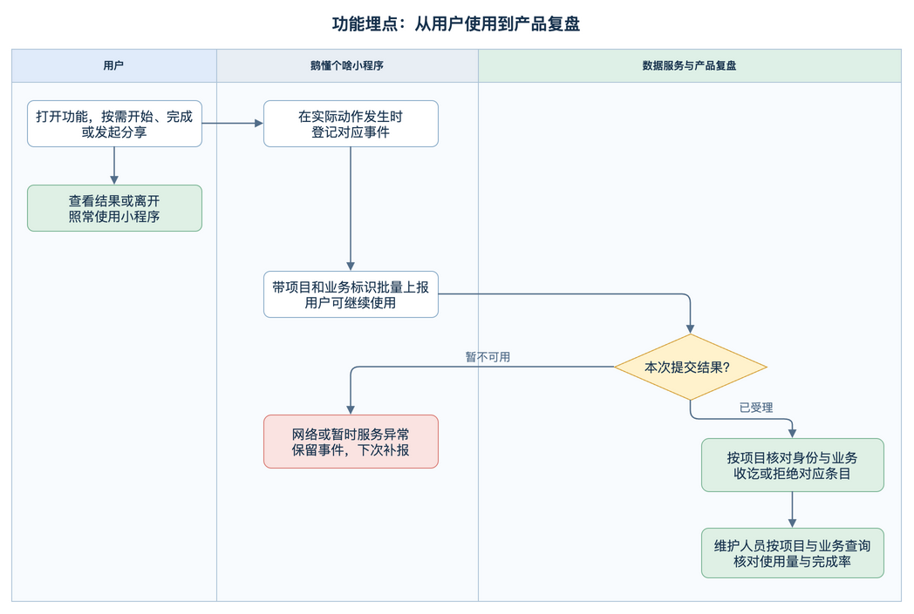
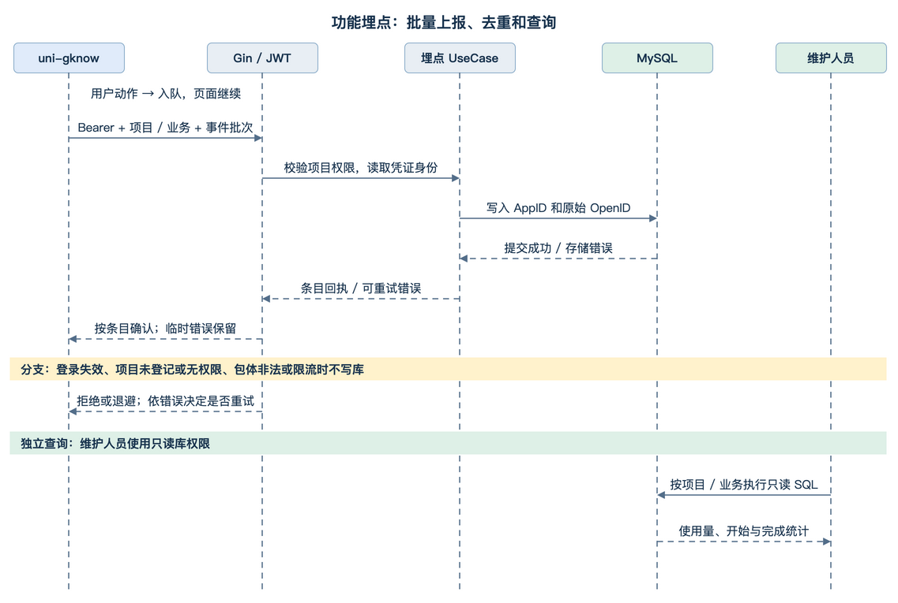

# 鹅懂个啥功能埋点方案

## 需求与范围

1. **知道哪些功能被使用。** 按功能、子内容和入口查看打开人数、打开次数、开始次数，区分同一人反复玩和多人各玩一次。
2. **知道开始后有多少人做完。** 首版打通可配置测试、人生／恋爱／理财副本、大转盘和默契大作战四种路径，分别验证本地计算、本地阅读、即时工具和双人房间的完成口径。
3. **能独立核验数据。** 首版交付事件表、查询 SQL 和目标端验收步骤。维护人员用现有只读库权限查聚合结果；小程序不增加统计页面或查询接口。

**采集依据**　可配置测试从后端加载详情，答题和评分在本地完成。转盘也在本地结算。后端接口访问日志无法代表这些功能的开始和完成。

**已确定**　上报路由和事件表由工作台接入的各项目共用，项目和业务通过请求参数区分；gknow 是首个接入方。首版事件的 `actor_key` 直接存已验证登录凭证中的原始 `openid`，同时保存同一凭证中的 `app_id`。

**本期建议**　统计真实动作，不采集全站点击、页面曝光、逐题答案、停留时长或用户输入。先不接微信统计或第三方分析服务；如果目标只是快速看页面流量，可先用平台统计，但它不能替代这里定义的一次玩法开始和完成。首版不覆盖 demo、已下线玩法、跨用户传播链或精确的转发成功率。

## 整体方案

1. **前端在业务状态改变时记事件。** 功能打开、开始、完成由相应页面或 composable 产生；全局只负责队列和发送，页面不等网络。首页卡片点击只传入口来源，打开事件由目标内容实际可用时记录，所以能涵盖直达链接并排除打开失败。
2. **后端统一接收并持久化。** 复用现有 JWT、Gin、GORM 和 MySQL。单一路由接收所有已登记项目，按项目验证凭证、按业务校验事件，写入同一张表并在项目内去重；批量写成功后才确认收讫。首版事件源统一为客户端观察到的产品状态。将来由后端拥有的业务状态可由后端直接记，但每个动作只指定一个权威来源。
3. **统计直接查询一张表。** 设计细则记录 gknow 日活约 100；按每人每天 20 条估算约 2,000 条/日、90 天约 18 万条，仅用于判断复杂度，不是流量实测。首版不引入消息队列、缓存或预计算；先用索引和带时间范围的 SQL。

## 使用流程与图

用户从首页、目录、每日挑战或外部入口打开内容。内容可操作后记打开；若用户开始并完成，则分别记开始和完成。离开或网络异常时，已有玩法按原流程工作。维护人员独立查询已收讫的事件，复核每个入口的使用量和每类功能的完成率。

业务泳道按用户、小程序、数据服务与维护人员分工。[可编辑泳道图](feature-analytics/business-flow.drawio)



系统图展示批量上报和独立查询。横向实线是请求，横向虚线是响应，竖向虚线是生命线。[可编辑时序图](feature-analytics/system-sequence.drawio)



## 任务拆分与实施顺序

| 顺序 | 子任务与交付物 | 前置依赖 | 验收方式 | 状态 |
| --- | --- | --- | --- | --- |
| 1 | **建立事件表和收集接口。** 定义事件契约、身份校验、去重及回执，交付只读查询 | 首版口径和 test DDL 已获授权 | 重发只存一条，错误身份不能写入，查询能解释样本 | test 已建表，本地接口联真实 test 库通过 |
| 2 | **接入小程序采集。** 接入四类玩法和来源标记，统一持久化队列 | 接口契约稳定 | 四条真实路径能产生预期事件，网络失败不影响玩法 | 实现已完成，类型检查和微信构建通过 |
| 3 | **用微信体验版和 test 服务对账。** 核对重入、跨日、离线和双人重连 | 共享契约发布后固定小程序子模块版本，部署 test 服务并使用体验版 | 按事件与汇总两个层次核对，验收通过后再安排正式开启 | 待部署与目标端验收 |

## 功能模块设计

### 1. 事件定义和触发点

| 事件 | 触发规则 | 不计入的动作 |
| --- | --- | --- |
| `feature_open` | 可操作内容第一次真正呈现时记一次。每次新的页面访问、同页切换实际子内容或内容版本变化，产生新 `visit_id` | 点击卡片但跳转失败；目录浏览；加载失败；原页面返回前台或关闭弹窗 |
| `feature_start` | 业务实际进入一轮时记一次，并分配 `attempt_id` | 重复点击、错误操作、已开始的同一轮恢复、只浏览说明 |
| `feature_complete` | 同一轮第一次进入最终结果、结局或结算状态时记一次，沿用开始时的 `attempt_id` 和 `visit_id` | 历史结果回看、同轮重新算分、临时画面、进度恢复 |
| `feature_share_intent` | 首版只对已打开的试点内容，在现有微信分享回调触发时记分享意图；携带当前访问 ID，独立于漏斗 | 不称为已送达、对方已看到或分享成功；不计生成二维码或海报 |

业务来源仅允许 `home`、`catalog`、`daily_challenge`、`share`、`unknown`。首页与目录由现有导航传显式枚举，挑战沿实际挑战入口传值；项目自己的分享链接可在原业务参数外附加固定 `src=share`。带标记的外部访问只代表链接带分享标记，不是可靠投放归因；原有链接、小程序码或没有标记的访问仍可用，统一记 `unknown`。不上传 URL、query、微信 scene 原文或邀请参数。访问来源在打开时冻结；跨页面续答的完成归到发起该轮的访问。

| 业务键 | 功能键 | 子内容键 | 开始 / 完成落点 |
| --- | --- | --- | --- |
| `assessment` | `configured_assessment` | 当前测试的 `test_key`；另存打开时的 `content_version` | `pages/quiz/configured/index.vue`：新轮第一次实际保存答题或跳过时开始；本地算分产出有效结果并进入结果态时完成。沿用本地草稿保存尝试标记；回看改答属于同一轮，明确「重新开始」才分配新 ID。测试内容版本变化时随原逻辑重建草稿；旧草稿/历史结果不补造开始事件 |
| `story` | `immersive_story` | 各副本目录已有稳定剧本 ID | 各 `pages/game/*-copy/story/index.vue` 提供剧本 ID；共享 `ImmersiveStoryPlayer.vue` 以进入第一幕、第一次进入结局为准；回看不算新轮，再读需重新点开始 |
| `tool` | `decision_wheel` | `food`、`shenzhen`、`play` | `pages/tools/wheel/index.vue` 在目标主题可用时打开；`useDecisionWheel.ts` 的 `spin()` 接受转动时开始，最终结果生效时完成，不采集自填选项或抽中内容 |
| `game` | `tacit_battle` | 无子内容，固定空字符串 | 新开页面显示可用大厅、或邀请进房成功后记打开。`useTacitBattle.ts` 在当前账号首次确认答题保存时开始；结果页首次观察到房间结束时完成。每个参与者算一次尝试，两人完成是两次参与者完成，不能解读为两局。按本地账号和房间缓存同一尝试标记，重连不重记，房间号不传给埋点接口；跨设备恢复若本地没有开始记录，不补造完成或开始 |

可配置测试开始后即使后续全跳过而无法计算结果，也不会写完成。默契以客户端确认的答题与最终房间快照为口径，房间中途断开且未回来看结果的用户不算完成；这条数据回答「参与者看到完成」，不回答「服务器实际结算了多少局」。统计用途不承担计费、奖品或权威结算。

### 2. 小程序队列

1. **只在业务动作里入队。** 新增 `utils/analytics.ts` 和薄的类型化入口 `trackFeature()`。同一次事件分配一次 UUID，重试复用整条记录；开始和完成的 UUID 与尝试元数据和已记录标记一起保存，刷新或恢复后若再次尝试入队仍用原 ID。访问 ID 按页面实例与子内容生成；无播放、答题或结算动作的纯重渲染不记。
2. **等账号和正式入口就绪。** 复用 `stores/app.ts` 的 `ready` 和现有登录；只在真实功能可用时入队。队列按 API 环境、项目和已登录账号在本机分桶；同项目的不同业务可以同批发送，发送前再次核对当前身份；换账号不串发，队列不包含 token。调试环境默认停采，体验版走 test，正式版走正式环境。
3. **后台发送。** 队列最多 200 条，超过上限淘汰最旧条目，48 小时过期；每批最多 20 条、仅一个在途请求。首条进入队列后约 5 秒尝试发送，满 20 条可提前发送；网络恢复、启动初始化成功及回前台可重试。利用 `App.vue` 的生命周期补发，退后台先保证本地已保存，只尽力发送一次，不依赖卸载请求一定到达。[uni-app 应用生命周期](https://uniapp.dcloud.net.cn/collocation/App.html)
4. **失败留在队列。** 网络、存储接口临时失败、业务限流指数退避，最多 5 分钟；账号失效暂停至现有登录机制恢复，不因埋点弹登录提示。明确回执为收讫或单条拒绝的事件才按条目移除；业务参数错误和无权限清除当前不可重试批次。队列写入失败只在当前进程尽力缓存，不影响玩法，允许少量丢失。后台或断网不做心跳。默认每次请求超时 3 秒，不调用 toast 或全局加载态。

### 3. 后端收集与统计

1. **按项目鉴权，再校验业务。** 后端维护项目登记，配置允许的认证身份范围、收集开关和业务事件规则。首版只登记 `gknow`，要求 JWT 的 AppID 等于服务端配置的 gknow AppID、登录类型为 `LoginTypeMpCode`、非 MCP、且 openid 有效；游客或其他项目凭证不能靠修改 `project_key` 写入 gknow。未登记的项目拒收整批，登记项目下未知或不匹配的 `business_key + feature_key + item_key` 只拒收该条。gknow 静态规则来自稳定目录；动态测评按 `test_key` 批量核对是否为已知键（当前发布状态不能证明离线发生时的状态）。以后接入项目时登记凭证范围和业务规则，沿用同一路由、契约和表。
2. **从认证凭证取用户身份。** 后端通过项目鉴权后，从已验证的登录凭证读取显式的 `app_id` 和原始 `openid`，分别原样写入 `app_id` 和 `actor_key`。保留 `actor_key` 字段名，方便以后登记其他身份来源。启用现成的 `NoPayloadLog()`，校验和错误日志仅记录分类与计数。事件表只保留统计所需字段，题目答案、分数、画像结果、房间号、昵称、头像、自定义文本和完整 URL 均排除在采集范围外。后端从凭证标记管理员自测数据，写入成功后返回回执。
3. **限制异常流量。** 按已授权的项目和认证主体在进程内做有界限流，建议每分钟 30 批、突发 5 批，闲置键及时清理。它用于保护写入入口，不承诺跨实例全局配额。监控接收量、无效条目、重复、写入失败和限流；标签仅用服务端已登记的项目及固定结果枚举，不含用户或内容 ID。
4. **用同一事件表复核。** 授权维护人员使用只读账号查询，绑定 `project_key`，按 `business_key` 分组；不跨项目计算用户去重。时间口径为北京时间自然日，SQL 绑定已换算的 UTC Unix 秒范围；PV 是打开行数。UV 在指定项目内按 `(app_id, actor_key)` 去重，同一个 OpenID 文本出现在不同 AppID 下时分别计数。另查分享意图、开始尝试和完成尝试；不把分享意图当作转发成功，不用「当天完成行 / 当天开始行」替代漏斗。

## 接口与契约

**`POST /api/so/analytics/events/batch`**。沿用 `HandleRequest` 的鉴权、`BizContext`、JSON 参数绑定、日志和 HTTP 200 响应流程。请求 DTO 使用 `Events []EventReq`；Go 只解析结构体中定义的字段，未知字段会被忽略，也不会用于身份或数据写入。字段类型或 JSON 结构错误会使整批返回参数错误；字段类型正确但业务规则不合法的事件按条返回拒收回执，其他有效事件仍可写入。传输使用 snake_case，`uni-gknow` 通过现有转换和 `contract.ts` 消费 camelCase。单批 1–20 条，不设额外包体上限。`app_id` 和 `actor_key` 由服务端凭已验证登录凭证填充。

| 请求字段 | 规则 |
| --- | --- |
| `project_key` | 批次必填，最长 32 字符；稳定小写键（`[a-z][a-z0-9_]{0,31}`），首版为 `gknow`。服务端登记并校验权限，不用请求值当作身份凭证 |
| `schema_version` | 必填整数，首版为 1；将来有不兼容变化再增版 |
| `events[].event_id`、`visit_id` | 必填 UUID，规范小写；重传不换 ID |
| `events[].business_key` | 每条必填，格式同项目键；gknow 首版为 `assessment`、`story`、`tool`、`game`。同一个项目的不同业务可放在同批 |
| `events[].event_name`、`feature_key`、`item_key`、`source` | 必填；按事件、功能和入口白名单。子键最长 64，默契固定空串；不接收标题或任意路径 |
| `events[].attempt_id` | 开始和完成必填 UUID；打开和分享省略。完成继承开始的尝试 ID、访问、来源、子项、版本 |
| `events[].content_version` | 配置测试必填，正整数且在 uint32 范围；其他功能省略，库内记 0 |
| `events[].occurred_at` | 必填整数 Unix 秒；最长允许迟到 48 小时、领先服务端 5 分钟；异常时间拒收，不改写成收到时间 |
| `events[].app_version` | 必填字段，允许空字符串表示平台未提供；只接收版本号字符，最多 32 字符 |

示例仅用于说明格式：

```json
{
  "project_key": "gknow",
  "schema_version": 1,
  "events": [{
    "event_id": "b66b142d-46c4-4bda-9a2e-4df60c46e56e",
    "visit_id": "ed084798-a733-4aef-a678-e2b095937bbd",
    "event_name": "feature_open",
    "business_key": "assessment",
    "feature_key": "configured_assessment",
    "item_key": "stock-methods",
    "source": "catalog",
    "content_version": 1,
    "occurred_at": 1794096000,
    "app_version": "1.0.0"
  }]
}
```

- **收讫：** HTTP 200、`err_code=0`、`data.collection_enabled=true`，`data.results` 按输入顺序返回从 0 起的 `index`、`status: accepted | rejected` 和拒绝时的 `reason`。同一项目、同一 `(app_id, actor_key)` 下有效的重复事件也返回 `accepted`，以库内第一次成功提交的内容为准。单条坏数据按索引拒绝，原因如 `invalid_event`、`unknown_business`、`unknown_feature_item`、`invalid_time`，有效条目仍写入。用索引回执可处理非法或重复的事件 ID。
- **暂停采集：** 项目开关关闭时 HTTP 200、`err_code=0`、`data.collection_enabled=false`、`data.results=[]`，不写库。客户端清除当前环境、当前项目、当前账号的待发队列，本次前台不再入队，下次进入前台可重新探测。
- **整包不受理：** 复用参数错误 `-100001`、JWT 错误 `-100004`、无权限 `-100008`（未登记项目和身份不匹配统一拒绝）及限流业务错误 `-100012`，数据库错误用 `-100002`；业务错误均通过现有 HTTP 200 响应体返回。参数错误和无权限不重试；登录失效等待原会话恢复；限流、网络错误和数据库错误可退避重试。后端写入失败不得返回已收讫回执。
- **契约主源：** 在 `frontend-contracts/openapi/analytics_api.yaml` 定义接口和事件枚举，发布共享 `apis/analytics.ts`、`types/analytics.ts` 及索引出口，再更新 `uni-gknow/src/contracts` 引用。旧客户端未接入则继续正常使用，统计从新版实际开始采集；现有 API 无需迁移。

## 数据设计与迁移

新增 `weiyi_feature_event_tab`，所有已登记项目共用，一行代表该项目某个业务下一个被收讫的事件。字段在 DDL 中给全；所有列非 NULL，无默认值的字段必须写入，空串或 0 只用于明确不适用的字段。沿用 `model.BaseTab` 的 `id/create_time/update_time` 及 Unix 秒；去重不修改首行，`update_time` 正常等于入库时间。版本 1 不设 JSON 扩展列。

在 test（`weiyi_superone_db_test`）和 live（`weiyi_superone_db`）通过 `information_schema.COLUMNS` 只读核对，`user_tab.openid` 都是 `varchar(64) CHARACTER SET utf8mb4 COLLATE utf8mb4_general_ci`，并有唯一索引。两库的 `user_tab` 都没有 `app_id` 列。事件表的 `actor_key` 沿用该长度和比较规则。关联当前用户表时先限定事件的项目和 AppID，再用 `user_tab.openid = actor_key` 关联。这个关联适用于首版微信登录来源。

2026-11-08 已在 `weiyi_superone_db_test` 执行下方 DDL。建表前确认表名未占用，建表后核对了字段、排序规则和索引。新表无历史数据回填。 [迁移文件](../../../../business-repo/backend-superone/scripts/migration/sql/20261108_create_feature_event.sql)

```sql
CREATE TABLE `weiyi_feature_event_tab` (
  `id` bigint NOT NULL AUTO_INCREMENT COMMENT '主键ID',
  `project_key` varchar(32) CHARACTER SET ascii COLLATE ascii_bin NOT NULL COMMENT '项目稳定标识',
  `business_key` varchar(32) CHARACTER SET ascii COLLATE ascii_bin NOT NULL COMMENT '项目内业务稳定标识',
  `app_id` varchar(64) CHARACTER SET ascii COLLATE ascii_bin NOT NULL COMMENT '已验证登录凭证中的应用标识',
  `actor_key` varchar(64) CHARACTER SET utf8mb4 COLLATE utf8mb4_general_ci NOT NULL COMMENT '用户身份键，首版存已验证登录凭证中的原始微信openid，可直接关联user_tab.openid',
  `event_id` char(36) CHARACTER SET ascii COLLATE ascii_bin NOT NULL COMMENT '客户端事件UUID',
  `visit_id` char(36) CHARACTER SET ascii COLLATE ascii_bin NOT NULL COMMENT '功能访问UUID',
  `attempt_id` varchar(36) CHARACTER SET ascii COLLATE ascii_bin NOT NULL DEFAULT '' COMMENT '玩法尝试UUID，非尝试事件为空',
  `event_name` varchar(32) CHARACTER SET ascii COLLATE ascii_bin NOT NULL COMMENT '事件名',
  `feature_key` varchar(32) CHARACTER SET ascii COLLATE ascii_bin NOT NULL COMMENT '功能稳定标识',
  `item_key` varchar(64) CHARACTER SET ascii COLLATE ascii_bin NOT NULL DEFAULT '' COMMENT '功能内内容稳定标识，无子项为空',
  `source` varchar(24) CHARACTER SET ascii COLLATE ascii_bin NOT NULL COMMENT '入口枚举',
  `content_version` int unsigned NOT NULL DEFAULT 0 COMMENT '内容版本，0表示不适用',
  `app_version` varchar(32) CHARACTER SET ascii COLLATE ascii_bin NOT NULL DEFAULT '' COMMENT '客户端发布版本，未知为空',
  `schema_version` tinyint unsigned NOT NULL COMMENT '事件契约版本',
  `is_internal` tinyint unsigned NOT NULL DEFAULT 0 COMMENT '0普通事件，1管理员自测',
  `occurred_at` int unsigned NOT NULL COMMENT '事件发生时间，Unix秒',
  `create_time` int unsigned NOT NULL DEFAULT 0 COMMENT '入库时间，Unix秒',
  `update_time` int unsigned NOT NULL DEFAULT 0 COMMENT '更新时间，Unix秒',
  PRIMARY KEY (`id`),
  UNIQUE KEY `uniq_project_actor_event` (`project_key`, `app_id`, `actor_key`, `event_id`),
  KEY `idx_project_event_time` (`project_key`, `event_name`, `occurred_at`),
  KEY `idx_create_time` (`create_time`)
) ENGINE=InnoDB DEFAULT CHARSET=utf8mb4 COLLATE=utf8mb4_unicode_ci COMMENT='跨项目功能埋点事件';
```

`uniq_project_actor_event` 用项目、AppID、用户身份键和事件 ID 保证幂等。重报保留首次入库的业务归属。同批有效行使用批量写入，重复键执行空更新并保留原行。只有写入成功才能确认批次，重复数只作服务监控，不用受影响行数推断单条是否收讫。[MySQL 重复键写入说明](https://dev.mysql.com/doc/refman/8.0/en/insert-on-duplicate.html) `idx_project_event_time` 支持按项目、事件类型和日期筛选，`idx_create_time` 支持保留期清理。首版原始数据建议按入库时间保留 90 天，用已有任务服务每日限批清理。回滚时停采集和清理，保留已写数据供核对。

查询样例需要绑定 `:project_key`，例如 `gknow`。聚合默认排除管理员，UV 使用 MySQL 的多列 `COUNT(DISTINCT ...)`。 [MySQL 聚合函数说明](https://dev.mysql.com/doc/refman/8.0/en/aggregate-functions.html#function_count-distinct)

```sql
-- 目标日期范围的打开量与分享意图，可按功能、子项、来源筛选。
SELECT business_key, feature_key, item_key, source,
       SUM(event_name = 'feature_open') AS opens,
       COUNT(DISTINCT app_id, CASE WHEN event_name = 'feature_open' THEN actor_key END) AS open_users,
       SUM(event_name = 'feature_share_intent') AS share_intents
FROM weiyi_feature_event_tab
WHERE project_key = :project_key AND event_name IN ('feature_open', 'feature_share_intent')
  AND occurred_at >= :from_ts AND occurred_at < :to_ts AND is_internal = 0
GROUP BY business_key, feature_key, item_key, source;

-- 以开始日期为归属，完成允许发生在开始后 24 小时以内。
WITH starts AS (
  SELECT app_id, actor_key, business_key, feature_key, item_key, content_version, source,
         visit_id, attempt_id, MIN(occurred_at) AS started_at
  FROM weiyi_feature_event_tab
  WHERE project_key = :project_key AND event_name = 'feature_start'
    AND occurred_at >= :from_ts AND occurred_at < :to_ts AND is_internal = 0
  GROUP BY app_id, actor_key, business_key, feature_key, item_key, content_version, source, visit_id, attempt_id
), finishes AS (
  SELECT app_id, actor_key, business_key, feature_key, item_key, content_version, source,
         visit_id, attempt_id, occurred_at
  FROM weiyi_feature_event_tab
  WHERE project_key = :project_key AND event_name = 'feature_complete'
    AND occurred_at >= :from_ts AND occurred_at < :to_ts + 86400 AND is_internal = 0
)
SELECT s.business_key, s.feature_key, s.item_key, s.source, COUNT(*) AS starts,
       SUM(EXISTS (
         SELECT 1 FROM finishes f
         WHERE f.app_id = s.app_id AND f.actor_key = s.actor_key AND f.business_key = s.business_key
           AND f.feature_key = s.feature_key
           AND f.item_key = s.item_key AND f.content_version = s.content_version
           AND f.source = s.source AND f.visit_id = s.visit_id AND f.attempt_id = s.attempt_id
           AND f.occurred_at BETWEEN s.started_at AND s.started_at + 86400
       )) AS completed_within_24h
FROM starts s
GROUP BY s.business_key, s.feature_key, s.item_key, s.source;

-- 打开后 24 小时内至少开始一次的访问，按打开日期归属。
WITH opened AS (
  SELECT app_id, actor_key, business_key, feature_key, item_key, source, visit_id,
         MIN(occurred_at) AS opened_at
  FROM weiyi_feature_event_tab
  WHERE project_key = :project_key AND event_name = 'feature_open'
    AND occurred_at >= :from_ts AND occurred_at < :to_ts AND is_internal = 0
  GROUP BY app_id, actor_key, business_key, feature_key, item_key, source, visit_id
)
SELECT o.business_key, o.feature_key, o.item_key, o.source, COUNT(*) AS opened_visits,
       SUM(EXISTS (
         SELECT 1 FROM weiyi_feature_event_tab s
         WHERE s.project_key = :project_key AND s.event_name = 'feature_start' AND s.is_internal = 0
           AND s.app_id = o.app_id AND s.actor_key = o.actor_key AND s.business_key = o.business_key
           AND s.feature_key = o.feature_key
           AND s.item_key = o.item_key AND s.source = o.source AND s.visit_id = o.visit_id
           AND s.occurred_at BETWEEN o.opened_at AND o.opened_at + 86400
       )) AS started_visits
FROM opened o
GROUP BY o.business_key, o.feature_key, o.item_key, o.source;

-- 核对单个微信小程序的事件能否关联用户表。
SELECT e.event_id, u.id AS user_id
FROM weiyi_feature_event_tab e
LEFT JOIN user_tab u ON u.openid = e.actor_key
WHERE e.project_key = :project_key AND e.app_id = :app_id
  AND e.event_id = :event_id;
```

完成率 = `completed_within_24h / starts`。打开到开始转化在同一项目内按 `app_id + actor_key + business_key + feature_key + item_key + visit_id` 连接：统计打开后 24 小时内至少开始过一次的访问，分母为打开访问数；同一次访问连玩三轮只贡献一个转化访问。计算总 UV 时移除来源分组，再对 `(app_id, actor_key)` 去重。按天汇报应使用结束满 72 小时的开始队列作为稳定口径（24 小时完成窗口 + 48 小时迟到窗口）；近三日可看暂估。实际拖到 24 小时后完成仍留作事件，不计入首版完成率。

## 改动范围

| 仓库 | 预计落点 |
| --- | --- |
| `uni-gknow` | `src/utils/analytics.ts`（队列和入口）、`src/contract.ts`（契约 client）、`src/App.vue`／`src/stores/app.ts`（生命周期和身份就绪）、`src/composables/useProjectNavigation.ts` 及实际首页/目录/挑战导航（来源），试点功能页和共享状态点见上表。复用 `utils/request.ts` 和平台 HTTP 适配；无新增 UI、路由和样式。 |
| `backend-superone` | 新增 `app/api_service/api_analytics.go`，与 gknow 路由分开注册；`use_case/analytics_use_case.go`、`internal/domain/analytics/` 处理项目鉴权、业务校验与收讫，`internal/repo/feature_event_repo.go`、`internal/model/weiyi_feature_event_tab.go` 持久化。同步 `app/api_service/{api_service,wire}.go`、相关 Wire 生成物、环境配置、`scripts/migration/sql/`，清理任务接入 `app/task_service/`。参考既有 `assessment_use_case.go` 和 `assessment_repo.go` 分层。 |
| `frontend-contracts` | 新增事件 OpenAPI、共享 TS 类型/API 与入口导出；客户端只更新子模块并消费契约。 |

## 验收与验证

| 场景 | 操作 | 预期结果 | 环境 |
| --- | --- | --- | --- |
| 四种真实玩法 | 完成一个测试、读到副本结局、转出结果、双账号完成一局默契 | 前三种各 1 开始、1 完成；默契两名参与者各 1 开始、1 完成；每个实际入口有打开记录 | 微信体验版 + test |
| 伪完成和重复 | 回看旧报告、同轮改答、后台恢复、切换回页面、双人重连 | 已有尝试不重复；新一轮有新 ID；实际从未开始的恢复记录不造开始 | 微信体验版 + test |
| 断网和重复上报 | 飞行模式下完成本地可用玩法，恢复网络；对同一批模拟丢失回执后重发 | 玩法不受影响；队列补发，重复请求只增加一份有效事件；临时错误不确认 | 微信体验版 + test 服务 |
| 账号、边界及数据最小化 | 换账号，提交其他 App JWT、游客凭证、未知事件、未知字段、字段类型错误和带题目答案字段的事件 | 原队列不串账号；非 gknow 身份不能写；未知字段忽略；字段类型错误返回整批参数错误；业务规则错误只拒收对应条目；库和请求日志不出现业务内容 | test 真实接口及只读库 |
| 跨项目与业务隔离 | 用其他 App 凭证冒报 gknow、报未登记项目；一个合法 gknow 批次混发测评和转盘，再放入错配业务的条目；核对另一项目的同名事件不进入 gknow 汇总 | 冒报和未知项目不写库；合法条目各归对应业务，错配仅拒收该条；查询与配对按项目隔离 | test 真实接口和查询样本 |
| 用户身份与去重 | 注入客户端身份字段，核对正常上报的已验证身份。用两个 AppID 的同文本 OpenID 测试 UV、重报和漏斗配对，并在指定 AppID 下关联 `user_tab` | 未定义字段被忽略；入库身份仍与凭证一致。同一 AppID 下同一用户去重，两个 AppID 分开计数和配对，微信事件直接关联 `user_tab.openid` | test 真实接口与查询样本 |
| 汇总与跨日 | 同一人打开两次，跨午夜完成一轮，用固定样本核对日期、来源和尝试配对 | 打开 2、UV 1；24 小时内完成归到开始那天；两种日期口径可解释 | test 数据及只读查询 |
| 保留期、关闭和旧版 | 在 test 用过期记录核对清理范围，关闭埋点配置，回归现有玩法和旧版 | 仅清理超过保留期的数据；关闭后停止新增；玩法和旧接口照常使用 | test 服务及微信目标端 |

小程序 `npm run type-check` 和 `npm run build:mp-weixin` 已通过，共享契约类型检查和 OpenAPI YAML 解析也已通过。上表中的微信场景仍需用目标客户端、部署后的 test 服务和只读库对账。

## 风险与回滚

1. **计数边界。** 断网超过 48 小时、操作时进程被杀、设备时间错误或极端队列积压会漏数；邀请链接分享标记也可被转传。统计适合看趋势，不能据此判定单个用户做了什么。
2. **上线顺序。** 先在 test 建表、启用服务和清理任务，再用体验版跑对账；正式环境按同样顺序，各项目收集开关默认关闭。建议后端配置禁用时返回明确的停采回执，小程序丢弃当前批并暂停本次前台发送；原玩法不受影响。发布前按新增用途核对现有小程序隐私说明和统计数据的访问范围。
3. **止损。** 若接口异常或数据口径错误，先关受影响项目的采集，必要时暂停共享清理任务，停止扩大影响；可回滚客户端接入和后端代码，表与已写数据保留。排查并验证口径后再开启。若需要处理既有数据，先按时间和版本限定范围，另行确认。

## 落地记录

- 后端新增通用收集路由、gknow 项目校验、逐条回执、项目和身份范围内的幂等写入、限流和监控。test 配置启用 `app.analytics_enabled_projects: [gknow]`。90 天保留期清理由 `app.analytics_cleanup_enabled` 独立控制，默认关闭。
- 共享契约已提交并推送至 `frontend-contracts/release`（`3426d2d`），小程序子模块已固定到该版本。后端接口已推送至 `backend-superone/dev`（`6cecd90`），小程序埋点已推送至 `uni-gknow/release`（`3223d04`）。干净检出构建及 test 部署后的体验版对账仍待完成。
- 已运行本地 Go HTTP 服务和真实 test MySQL 的接口测试，核对项目鉴权、混合条目回执、凭证身份落库和重复事件保留首条。限流用固定时间验证。小程序队列用脚本复核断网、重报 ID、重复完成和在途账号切换。
- 埋点实现后用 `ENV=TEST` 本地服务完成旧接口回归：middleware 与 api_service 短测试通过；健康检查、旧 GET 查询绑定、旧 POST JSON 参数校验、未登录鉴权均符合现有响应约定。埋点自测事件在 test 库确认后已删除。
- 当前自动化测试按 Go package 分布。后续可增加 `test/api/` 黑盒接口回归入口与 `make test-api`，专门运行跨接口和真实服务测试；领域单测及服务级集成测试继续留在原 package。尚未新建该目录。
