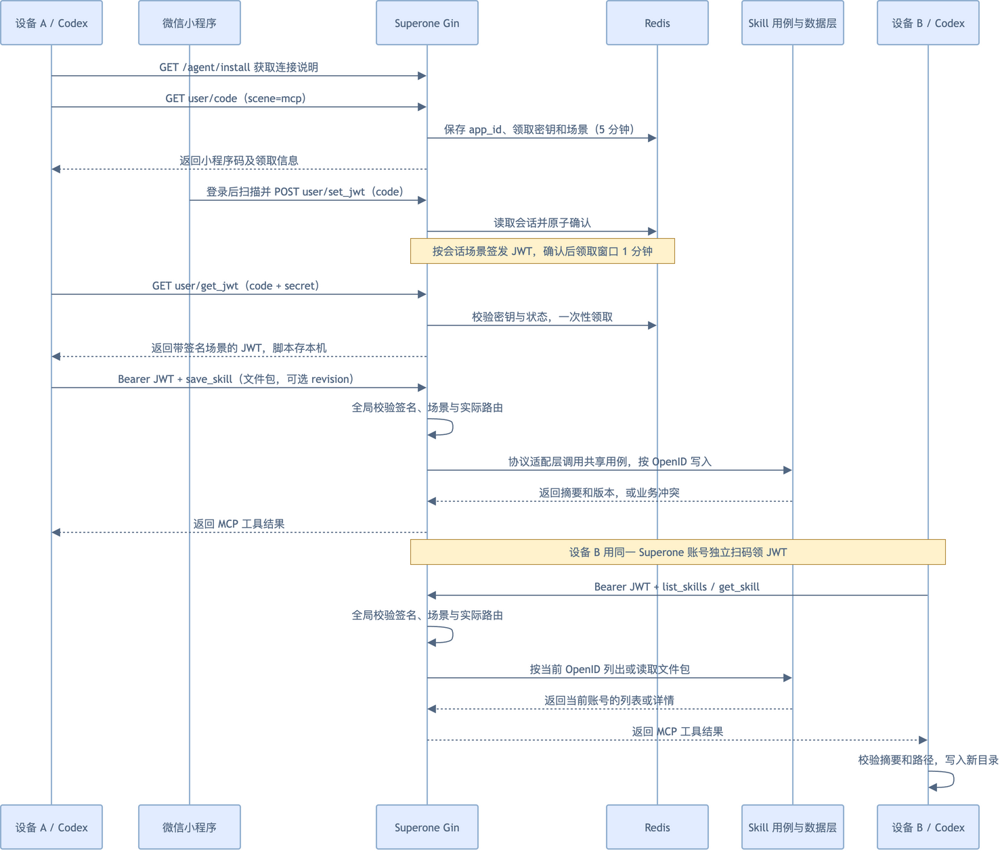
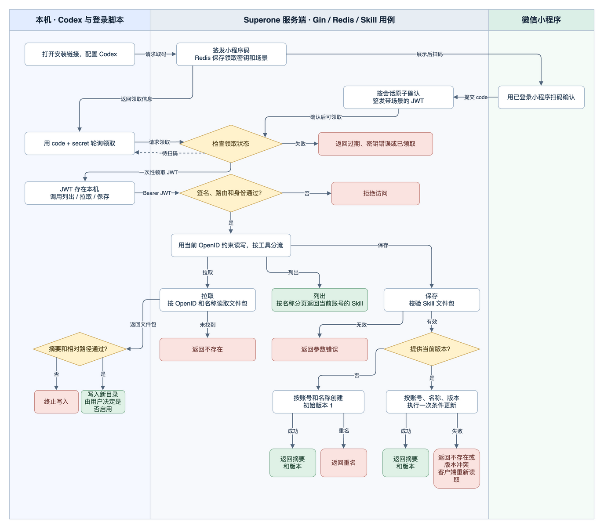

# 261107 Superone Agent 接入与私有 Skill 同步

AI 数据表统一命名见 [命名方案](plans/AI数据表命名.md)。组织与公开 Skill 的[方案](plans/组织与公开Skill.md)已完成本地实现、test 库迁移及本地集成验证；用户反馈已部署 test，实际运行版本和目标客户端验收待核实。[test 集成测试用例](plans/组织与公开Skill集成测试用例.md)已设计，尚未执行。

数据库验证状态：此前自行创建的临时数据库已清理；经用户确认，现已使用项目已有 test 库完成迁移及本地集成验证。远端新版本的接口状态待复核。

## 需求与范围

1. **让用户接入 Superone。** 提供可分享的连接说明，用户在自己的 Codex 中配置远程 MCP。
2. **用微信扫码登录。** 复用小程序扫码和 JWT，让工具以当前 Superone 账号访问服务。
3. **限制凭证和数据的访问范围。** MCP 场景凭证只访问 MCP 接口，业务数据按账号隔离。
4. **在设备之间同步 Skill。** 用户可以保存、列出和拉取自己的 Skill 及附属文件。

**当前状态**　test 环境已通过微信扫码领取凭证，并在 Codex CLI 安装远程 MCP；Codex 成功发现 `list_skills`、`get_skill`、`save_skill` 并调用只读列表工具。`superone-mcp-install` Skill 已保存到当前账号，revision 1；拉取后与本地文件逐字节一致。两台设备同步、普通 Skill 保存和跨账号隔离仍待验收。

**已确定**　废弃一年的旧扫码登录无需处理；JWT 默认有效期设为一年；MCP 采用官方 Go SDK v1.8.0。

**待验证**　两台设备的 Skill 同步、写入及跨账号隔离，以及 Skill 文件包的跨语言摘要规则。此前记录的 Host 校验失败已由本次真实 Codex CLI 初始化和工具调用复验通过。

**接入方式已调整**　服务继续提供登录脚本，并在接入说明中解释脚本的扫码登录与鉴权逻辑。说明不要求客户端运行该脚本，客户端可自行选择 curl、本机操作或其他方式完成相同流程。验收看 MCP 是否成功安装、连接并通过鉴权，具体接入命令由客户端决定。

test 服务 `https://api.beanflow.top:8080` 的 `/ping`、`/agent/install` 和 `/agent/login.py` 均返回 200。远端 `dev`、`test` 均指向 `3be24df`，线上下载脚本与该版本一致。共享契约已推送 `release`（`8164f91`）。详见[部署与验收记录](process/04-部署与验收.md)。

## Redis 环境隔离

- Redis key 按运行环境统一添加前缀，`LIVE` 使用 `live:`，其余环境使用 `nonlive:`。普通 Redis 操作、实时房间 key 和房间事件频道均使用同一规则。
- 用户确认直接切换，历史无前缀数据不迁移。切换后旧缓存、进行中的扫码会话、实时房间、队列和前端缓存数据不再被新代码读取。
- 已使用 test 配置启动实际后端，通过前端缓存 HTTP 接口和 test Redis 验证前缀、读取、条件更新和删除。生产部署后再核验实际环境。

## 整体方案

1. **复用扫码登录。** 沿用 `user/code → user/set_jwt → user/get_jwt` 和领取密钥。继续提供展示该流程的登录脚本，作为登录与鉴权逻辑参考；客户端可自行选择执行方式，最终以 MCP 请求携带有效凭证并通过鉴权为准。
2. **复用后端业务分层。** 新接口参照 [物品路由](../../../business-repo/backend-superone/app/api_service/api_superone.go)，经过 `HandleRequest → UseCase → Service → Repo`，使用现有业务错误码和响应格式。
3. **在同一个后端进程提供远程 MCP。** 沿用现有域名、Gin 监听和部署链路，Codex 通过 HTTPS 直连 Streamable HTTP 协议入口。协议适配层独立注册工具并转换参数，和普通 HTTP 业务接口共享 Skill Service 和 Repo。[MCP 传输规范](https://modelcontextprotocol.io/specification/2026-07-28/basic/transports)
4. **提供连接说明。** 用户访问 `GET /agent/install` 获取接入步骤。MCP 协议入口建议设为 `/api/so/mcp/transport`，采用官方 Go SDK v1.8.0。

## 使用流程

用户从分享链接了解 MCP 安装、微信扫码登录与鉴权逻辑，并获取服务提供的登录脚本。脚本展示一条可完成登录和鉴权的参考逻辑，接入说明不要求客户端执行脚本。客户端自行选择用 curl、本机操作或其他方式完成登录和凭证配置，再按客户端支持的方式安装 MCP、提交凭证并验证鉴权。鉴权成功后，设备 A 可以保存 Skill，设备 B 登录同一账号后可以下载。

图中实线表示请求或流程，虚线表示响应或等待扫码时的轮询。

### 扫码登录与跨设备同步

[编辑时序图](diagrams/sequence.drawio)



### 私有 Skill 的保存与下载

[编辑流程图](diagrams/business-flow.drawio)

泳道按本机 Codex 与登录脚本、Superone 服务端、微信小程序划分。新建时按账号和名称保证唯一。更新发生版本冲突时，客户端重新读取，再决定是否提交。



## 任务拆分与实施顺序

| 顺序 | 子任务与交付物 | 前置依赖 | 验收方式与结果 | 状态 |
| --- | --- | --- | --- | --- |
| 0 | **清理未提交的 MCP 原型**。移除旧 `/mcp` 路由及启动注册、直接连接全局数据库的 Skill 原型、旧建表草稿、原型依赖和脚本中的旧协议调用。保留现有扫码接口和客户端调用链 | 用户确认清理 | 本地 Go 编译、相关包短测试及登录脚本命令检查通过，已核对旧入口和扫码路由 | 已完成 |
| 1 | **建立远程 MCP 服务器**。接入官方 Go SDK v1.8.0，在 Superone 内挂载协议入口并声明工具能力 | 子任务 0；Go 工具链兼容性 | 本地 HTTPS 客户端可连接，`tools/list` 返回空列表，未知工具和未授权请求被拒绝。真实 Codex 连接在目标服务部署后验证 | 本地协议验证通过 |
| 2 | **接入扫码和场景鉴权**。实现场景签发、默认一年有效期、MCP JWT 路由限制和用户契约 | 子任务 1 | JWT 有效期、路由限制、普通登录和本地 Redis 单次领取检查通过 | 本地验证通过 |
| 3 | **实现 Skill 业务接口和存储**。按现有分层完成 API、数据层、Wire、契约及迁移 SQL | 子任务 2 的身份与授权约定 | test 库结构与索引核对通过。实际路由连接 test 库验证账号隔离、分页、文件包校验和并发版本冲突 | test 库及接口验证通过 |
| 4 | **接通 MCP 工具和用户接入**。注册 Skill 工具并调用子任务 3 的业务逻辑，提供扫码登录脚本及逻辑说明、文件恢复和分享说明 | 子任务 1–3 | 本地启动真实后端并连接 test 库，验证工具发现与调用、有效 JWT 鉴权、文件恢复和安装入口。客户端不要求执行所提供的脚本 | 开发验证通过 |
| 5 | **完成真实链路验收**。在目标环境验证分享说明、客户端自行选择的登录与 MCP 安装方式、鉴权和两台设备的 Skill 同步 | 子任务 1–4；数据库迁移、实际服务部署和目标设备就绪 | 使用目标客户端按其支持的方式安装 MCP；通过登录脚本逻辑或客户端自选方式完成扫码登录，确认 MCP 凭证鉴权、工具发现与调用；设备 A 保存、设备 B 同账号拉取并校验文件；跨账号访问被拒绝 | Codex CLI 扫码安装、工具发现与只读调用已通过；两台设备同步、Skill 写入及跨账号隔离待验收 |

本地检查只验证对应代码路径。数据库执行环境和部署按工作台规则分别处理。

## 功能模块设计

### 1. 远程 MCP 服务器

Gin 提供远程协议入口，适配层接收工具请求并调用现有业务层。

1. **挂载协议入口。** 在 `app/api_service` 的 `ApiGroup.InitRouters` 中初始化 `/mcp` 路由组，将 `/api/so/mcp/transport` 交给独立的 Streamable HTTP 处理器。接入 Skill Service 时再增加 Wire 装配。
2. **验证身份并处理协议。** 入口复用现有 JWT 校验，缺失或无效凭证及游客返回 HTTP 401。工具调用使用认证后构造的业务上下文，客户端不能通过工具参数指定 OpenID。
3. **调用同一业务服务。** HTTP 业务接口按现有方式从 DTO 调用 UseCase。MCP 适配层把工具参数转换为相同 DTO，调用共用的 Skill Service。当前 UseCase 通过 `BizContext.GetReqParam()` 获取 HTTP 参数，因此 MCP 不直接伪造 HTTP 参数；Service 通过 Wire 注入并共用同一业务实现。
4. **转换返回结果。** Service 返回的业务错误由 HTTP 层转换为现有响应信封，由 MCP 层转换为工具错误结果。协议错误与业务错误分别处理，日志不记录 JWT 或文件包。

**SDK 与构建**　采用官方 MCP Go SDK v1.8.0，`go.mod` 基线为 Go 1.25.0。部署脚本直接编译 Go 二进制，再通过 Supervisor 加载。按 `CGO_ENABLED=0 go build ./cmd/api_service/main.go` 验证本地编译，部署环境的 Go 工具链待核对。[现有部署脚本](../../../business-repo/backend-superone/deploy.sh) · [SDK 发布记录](https://github.com/modelcontextprotocol/go-sdk/releases/tag/v1.8.0)

### 2. 微信扫码登录

服务提供登录脚本，展示如何创建 MCP 扫码会话、等待已登录的 Superone 小程序确认、一次性领取 JWT 并提交 MCP 鉴权。用户扫码后，新版 Superone 首页从 `code$…` 场景跳转到扫码登录页，页面使用当前小程序登录态自动调用现有 `set_jwt`。接入说明将脚本作为登录与鉴权逻辑参考，不要求客户端执行脚本，也不规定 curl、本机操作或其他具体实现。客户端自行选择方式取得有效凭证，并按其 MCP 客户端支持的配置方式提交鉴权。

1. **创建扫码会话。** `GetCodeReq` 增加可选 `scene`，仅接受空值和 `mcp`。沿用原有 Redis key，普通扫码沿用原有状态格式。MCP 场景在会话的密钥字段后加 `|mcp`，确认时从 Redis 读取该值。
2. **确认扫码并签发凭证。** 创建会话沿用 `SetNX`，过期时间五分钟。`SetJwt` 校验当前小程序的 AppID 和已登录身份，从会话读取场景并签发 JWT，再通过 `SetIfEqual` 将未确认状态原子改为已确认，设置一分钟领取窗口。并发确认只有一次成功。
3. **一次性领取凭证。** `GetJwt` 读取会话并校验 `secret`。未确认时返回待扫码；已确认时用 `DelIfEqual` 原子删除匹配的会话，删除成功才返回 JWT。并发领取只有一次成功，Redis 错误返回现有内部错误。
4. **同步契约并控制日志。** 扫码链路的日志保留方法、路由和业务码。领取密钥、JWT 和二维码不写入应用日志。接口字段与错误说明同步到用户契约。

**切换边界**　用户已确认废弃一年的旧扫码登录无需处理。当前使用的 `user/code → user/set_jwt → user/get_jwt` 流程继续承接 MCP 登录和已确认仍在使用的客户端。

### 3. JWT 场景和接口权限

服务端从签名后的 JWT 读取场景，并在请求进入业务前检查允许的路由。

1. **统一检查路由。** 在 `StartApiService` 注册全局场景检查，覆盖监控、诊断和转发入口。对携带有效 Bearer JWT 的请求，根据 Gin 实际匹配的路由判断范围。未携带凭证的公开接口沿用原有行为。
2. **按凭证场景限制访问。** `scene=mcp` 的有效 JWT 只能进入 `/api/so/mcp/` 对应路由。访问普通鉴权、免登录、WebSocket 或转发入口时均拒绝。普通小程序 JWT 可访问 MCP 业务接口和协议入口，继续按账号执行业务权限检查。
3. **签入场景字段。** 取码的查询参数叫 `scene`，JWT payload 字段按 `bizctx.Metadata` 现有命名写为 `Scene`。扫码签发从服务端会话赋值，普通凭证的场景为空。签名算法、无效场景和未注册路由的处理通过针对性检查确认。

**JWT 有效期**　新签发的 JWT 写入 `exp` 和 `iss`，默认有效期 365 天，解析时拒绝已过期的凭证。已签发的无场景普通 JWT 即使缺少 `exp` 也继续按原规则校验签名，现有客户端可沿用登录态。MCP JWT 必须有 `exp`。

### 4. 私有 Skill 同步

用户在一台设备保存 Skill，另一台设备登录同一账号后读取并恢复。

1. **校验文件包。** 客户端上传 `skill_name`、`files` 和更新时的 `revision`。Service 校验名称、文件数、解码后总量、相对路径、重复路径和非空 `SKILL.md`；无效输入在写库前返回参数错误。
2. **按账号创建。** Service 对文件包按确定的顺序编码并计算 SHA-256，Repo 按当前 OpenID 查询或写入 `user_skill_tab`。创建由 `(openid, skill_name)` 唯一索引保证幂等边界；重复创建返回冲突，不覆盖原内容。
3. **按版本更新。** 更新由数据库单条条件语句同时检查 `openid`、`skill_name` 和 `revision`，并更新文件包、摘要、版本和时间。零行更新返回不存在或版本冲突；具体错误码在实现前按现有错误规范定稿。
4. **在本机恢复。** MCP 读取结果包含名称、版本、摘要和文件映射。本机恢复前验证摘要、Base64、路径和文件总量，在新目录中写入；目标目录已存在时停止，写入失败清理本次创建的临时内容，避免留下半成品。
5. **按账号分页。** HTTP 列表使用现有 `offset + size`，默认 `0 + 20`，最大 `size=100`，按名称升序返回列表和总数。列表查询与计数均限定当前 OpenID。

### 5. 分享链接和接入配置

用户从公开说明获取扫码、配置和连接步骤，每台设备分别登录。

1. **提供分享入口。** `GET /agent/install` 返回纯文本说明和脚本下载地址。页面说明 MCP 安装、扫码登录、凭证领取和鉴权逻辑，并明确脚本是参考实现。凭证不出现在 URL 或聊天中。
2. **提供登录脚本与逻辑说明。** 保留 `scripts/agent-login/login.py`，说明其创建扫码会话、等待小程序确认、禁用重定向、一次性领取凭证和本机保存逻辑。客户端可参考该逻辑，自行选择 curl、本机操作或其他方式完成登录及凭证配置；服务不要求客户端执行该脚本。MCP 安装和凭证提交由客户端按自身能力完成，验收以成功安装 MCP 并通过服务端鉴权为准。
3. **接入 Skill 工具。** MCP 的 `list_skills`、`get_skill`、`save_skill` 映射到同一套 Skill Service。文件打包、写入本机和路径校验由客户端侧执行，不能依赖远端服务器访问用户电脑文件。

## 接口与契约

以下路径均以 `/api/so/mcp` 为前缀，响应统一使用现有业务信封。

| 方法和路径 | 请求 | 返回 |
| --- | --- | --- |
| `POST /skill/list` | `offset`、`size` | `offset`、`size`、`total`、`list`，列表项包含名称、版本和摘要 |
| `GET /skill/detail` | `skill_name` | 单个 Skill 的版本、摘要和文件包 |
| `POST /skill/create` | `skill_name`、`files` | 名称、摘要和初始版本 |
| `POST /skill/update` | `skill_name`、`files`、`revision` | 名称、摘要和新版本 |

每项业务接口使用 Bearer JWT 和现有 `err_code`、`msg`、`detail`、`data` 响应信封。重名和版本冲突复用 `IllegalOperation`（`-100011`），通过 `msg` 区分。请求与错误码见 [Skill OpenAPI](../../../business-repo/frontend-contracts/openapi/skill_api.yaml)。MCP 传输入口使用协议响应格式。

`GET /api/so/user/code` 增加可选 `scene=mcp`，其余参数和返回值沿用现有契约。`POST /api/so/user/set_jwt` 继续由已登录小程序提交扫码 `code`。`GET /api/so/user/get_jwt` 继续用 `code` 和 `secret` 领取 JWT。待扫码时 data 为空，密钥错误、会话过期或已领取时返回业务错误。

- 客户端工具为 `list_skills`、`get_skill`、`save_skill`。保存新 Skill 调用 `create`，显式给出当前版本时调用 `update`。
- 归属取自 `BizContext.GetOpenid()`，拒绝访客。列表、详情及更新全部带归属条件。账号内的名称唯一，更新按归属、名称及当前版本做一次条件写入。重名或版本冲突用业务错误返回。
- 包包含非空 `SKILL.md` 和可选附属文件，采用相对路径到 Base64 内容的映射。最多 64 个文件，解码后总计不超过 256 KiB。请求和响应保留路径键的原始大小写。下载先校验摘要和路径，再写入新目录，由用户决定是否启用。

## 数据设计与迁移

新增 `user_skill_tab`，以登录态 OpenID 加 Skill 名称定位记录。一个包存储一份按文件相对路径排序的 JSON，值为标准 Base64 文件内容。摘要为该规范化 JSON 的 SHA-256 十六进制值。名称限定小写英文、数字和连字符，最多 64 字符。

```sql
CREATE TABLE IF NOT EXISTS `user_skill_tab` (
  `id` bigint NOT NULL AUTO_INCREMENT COMMENT '主键ID',
  `create_time` int unsigned NOT NULL DEFAULT '0' COMMENT '创建时间',
  `update_time` int unsigned NOT NULL DEFAULT '0' COMMENT '更新时间',
  `openid` varchar(64) CHARACTER SET utf8mb4 COLLATE utf8mb4_bin NOT NULL COMMENT '所有者OpenID',
  `skill_name` varchar(64) CHARACTER SET ascii COLLATE ascii_bin NOT NULL COMMENT 'Skill名称',
  `bundle` mediumblob NOT NULL COMMENT '规范化JSON文件包，值为Base64编码的文件内容',
  `digest` char(64) CHARACTER SET ascii COLLATE ascii_bin NOT NULL COMMENT '文件包SHA-256十六进制摘要',
  `revision` bigint NOT NULL DEFAULT '1' COMMENT '并发控制版本，创建时为1',
  PRIMARY KEY (`id`),
  UNIQUE KEY `uniq_openid_skill_name` (`openid`, `skill_name`)
) ENGINE=InnoDB DEFAULT CHARSET=utf8mb4 COLLATE=utf8mb4_unicode_ci COMMENT='用户私有Skill表';
```

- 唯一索引用于同一账号按名称查找、名称排序分页及避免并发重复创建。OpenID 和 Skill 名称使用二进制排序规则，以精确匹配身份和名称；表默认排序规则沿用现有建表 SQL。列表按名称升序，使用 `offset` 和 `size` 分页，默认 `offset=0`、`size=20`，`size` 最大为 100，返回符合当前账号条件的 `total`。参数命名和默认值参考现有近期任务列表。
- 创建写入版本 1，唯一键冲突返回业务冲突。更新执行 `WHERE openid = ? AND skill_name = ? AND revision = ?`，同时更新文件包、摘要、`revision + 1` 和更新时间。影响行数为零时返回不存在或版本冲突，由客户端重新读取后决定是否更新。
- 首版全部字段非空，创建和更新时间由应用填写，无历史数据回填。新表及索引在目标环境执行前需检查同名表，迁移 SQL 按本方案编写。回滚业务代码时保留数据表，删除表需单独决定。
- 已按用户要求在 `weiyi_superone_db_test` 执行 [迁移 SQL](../../../business-repo/backend-superone/scripts/migration/sql/20261107_user_skill.sql)，核对字段和唯一索引，并确认本轮测试数据已清理。

## 改动范围

| 层 | 落点 |
| --- | --- |
| 路由和注入 | `backend-superone/app/api_service/mcp/`、`api_service.go` 和 `wire.go`。路由只注册请求，按现有流程重新生成 Wire 文件。 |
| 场景鉴权 | `internal/domain/user/user_dto/user_dto.go`、`user_service/user_service.go`、`internal/infrastructure/bizctx/metadata.go`、`internal/middleware/jwt.go` 及全局路由注册，贯通扫码场景与 JWT 并限制可访问路径。 |
| 用例和领域 | `use_case/skill_use_case.go`、`use_case/wire.go`、`internal/domain/skill/skill_dto/`、`internal/domain/skill/skill_service/`。在 Service 校验归属、文件包和业务错误。 |
| 持久化 | `internal/repo/user_skill_repo.go`、`internal/model/user_skill_tab.go`、`scripts/migration/sql/20261107_user_skill.sql`。只新增 `user_skill_tab`，字段为 `id`、`openid`、`skill_name`、`bundle`、`digest`、`revision`、`create_time`、`update_time`。字段非空，时间按现有 Unix 秒字段维护，唯一索引为 `(openid, skill_name)`。新表无需历史数据回填。 |
| 契约 | `frontend-contracts/openapi/skill_api.yaml` 记录四个 HTTP API、DTO 和业务错误，并在 `openapi/user_api.yaml` 中更新取码场景参数。 |
| MCP 协议与安装 | 在同一个后端进程挂载远程 MCP 协议适配层，工具调用共用的 Skill Service。公开入口提供安装、登录逻辑和鉴权说明；由目标客户端选择安装与凭证配置方式，部署后验证真实连接和鉴权。 |
| 日志 | 在扫码和 Skill 详情、写入路由使用 `NoPayloadLog`，日志只记录方法、路由和业务码。 |

新入口按协议适配和业务分层接入，继续复用现有扫码脚本及登录链路。

## 验收与验证

| 场景 | 预期 |
| --- | --- |
| MCP 安装与鉴权 | 可分享说明提供登录脚本及其扫码、凭证领取和鉴权逻辑；目标客户端可自行选择登录和凭证配置方式，成功安装并连接 MCP，凭证鉴权通过。 |
| 接口权限 | 缺少 JWT、访客身份或另一个账号无法读写目标 Skill。 |
| 列表分页 | 构造超过一页的数据，按名称顺序请求相邻页，验证默认值、上限及 `offset`、`size`、`total`。 |
| 场景隔离 | MCP JWT 可访问 MCP 路由，访问普通鉴权、免登录和绕过通用处理器的接口均被拒绝。普通小程序 JWT 可调用 MCP 业务接口及协议入口，按账号访问数据。相似路径和路径规范化不能绕过限制。 |
| 扫码回归 | MCP 扫码取得的 JWT 含签名场景值，当前使用的普通扫码和客户端正常运行；废弃的旧扫码登录无需覆盖。 |
| JWT 有效期 | 新 JWT 默认一年有效，检查 payload 的 `exp`；测试一年内可用、过期后拒绝。 |
| 版本冲突 | 两台设备提交相同版本的更新时，只有一条写入成功。 |
| 跨设备 | A 上传含附属文件的 Skill，B 同账号下载，文件字节和摘要一致，已有目录不被覆盖。 |
| 回归 | 现有 uTools 扫码及小程序登录回归通过。 |

验证环境：先运行本地 Go 测试、Wire 和契约检查；跨端链路使用用户实际部署的目标服务、Codex、微信真机和两台设备。部署前无法完成真实链路的部分记录为待联调。

## 风险与回滚

公开服务依赖 HTTPS、目标客户端能够配置并提交有效 MCP 凭证，以及真实扫码链路。JWT 场景检查需要覆盖免登录、WebSocket 与请求转发，防止受限 JWT 访问普通接口。Go 升级后需核对 CI 和部署服务器实际使用的 Go 工具链。

回滚时先核对已发放的 MCP JWT，避免旧版本无法识别场景导致限制失效，再撤回协议入口和业务代码。新表及用户数据保留，删除需另行决定。

## 落地记录

先前通过本机启动的实际后端验证了 MCP 工具和文件推送、恢复，详见[开发记录](process/03-开发与迭代.md)。本轮通过已部署的 test 服务验证了安装入口、扫码取码、Skill HTTP 分页和校验、MCP 凭证权限。真实 Codex 握手和微信扫码确认的阻塞见[部署与验收记录](process/04-部署与验收.md)。

新版小程序已复刻备份的扫码入口和自动提交行为。通过 TypeScript 检查、微信小程序构建和构建产物的页面逻辑检查。真机复测时使用指向后端 test 的体验版小程序，生成二维码时指定 `--env-version trial`。详见[开发记录](process/03-开发与迭代.md)。
