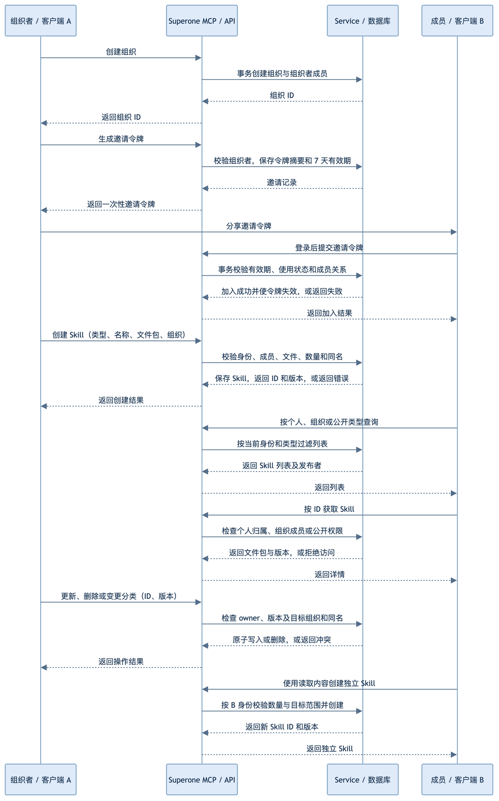
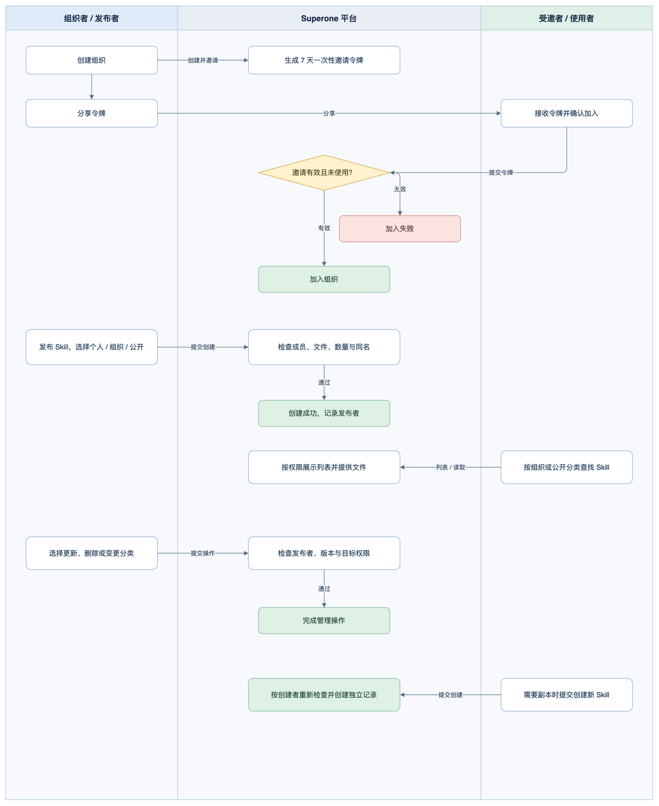

# 组织与公开 Skill 方案

> 2026-11-07 更新：经用户确认，已在项目 test 库执行迁移，并完成数据库集成及本地真实 API 的 MCP 验证；详见部署验收记录。远端 test 服务尚未部署新代码，旧版 Skill 接口暂不可用。

## 需求与范围

1. **创建组织并邀请成员。** 用户创建组织后生成邀请令牌。令牌有效期为 7 天，一个人成功加入后失效。成员移除、退出和组织解散留到后续 uTools 管理插件阶段。
2. **在组织内共享 Skill。** 组织成员都可以发布和读取组织 Skill，只有发布者可以更新、变更分类或删除自己发布的 Skill。
3. **发布和发现公开 Skill。** 已登录用户可以发布公开 Skill，其他登录用户通过 `list_skills` 指定 `public` 分类，列出并读取公开 Skill。
4. **管理 Skill 分类。** 创建时指定个人、组织或公开类型，同一条 Skill 可在三种类型间变更。用户需要副本时，由客户端调用创建工具新建，两条记录各自独立。
5. **检查数量和同名。** 每个用户的三类 Skill 合计在创建时检查 30 条阈值；并发请求同时通过检查时允许超出。个人按用户、组织按组织、公开按发布者分别检查同名。
6. **迁移已有数据。** 现有 Skill 全部迁移为 `personal`。现有接口和调用方按新契约直接重构。

**当前状态**　本地实现及 test 库迁移和集成验证已完成；远端部署和真实目标客户端验收尚未执行。首版个人 Skill 已在 test 环境完成扫码接入、列表读取和一次 Skill 保存与取回，详见 [首版任务记录](../README.md)。

**已确定**　组织者生成一次性邀请令牌；组织成员只能更新或删除自己发布的 Skill；本期生成令牌和加入接口，由客户端提交令牌，不新增邀请页面；数量检查不加锁。

**实施决定**　创建邀请直接返回 `invite_token` 和有效期，由受邀用户的客户端提交令牌；更新提交完整文件包；用户确认物理删除并释放名额。外部调用方仍需部署前核实。

## 整体方案

1. **沿用第一版 MCP 接入。** 客户端继续通过微信扫码获取凭证，以当前登录身份调用 `/api/so/mcp/transport`。组织与 Skill 工具共享现有鉴权入口。
2. **新增组织和邀请能力。** 后端提供组织、成员和邀请存储及工具；令牌使用一次或到期后失效，加入操作在事务内完成。
3. **扩展现有 Skill 业务。** 在同一 Skill 记录上增加分类和组织归属。HTTP 与 MCP 调用同一 Service，按分类、组织成员关系和 owner 判断读写权限。
4. **统一切换接口与数据。** 将现有数据迁移为个人 Skill，更新 MCP 工具、HTTP 接口、共享契约及已识别的客户端调用。详情与更新使用 Skill ID 定位。

## 使用流程

用户通过 Agent 创建组织，生成一次性令牌并分享。受邀用户在自己的客户端提交令牌并加入组织。组织成员可以向该组织发布 Skill，也可以通过组织列表找到其他成员发布的 Skill。

用户创建 Skill 时选择个人、组织或公开类型。组织 Skill 对成员可见，公开 Skill 可由登录用户按 `public` 分类发现。发布者可以更新、删除或变更自己 Skill 的类型；需要一份独立副本时，客户端读取内容并重新调用创建工具。

### 系统处理时序

时序图覆盖创建组织、邀请加入、Skill 创建、查询、读取、管理和独立副本，展示客户端、MCP 接口及业务服务与数据库的交互。

[编辑系统处理时序图](../diagrams/organization-invite.drawio)



### 组织与 Skill 业务泳道

泳道图从业务角度展示组织者、平台及使用者如何邀请加入、发布、发现、管理 Skill 和创建独立副本。

[编辑组织与 Skill 业务泳道图](../diagrams/skill-category.drawio)



## 任务拆分与实施顺序

| 顺序 | 子任务与交付物 | 前置依赖 | 验收方式与结果 | 状态 |
| --- | --- | --- | --- | --- |
| 1 | **评审 DDL、契约及调用方切换** | 已确认业务规则 | 核实目标表、令牌处理及删除策略 | 本地已验证；目标库待核实 |
| 2 | **组织、成员和邀请** | 方案确认、迁移 | 两个账号完成创建、邀请及加入 | 本地已验证 |
| 3 | **Skill 分类、权限、配额和迁移** | 组织能力、数据迁移 | 三类读写、分类变更、并发配额和原有数据验证 | 本地已验证；目标迁移待执行 |
| 4 | **MCP、HTTP 和共享契约重构** | 业务服务完成 | 目标客户端使用新接口完成链路 | 本地已完成；真实客户端待验收 |
| 5 | **目标环境验收** | 部署和数据库执行授权 | 两账号验证邀请、组织与公开 Skill | 待开始 |

## 功能模块设计

### 1. 创建组织并邀请一个人

组织者创建组织并生成邀请令牌，受邀用户通过自己的客户端提交令牌加入。

1. **创建组织。** Agent 调用 `create_organization`，提交组织名称。服务从 JWT 取得组织者身份，在同一数据库事务中创建组织和组织者成员记录，返回组织 ID。后续操作用 ID 定位组织，组织名称只用于展示。
2. **生成邀请。** 组织者调用 `create_organization_invite` 并指定组织 ID。服务核对请求者是组织者，生成随机令牌，保存令牌摘要、组织 ID 和到期时间，直接返回令牌。明文令牌只在创建响应中出现；组织者可以多次生成令牌，每条令牌独立计算有效期和使用状态。
3. **加入组织。** 受邀用户的客户端读取令牌并调用 `accept_organization_invite`。服务根据令牌摘要找到邀请，在事务内检查未使用、未过期且受邀用户尚未加入；检查通过后插入成员并标记邀请已用，然后返回组织 ID。两个不同用户同时使用同一令牌时，只有一个能加入。
4. **处理失败。** 令牌不存在、过期或已使用时返回原因。受邀用户已经是成员时告知已加入，不消耗该令牌。加入请求超时后，受邀用户可查询自己的组织列表确认结果，再决定是否重试。

**令牌交付方式**　创建邀请直接返回一次性令牌；受邀用户登录后，将令牌交给自己的客户端调用加入工具。本期不建设邀请页面或注册系统协议。

### Carbon 空间与邀请的对照

Carbon 已经实现了创建空间、查询邀请详情和接受邀请，可作为组织功能的同层实现参考。以下是代码对照后的方案判断。

1. **沿用事务和成员建模方式。** Carbon 的 `CreateSpace` 通过 `ctx.Transaction` 同时创建空间与组织者成员，成员表用 `(space_id, openid)` 唯一约束。组织沿用同一事务机制和 `(organization_id, openid)` 唯一约束，仓储沿用 `ctx.GetDB()`，让事务内查询和写入共享同一个事务。[创建空间](../../../../business-repo/backend-superone/internal/domain/carbon/carbon_service/carbon_service.go) · [成员仓储](../../../../business-repo/backend-superone/internal/repo/carbon_repo.go)
2. **沿用邀请行锁和事务边界。** Carbon 接受邀请时在事务中重新读取并锁定邀请行，再检查状态、插入成员和更新邀请。组织邀请同样锁定单条邀请，保证一条令牌只成功加入一人；这是邀请的一次性约束，不涉及 Skill 数量检查，后者仍不加锁。[邀请服务](../../../../business-repo/backend-superone/internal/domain/carbon/carbon_service/carbon_service.go) · [邀请仓储](../../../../business-repo/backend-superone/internal/repo/carbon_repo.go)
3. **补齐不同邀请并发加入的结果。** 同一用户同时持两条有效令牌加入同一组织时，两个事务锁的是不同邀请行。成员唯一索引最终只允许一个插入成功；另一个事务应回滚并转换为“已是成员”，不得把数据库唯一键错误直接返回，也不能消耗第二条令牌。遇到死锁或其他数据库错误，整次事务回滚并返回可重试的错误，不自行重复消耗邀请。
4. **明确超时重试。** Carbon 对已有成员提供进入空间的处理。组织方案建议在锁定邀请后，若当前账号就是该令牌的领取人且成员关系存在，重复调用返回已加入结果；若成员通过其他令牌加入，返回已是成员且不消耗当前令牌；若令牌由其他人领取，返回已使用。这样调用成功但响应丢失时，原领取人可安全重试。本地实现采用该重试行为。
5. **可参考邀请详情，但不增加页面前提。** Carbon 的 `GetInviteDetail` 返回空间、邀请者、到期及是否已是成员，供客户端确认。组织 MCP 可以增加只读 `get_organization_invite` 工具，以有效令牌返回组织名称、邀请者展示信息、到期时间和当前用户是否已是成员，再由用户决定是否加入。此工具为可选建议，本期未实现。
6. **过期状态以时间判断。** Carbon 在接受过期邀请时尝试更新状态，但随后返回业务错误。`ctx.Transaction` 遇业务错误会回滚事务，因此不能依赖这次写入持久化过期状态。组织方案保留 `expire_time`，查询时动态判断是否过期，接受时事务内再次判断；如以后需要持久化状态，应另行设计提交边界。[事务实现](../../../../business-repo/backend-superone/internal/infrastructure/bizctx/db_context.go)

**业务边界**　Carbon 当前为双人空间，邀请有效期 24 小时，活跃成员可发邀请，并包含默认空间、成员数量和空间解散等规则。本次组织按已确认要求采用 7 天、组织者发邀请、本期不实现退出和解散，不引入 Carbon 的双人上限或默认空间逻辑。复用代码时参考事务、仓储和 DTO 结构，不直接共用 Carbon 表或绑定 Carbon 领域语义。

### 2. 在组织内发布和使用 Skill

组织成员可发布和读取组织 Skill。组织是共享范围，每条 Skill 仍归发布者所有，只有发布者可以更新或删除。

1. **找到组织。** 成员调用 `list_organizations` 获取本人所属组织，再按需调用 `list_organization_members` 查看成员。未加入的用户不能通过组织 ID 查询成员或组织 Skill。
2. **发布 Skill。** 成员向 `save_skill` 提交 `category=team`、组织 ID、名称和文件包。服务检查其成员身份、个人 Skill 总数、组织内是否已有同名 Skill，再沿用现有文件包校验及摘要计算。创建成功返回 Skill ID 和版本 1。
3. **读取 Skill。** 成员在 `list_skills` 中传 `category=team` 和组织 ID，得到名称、ID、发布者及版本。客户端用 ID 调用 `get_skill`，服务再次检查当前成员身份，再返回文件包。文件在客户端本机恢复，服务不访问用户电脑。
4. **更新 Skill。** 发布者读取当前版本后提交 ID、版本及更新内容。服务同时检查 owner、目标组织成员身份和版本，用数据库条件更新。版本过期或同组织已有目标名称时返回冲突，原文件保持原样。
5. **删除 Skill。** 发布者可提交 ID 和版本删除自己发布的 Skill，其他成员无法删除。删除后列表和详情不再返回该条，释放 owner 的创建名额。删除采用物理删除；已下载到其他设备的文件不会随之消失。

**权限依据**　JWT 决定当前用户，数据库成员关系决定是否能读取或向组织发布，Skill 的 `openid` 决定谁可以更新、变更分类和删除。请求中的组织 ID 是目标范围，不代表请求者已经获得权限。本期不提供移除成员、退出或解散。

### 3. 发布公开 Skill，让其他人发现和使用

已登录用户可以发布公开 Skill，其他登录用户在 `list_skills` 传 `category=public` 后发现并读取。不同发布者可以使用相同名称，列表需要展示发布者及 ID。

1. **创建公开 Skill。** 已登录用户提交 `category=public`、名称和文件包，服务检查该发布者的公开范围内是否重名，并与其他分类一起计算该用户的 Skill 数量。创建后，其他登录用户即可在公开列表中发现。
2. **列表与读取。** 列表只返回元数据，用户选中条目后再按 ID 获取文件包。服务不要求读取者与发布者在同一组织；未登录用户能否读取遵循本期已确认的登录要求。
3. **更新和停止公开。** 只有发布者可以更新或删除自己的公开 Skill，也可以将其改为 `personal` 或自己所属组织的 `team`。变更成功后，该条不再出现在公开列表，其他用户无法继续通过公开权限读取。
4. **独立副本。** 用户想保留自己的版本时，由客户端读取公开 Skill，按自己的意愿调用创建工具提交文件包。新记录以创建者为 owner，独立计入创建者的数量，新旧记录没有来源关联，后续更新互不影响。

### 4. 一个 Skill 在三种分类之间变更

分类表示这条记录当前的可见范围。发布者可以从个人变公开、从公开变个人，也可以移入或移出自己所属的组织。变更操作修改原记录，不创建副本，因此 Skill ID 和 owner 保持不变，revision 增加，计数不变。

1. **提交目标状态。** 客户端先读取当前 Skill 的 ID、revision 和文件，再提交目标分类。目标为 `team` 时还需提交目标组织 ID，其他分类不接受非零组织 ID。
2. **检查目标范围。** 服务核对操作者是 owner；迁入组织时核对当前成员身份；随后根据目标分类和归属范围检查同名。三个条件任一失败，原分类、文件和版本都保持不变。
3. **一次写入。** 服务按 ID、owner 和 revision 条件更新分类、组织 ID、范围键、文件、摘要及版本。唯一索引处理并发重名；条件更新处理版本竞争。客户端遇到冲突后重新读取，再由用户决定如何处理。
4. **读取权限立即变化。** 更新成功后，列表和详情按新分类授权。例如从公开改为个人后，其他用户的后续详情请求被拒绝。已经下载的文件由各自客户端管理。

**设计取舍**　这里建议更新时提交完整文件包和目标分类，现有文件校验与摘要计算可继续复用；若只改分类，也需要客户端先读出当前文件再提交。本地实现采用该接口形态。

### 5. 创建数量、重名和文件包

1. **创建数量。** 用户作为 owner 的个人、组织和公开 Skill 合计达到 30 条时，新建请求返回数量限制。创建前按 owner 普通计数，不加锁；并发请求可能同时通过并超过 30，这是已确认接受的行为。分类变更不新增记录，客户端新建独立副本会计入创建者的数量。
2. **三个同名范围。** `personal` 在同一 owner 内查重，`team` 在同一组织内查重，`public` 在同一发布者内查重。同一用户可以分别拥有一个同名个人和公开 Skill，两个不同组织也可以拥有同名 Skill。同一组织里的两名成员不能分别创建同名组织 Skill。
3. **文件校验。** 沿用首版 Skill 名称、路径、Base64、非空 `SKILL.md`、最多 64 个文件及解码总量不超过 256 KiB 的约束。服务以原有规范计算摘要，客户端恢复文件前验证摘要和路径。
4. **删除后计数。** 删除采用物理删除并从计数中排除。现有数据迁移到 `personal` 后也参加同一 owner 的计数，若已有数量超过 30，仍可读取、更新、变更和删除，新建时会被拒绝。

### 6. MCP 与现有后端如何衔接

1. **沿用认证入口。** 客户端继续使用现有扫码获得的 MCP JWT，经过 `/api/so/mcp/transport`。协议层读取已认证的业务上下文，不能通过工具参数指定 owner。
2. **共用业务规则。** HTTP 入口通过 `HandleRequest → UseCase → Service → Repo`，MCP 工具转换参数后调用同一 Service。组织成员校验、Skill 权限、数量和文件校验均由 Service 负责，两个入口使用同一套规则。
3. **切换调用方。** 现有 `save_skill` 和 `get_skill` 按名称定位，新方案按 Skill ID 定位详情与更新，并给创建请求增加分类。登录脚本的 push/pull、共享契约和接入 Skill 需要一起修改；旧参数不走旧分支。实际部署前还要盘点外部客户端，避免切换后仍使用旧契约。
4. **输出和日志。** HTTP 继续返回业务响应信封，MCP 返回对应工具结果和错误。邀请令牌、JWT 与 Skill 文件包不写入请求日志；公开范围也沿用文件包日志控制。

## 接口与契约

路径以 `/api/so/mcp` 为前缀，使用现有 JWT 和统一业务错误；MCP 工具共享同一 Service。下表为拟定接口，具体请求与响应在契约设计中定稿。

| HTTP | MCP 工具 | 作用及权限 |
| --- | --- | --- |
| POST `/organization/create` | `create_organization` | 登录用户创建组织，返回组织 ID |
| POST `/organization/list` | `list_organizations` | 查看本人组织及角色 |
| POST `/organization/member/list` | `list_organization_members` | 成员查看指定组织成员 |
| POST `/organization/invite/create` | `create_organization_invite` | 组织者创建 7 天有效令牌 |
| POST `/organization/invite/accept` | `accept_organization_invite` | 已登录用户确认加入 |
| POST `/skill/list` | `list_skills` | 分类、组织 ID 和分页查询 |
| GET `/skill/detail` | `get_skill` | 以 Skill ID 读取，按分类鉴权 |
| POST `/skill/create` | `save_skill` | 分类、组织 ID、名称、文件包创建，检查配额和重名 |
| POST `/skill/update` | `save_skill` | Skill ID、revision、文件包或目标分类更新 |
| POST `/skill/delete` | `delete_skill` | owner 以 Skill ID 和 revision 删除并释放配额 |

复制由客户端调用现有创建工具完成，不提供关联复制接口。同步 `frontend-contracts/openapi/skill_api.yaml` 和组织契约，并修改所有受影响客户端调用。原接口调用按新契约直接切换。

### 请求、响应与失败处理

下述为新契约草案，所有 ID、revision 为正整数，时间为 Unix 秒。HTTP 接口沿用现有业务响应信封，MCP 将业务错误转换为工具错误。用户身份取自已认证的业务上下文。`offset` 默认 0，`size` 默认 20、最大 100；非法参数返回参数错误。列表返回 `offset`、`size`、`total`、`list`。

| 操作 | 请求字段 | 成功结果 | 失败语义 |
| --- | --- | --- | --- |
| 创建组织 | `organization_name` | `organization_id`、名称 | 名称空或过长报参数错误 |
| 组织列表 | `offset`、`size` | 本人所属组织 ID、名称、角色 | 未登录拒绝 |
| 成员列表 | `organization_id`、`offset`、`size` | 成员标识、展示名称和角色 | 非成员或组织不存在拒绝 |
| 创建邀请 | `organization_id` | `invite_token`、`expire_time` | 非组织者拒绝 |
| 接受邀请 | `invite_token` | `organization_id`、成员角色 | 令牌无效、过期、已用或已是成员返回对应错误；已是成员不消耗未用令牌；原领取人重试返回成功 |
| Skill 列表 | `category`、`organization_id`（team 必填）、`offset`、`size` | ID、名称、分类、组织 ID、owner 展示信息、摘要、版本 | 分类非法或非成员拒绝 |
| Skill 详情 | `skill_id` | 上述元数据及 `files` | 不存在或无读取权限返回不可访问 |
| 创建 Skill | `skill_name`、`category`、`organization_id`（team 必填）、`files` | ID、名称、分类、摘要、revision 1 | 非成员、文件无效、重名或计数已达 30 分别返回错误 |
| 更新 Skill | `skill_id`、`revision`、`category`、`organization_id`（team 必填）、`files` | ID、分类、摘要、新 revision | 非 owner、目标非成员、重名或版本冲突分别返回错误 |
| 删除 Skill | `skill_id`、`revision` | 被删除 ID | 非 owner、版本冲突或不存在返回错误 |

更新提交完整目标分类和文件包，避免未传字段引起歧义；事务内校验目标组织、唯一键及 revision，再原子更新。删除以 owner、ID、revision 条件执行，成功后该条不再参与数量统计。删除采用用户确认的不可恢复物理删除，并释放名额。公开列表按名称及 ID 排序，`public` 是分类筛选，关键词搜索不作为本期必选条件。响应中的 owner 使用现有用户信息中适合展示的稳定标识，具体字段定稿时核对隐私及现有用户表。

MCP `save_skill` 建议以 `skill_id` 区分创建与更新：创建不传 ID 和 revision，更新同时提供两者；与第一版按名称和 revision 的参数形状不同，相关调用方一起切换。组织创建邀请工具直接返回令牌，受邀用户将令牌提交给加入工具。真实目标客户端仍需验收令牌交接与加入过程。

### 调用示例

下面展示 MCP 工具的 `arguments`，`files` 的值为 Base64，示例省略实际文件内容。HTTP 接口使用同名字段，详情以 GET 查询参数提交。数值仅用于解释，不表示已有真实组织或 Skill。

小王创建组织并拿到组织 ID 12，然后创建邀请：

```json
{"organization_name":"设计团队"}
```

```json
{"organization_id":12}
```

服务返回 `invite_token` 和 `expire_time`。小李将令牌交给客户端，客户端调用 `accept_organization_invite`：

```json
{"invite_token":"收到的令牌"}
```

小王创建组织 Skill，小李按组织列出，再根据列表返回的 ID 获取：

```json
{"skill_name":"design-review","category":"team","organization_id":12,"files":{"SKILL.md":"IyBleGFtcGxl"}}
```

```json
{"category":"team","organization_id":12,"offset":0,"size":20}
```

```json
{"skill_id":101}
```

若小王将 ID 101 变成公开 Skill，先读取当前 revision，再提交目标分类和完整文件包。更新成功后仍是 ID 101，版本递增：

```json
{"skill_id":101,"revision":1,"category":"public","organization_id":0,"files":{"SKILL.md":"IyBleGFtcGxl"}}
```

其他登录用户随后传 `{"category":"public","offset":0,"size":20}` 即可发现。客户端保存独立副本时，再用自己的身份调用创建，提交目标分类、名称和文件包，服务返回新的 ID。

### 事务与重试

组织创建在单事务插入组织及组织者成员。邀请生成使用随机高熵令牌，仅保存哈希和到期时间，明文仅创建时返回；有效期以服务端时间计算为 7 天。接受时事务内锁定邀请行，检查未使用和未过期，插入成员并记录领取人，提交后令牌失效；并发仅一个不同账号成功。已是成员且并非该邀请领取人时返回提示且不消费令牌；同一领取人超时重试返回已加入结果。创建 Skill 的 30 条检查不加锁，并发超额是用户明确接受的行为；同名由数据库唯一索引兜底。所有文件日志和请求日志遵循现有不记录文件包的约定。

## 数据设计与迁移

1. **组织数据。** 新建组织表、组织成员表和邀请表。组织者与成员的关系独立保存，邀请记录保存令牌摘要、过期时间和领取人。
2. **Skill 分类。** 当前代码已将 Skill 表名调整为 `agent_user_skill_tab`。新增分类、组织 ID 和范围键在该新表上实施。个人和公开 Skill 按 owner、组织 Skill 按组织 ID 检查同名；每条 Skill 的 owner 保持不变。
3. **历史数据。** 将现有 Skill 全部设为 `personal`，保留 ID、owner、文件、摘要和版本。迁移期间停写，部署新代码及调用方后核验并恢复写入。

### 表结构和迁移 SQL

以下为评审 SQL，执行前核实目标库版本、现有结构和索引；不得直接执行。使用 InnoDB 事务，时间沿用 Unix 秒。创建和更新时间由应用维护。

```sql
CREATE TABLE agent_organization_tab (
  id bigint NOT NULL AUTO_INCREMENT COMMENT '主键ID',
  create_time int unsigned NOT NULL DEFAULT 0 COMMENT '创建时间',
  update_time int unsigned NOT NULL DEFAULT 0 COMMENT '更新时间',
  organization_name varchar(128) NOT NULL COMMENT '组织名称',
  owner_openid varchar(64) CHARACTER SET utf8mb4 COLLATE utf8mb4_bin NOT NULL COMMENT '组织者身份',
  PRIMARY KEY (id), KEY idx_owner (owner_openid)
) ENGINE=InnoDB DEFAULT CHARSET=utf8mb4 COLLATE=utf8mb4_unicode_ci COMMENT='组织';

CREATE TABLE agent_organization_member_tab (
  id bigint NOT NULL AUTO_INCREMENT COMMENT '主键ID',
  create_time int unsigned NOT NULL DEFAULT 0 COMMENT '创建时间',
  update_time int unsigned NOT NULL DEFAULT 0 COMMENT '更新时间',
  organization_id bigint NOT NULL COMMENT '组织ID',
  openid varchar(64) CHARACTER SET utf8mb4 COLLATE utf8mb4_bin NOT NULL COMMENT '成员身份',
  member_role tinyint unsigned NOT NULL COMMENT '角色：1组织者，2成员',
  PRIMARY KEY (id), UNIQUE KEY uniq_org_member (organization_id, openid),
  KEY idx_member_org (openid, organization_id)
) ENGINE=InnoDB DEFAULT CHARSET=utf8mb4 COLLATE=utf8mb4_unicode_ci COMMENT='组织成员';

CREATE TABLE agent_organization_invite_tab (
  id bigint NOT NULL AUTO_INCREMENT COMMENT '主键ID',
  create_time int unsigned NOT NULL DEFAULT 0 COMMENT '创建时间',
  update_time int unsigned NOT NULL DEFAULT 0 COMMENT '更新时间',
  organization_id bigint NOT NULL COMMENT '组织ID',
  token_hash char(64) CHARACTER SET ascii COLLATE ascii_bin NOT NULL COMMENT '邀请令牌SHA-256',
  expire_time int unsigned NOT NULL COMMENT '到期时间',
  used_by_openid varchar(64) CHARACTER SET utf8mb4 COLLATE utf8mb4_bin NOT NULL DEFAULT '' COMMENT '领取人，空表示未使用',
  PRIMARY KEY (id), UNIQUE KEY uniq_token_hash (token_hash), KEY idx_org_invites (organization_id, id)
) ENGINE=InnoDB DEFAULT CHARSET=utf8mb4 COLLATE=utf8mb4_unicode_ci COMMENT='一次性组织邀请';

ALTER TABLE agent_user_skill_tab
  ADD COLUMN skill_category varchar(16) CHARACTER SET ascii COLLATE ascii_bin NOT NULL DEFAULT 'personal' COMMENT '分类：personal、team、public',
  ADD COLUMN organization_id bigint NOT NULL DEFAULT 0 COMMENT '组织ID，非组织分类为0',
  ADD COLUMN scope_key varchar(72) CHARACTER SET utf8mb4 COLLATE utf8mb4_bin NOT NULL DEFAULT '' COMMENT '同名校验范围键';

-- 仅迁移原有记录。变更前记录主键上界并以该上界执行，防止误处理新写入。
UPDATE agent_user_skill_tab SET scope_key = CONCAT('p:', openid)
WHERE id <= :migration_max_id AND scope_key = '';

ALTER TABLE agent_user_skill_tab
  ADD UNIQUE KEY uniq_skill_scope_name (scope_key, skill_name),
  ADD KEY idx_owner_skills (openid, id),
  ADD KEY idx_category_scope_list (skill_category, scope_key, skill_name, id),
  ADD KEY idx_category_list (skill_category, skill_name, id);

-- 确认新索引建立后再移除旧索引。
ALTER TABLE agent_user_skill_tab DROP INDEX uniq_openid_skill_name;
```

`scope_key` 由服务端根据分类生成，个人为 `p:` + owner，公开为 `u:` + owner，组织为 `t:` + 十进制组织 ID。前缀区分类型，二进制比较保留现有名称与身份语义。新增、分类变更必须同事务写入分类、组织 ID 和范围键，客户端不得传入范围键。真实数据库字符集、最大索引长度和目标版本需部署前核对。占位符 `:migration_max_id` 是迁移执行参数，不是可直接执行的 SQL 文本。

**迁移顺序**　先停写并备份 → 核对 `user_skill_tab` 表结构、数据量及索引 → 执行独立的表重命名 SQL，将表改为 `agent_user_skill_tab`（保留原表数据和索引）→ 核验重命名结果 → 在停写状态下执行本方案的分类字段及索引迁移 → 回填并校验历史个人 Skill → 部署新代码及调用方 → 验证服务读写后恢复写入。数据库重命名迁移尚未执行；新代码依赖新表名，必须先迁表再部署。MySQL DDL 会隐式提交，迁移过程不可假定为单事务，逐步记录成功状态和恢复点。无数据时可跳过回填；过程中不得放开旧代码写入。

**回滚**　停写，备份迁移后所有数据；若需回退到旧代码，先评估新分类数据，再按回滚 SQL 将 `agent_user_skill_tab` 改回 `user_skill_tab` 并恢复兼容索引。当前表重命名迁移尚未执行；**不得在新代码已部署时单独改回旧表名**。先确认新增的组织和公开 Skill 如何处置。旧唯一键无法容纳同一 owner 跨分类同名，旧代码也无法正确授权新分类，因此不能直接回滚。经确认后导出新数据，检查旧键冲突并按决定处理，再恢复原结构和旧代码。未确定处置前保持停写，避免丢失或暴露数据。

## 现有实现与改动范围

| 文件或目录 | 设计改动 |
| --- | --- |
| `backend-superone/app/api_service/mcp/` | 注册组织接口与工具，重构 Skill 工具参数和返回值；MCP 沿用已认证的业务上下文。 |
| `backend-superone/app/api_service/wire.go`、`use_case/wire.go` | 装配组织服务，重生成 Wire 产物。 |
| `backend-superone/use_case/skill_use_case.go`、新增组织 UseCase | HTTP 请求 DTO 转换后调用 Service，业务规则不复制到传输层。 |
| `backend-superone/internal/domain/skill/skill_dto/`、`skill_service/` | 改造分类、ID、owner 权限、同名和创建时数量检查；复用现有文件包校验及版本处理。 |
| `backend-superone/internal/domain/organization/` | 新增组织及邀请 DTO、服务和事务处理。 |
| `backend-superone/internal/repo/user_skill_repo.go`、`internal/model/user_skill_tab.go` | 分类查询、范围键、按 owner 计数、条件更新与删除；组织新增对应 model 和 repo。 |
| `backend-superone/scripts/migration/sql/` | 将评审 SQL 落为迁移脚本，执行前核验目标结构。 |
| `backend-superone/scripts/agent-login/login.py` | 更新 push/pull 的新参数、按 ID 拉取与创建参数。 |
| `frontend-contracts/openapi/skill_api.yaml` 及新增组织契约 | 更新唯一共享协议、分类、工具对应字段和错误。 |
| `.agents/skills/superone-mcp-install/SKILL.md`、安装说明 | 更新工具参数与 Skill 拉取保存说明；核对后端安装页的真实文件位置。 |

首次接入使用的 Codex 配置沿用现有鉴权；调用参数按新契约同步切换。具体其他外部调用方需部署前盘点。旧调用方式直接替换，不保留分流或旧名称回退。

## 验收与验证

| 场景 | 操作 | 预期 | 环境 |
| --- | --- | --- | --- |
| 邀请 | 组织者生成令牌，另一账号在 7 天内登录加入 | 成为该组织成员；过期令牌拒绝 | test、真实客户端 |
| 组织权限 | A 上传组织 Skill，B 读取并尝试更新 | B 可读取，更新拒绝；A 可更新 | test、两个账号 |
| 公开发现 | A 发布，B 按 `public` 列表发现并读取 | 返回正确发布者和文件包 | test、真实 MCP 客户端 |
| 配额 | 同一用户三类合计已有 30 个后创建；并发创建接近上限 | 创建被拒绝；单次达到 30 时拒绝，并发可超过 30 | 本地及 test |
| 分类变更 | owner 在三类间变更，尝试变更到非成员组织及目标重名 | 有权且无冲突时成功，其余拒绝且原记录不变 | test |
| 独立副本 | 把 Skill 复制到其他分类后更新其中一份 | 两份内容互不影响，各占一个名额 | test |
| 数据迁移 | 迁移前后核对原有记录 | 全部为个人分类，owner、文件、摘要及版本保持正确 | test |
| 隔离 | 非成员按组织和 Skill ID 访问 | 列表、详情和写入拒绝 | test |

## 风险与回滚

分类变更会改变内容可见范围，公开后被下载的文件无法通过变更分类收回。客户端需要接收邀请令牌、完成登录并调用加入接口。新接口直接替换现有调用，需要同步部署所有使用方；旧数据保留并迁移为个人分类，回滚顺序和新分类数据处置需在 DDL 定稿时明确。

## 当前状态

本地代码、客户端和契约已更新；test 库迁移、数据库集成和本地真实 MCP API 验证通过。远端服务尚未部署新代码，目标客户端及跨设备验收待完成。
