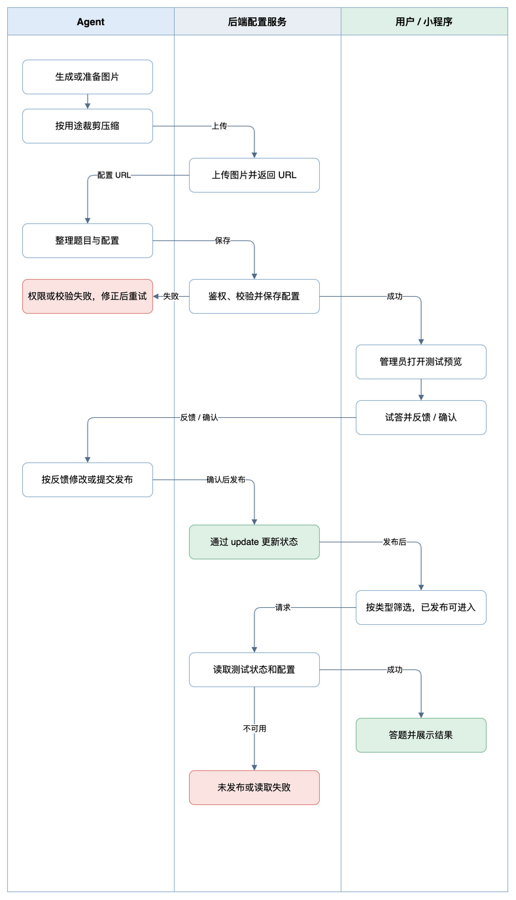
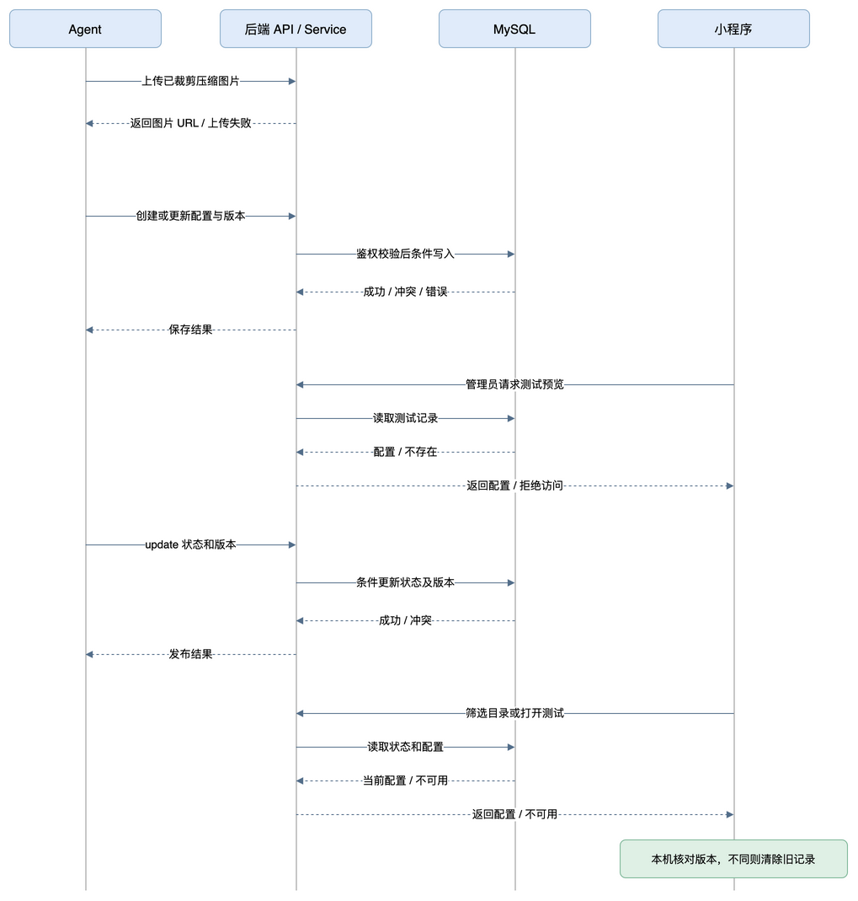

# 可配置测试与投资方式首测方案

> 状态：开发迭代中。用户已明确由 Agent 编辑配置，用户在小程序查看效果；本方案不建设后台编辑页面。

## 需求与范围

1. **完成第一套投资方式测试。** 通过生活与投资场景了解读者的时间、资金安排、收益期待和信息习惯，综合回答给出与五种方法的匹配结果，并解释依据。测试面向趣味探索，不采集收入金额、职业名称、账户或持仓。
2. **建立可复用模板。** 在首次开发、部署和小程序发版之后，运营者可以配置符合模板的测试、预览并发布；用户从目录或指定链接进入，无需为每套新题修改代码或发版。
3. **制作并托管图片。** Agent 按测试需要生成或准备图片，按实际用途裁剪与压缩，通过后端图片上传接口取得 URL，再填入测试配置。
4. **按类型筛选测试。** 测试记录包含类型，测试列表顶部以一行横向胶囊切换「全部」及已有类型，同时覆盖现有本地测试与后端配置测试。
5. **接入公众号文章。** 发布后的文章可插入直达该测试的小程序入口；卡片插入方式及账号实际能力上线前核验。

**当前状态**：已有 `ImmersiveAssessmentPlayer`、`AssessmentSceneRenderer`、`AssessmentResultReport`、本地草稿与 `AssessmentQuestion` 类型；理财人格题库、评分、入口及分享路径仍在前端代码中，股票和基金路线有各自规则。已有测试并不自动具备后端配置能力。

**已确定**：以投资方式为首个接入后端的测试；题目从具体情境了解用户，不直接让用户选择五种方法；结果解释判断依据。用户要求先写方案。

**建议范围**：支持单选、文字/聊天/图片/行情场景块、顺序答题、可配置回看或跳过、维度加权和单一倾向结果；每个测试一条配置，支持预览及状态切换，不保存历史版本。Agent 在工作区按模板编辑 JSON，通过管理员接口保存、校验和发布；小程序提供管理员预览，不建设后台编辑页面。首次题库、评分及文案需用户审阅。

**暂不纳入**：用户答案上传、投资账户连接、交易建议、历史测试迁移、任意脚本执行、任意页面布局、复杂自定义分支及无障碍之外的新交互类型。旧测试仍是独立玩法，本期不替换其流程；若未来迁移，需核实存量结果、调用方和规则并另行设计统一切换，不把本次作为旧流程迁移授权。

## 整体方案与使用流程

Agent 先按测试需要生成或准备图片，裁剪压缩后通过后端上传取得 URL；随后在工作区编辑配置并调用管理员接口保存测试配置，系统校验题目、结果引用和规则；预览时用同一个播放器和评分引擎实际答题。确认后将测试状态改为已发布。读者在目录或公众号卡片打开通用页面，获取已发布版本，完成答题，在本机计算并查看结果、分享测试。

后端负责配置校验、版本与发布状态；小程序负责展示、答题、计算和本地进度；共享契约描述双方的数据结构。配置只允许预定义规则，不执行来自服务端的代码。目录读取所有测试的公开摘要（含未发布）；公众号分享使用统一页面加稳定测试标识。固定直达路径建议为 `pages/quiz/configured/index?test_key=stock-methods`，最终以微信后台和目标版本实际测试为准。

规模基线：鹅懂个啥日活约 100。首期沿用现有 MySQL、简单分页和必要索引，不增加缓存、队列或复杂查询层。列表里的类型、计数和分页查询使用独立的普通 GORM 查询，避免复用可变查询链带入不相关的排序或筛选状态。

业务流程图展示 Agent 配置、用户预览确认和发布后的读者路径。[编辑业务流程图](../diagrams/business-flow.drawio)



系统时序图中实线为请求，虚线为响应；测试完成后的答案和计分留在小程序本机。[编辑系统时序图](../diagrams/sequence.drawio)



## 实施顺序

| 顺序 | 交付 | 前置条件 | 验收 |
| --- | --- | --- | --- |
| 1 | **审定测试内容。** 完整题库、规则、结果和例题 | 通用逻辑先实现，内容与用户逐步调整 | 五种结果及题感经用户审阅 |
| 2 | **建立配置与发布接口。** 契约、持久化、鉴权、校验和版本 | 确认方案、数据库及权限方案 | 真实测试服务验证配置、状态切换、目录、详情及权限 |
| 3 | **接入通用测试。** 目录、播放器、评分、本机进度、分享 | 接口及契约可用 | 目标端读取首套测试并完成测试，版本一致 |
| 4 | **配置首测并验收。** 配置预览、发布、公众号卡片预览 | 题库确认、测试环境可用 | 从目录和卡片分别直达，完成测试并检查结果与分享 |

## 功能设计

### 1. 内容模板

一套测试由稳定 `test_key`、类型、标题、简介、封面、目录信息、导航策略、题目、计分规则、结果和分享文案组成。每题和选项有稳定 ID；题目包含场景块、问题和选项；选项可同时影响多个维度，并关联可复述的证据文案。结果包含标题、简介、解释、条件提示、分享文案和图片。测试封面、题目场景、结果图和分享图按需使用上传后返回的 HTTPS URL，配置不存本机路径或图片二进制；原图与裁剪压缩后的文件保存在任务素材目录。发布前验证 URL 的稳定性、访问方式、小程序图片域名配置、分享图和 Canvas 海报能否使用。

模板首期仅支持有限的数据类型与声明式规则：各选项对维度的整数加权、结果对维度的权重、同分时按结果配置顺序选取。发布校验唯一 ID、引用存在、题数选项数限制、内容长度、维度和结果完整性、资源及版本兼容，拒绝未知规则；不接受表达式、脚本或任意链接执行。

### 配置和计算规则（首版建议）

首版模板固定为单选、线性题目和声明式加权，不允许服务端下发可执行脚本。配置通过同一个 JSON 文档保存，服务端发布前检查，客户端读取后再次检查版本与引用。下例只展示结构，不是完整题库：

```json
{
  "schema_version": 1,
  "scoring_version": 1,
  "test_key": "stock-methods",
  "title": "股市里这五种赚钱方式，哪一种更适合你？",
  "navigation": { "allow_previous": true, "allow_skip": true },
  "dimensions": ["time", "research", "cashflow", "volatility", "opportunity"],
  "questions": [{
    "id": "q01", "blocks": [
      { "type": "text", "text": "一周忙完后，投资方面你愿意做什么？" },
      { "type": "image", "src": "https://example.com/assessment/q01.png", "caption": "示意图：周末查看市场信息" }
    ],
    "prompt": "选最接近的一项", "options": [
      { "id": "a", "text": "偶尔看一次市场", "scores": { "time": -1 }, "evidence": "你倾向于减少日常盯盘" },
      { "id": "b", "text": "按计划查看价格", "scores": { "time": 1 }, "evidence": "你愿意按计划关注价格" }
    ]
  }],
  "results": [{ "id": "index", "title": "等大跌买指数", "weights": { "time": -1, "volatility": 1 }, "description": "结果说明", "considerations": "需要考虑的条件", "share": "我的投资方式测试结果" }]
}
```

每道题的 `blocks` 是按顺序展示的内容块数组：可没有图片，也可在文字之间插入一个或多个图片块。图片块使用 `type: "image"`、`src`（上传后返回的 HTTPS URL）和 `caption`（简短图片说明）；服务端校验 URL、字段和内容块类型，配置中不保存本地文件路径或图片二进制。例子中的地址仅用于说明字段，不是可访问素材。图文顺序由数组决定，题干与选项始终保持可读。预览与正式页面复用现有 `AssessmentSceneRenderer` 的图片块；图片加载失败时保留说明文字、题干和选项，并提示图片加载失败，不阻断答题。题目含有必须依赖图片才能判断的内容时，制作配置时应在说明或题干中保留必要信息。

当前内容块协议已覆盖 `text`、`image`、`chat`、`market`；题目和结果所需的图片用途沿用各自的 URL 字段，不重复增加语义相同的题目图片字段。未来新增视频等内容形态时升级 `schema_version` 并扩展客户端渲染与服务端校验；旧客户端遇到不支持的版本应提示升级或暂不可用，不静默跳过造成题目内容不完整。选项图片不是本次已确定范围，如后续需要再扩展选项协议。

示例仅展示配置结构。选项对各维度赋整数 -2 至 2，未列为 0；结果分数为本轮各选项的维度得分与该结果权重的点积之和。只返回得分最高的一种倾向；同分时按结果配置顺序取第一项，不设置并列或匹配度门槛。跳过不贡献分数，重复答题以最后一次为准，未知题目或选项返回错误；全部跳过时没有计分依据，提示至少回答一题。结果可引用本轮选择中对该结果有正向贡献的文案，但不以证据数量决定结果。预览和正式测试使用同一计分函数。

资金预计短期使用或不确定时展示提示，不推断收入。题目、权重和文案后续与用户逐步调整；先实现配置、展示和计分等逻辑，不以完整题库作为本次开发前置。

### 2. 首个测试的设计

测试名建议《股市里这五种赚钱方式，哪一种更适合你？》。结果为等大跌买指数、网格波段、稳定分红、价值投资、时代机会。用约 10—12 道情境单选题交叉了解以下方面，具体题目和权重另行审阅：

| 维度 | 需要了解 | 示例提问方向 |
| --- | --- | --- |
| 时间 | 能否持续看行情、研究资料 | 一周忙完后愿意怎样关注投资 |
| 资金安排 | 预计用钱时间、是否有追加计划 | 接下来一年这笔钱可能如何安排；设“不确定/可能要用” |
| 收益期待 | 现金分配、长期增长或机会 | 收到一笔投资回报时更关注什么 |
| 波动和操作 | 对价格变动与规则交易的态度 | 持有后价格上下波动时会如何处理 |
| 研究与信息 | 公司经营、价格、指数或行业信息 | 遇到新机会会先看哪些信息 |

首测的当前配置草稿见 [`content/stock-methods.json`](../content/stock-methods.json)，它是题文、选项分值和结果文案的单一编辑来源。第一版使用八个维度：`reserve`（资金安排弹性）、`time`（愿意投入的关注时间）、`rules`（按规则执行的倾向）、`cashflow`（对现金分配的偏好）、`research`（研究公司与信息的意愿）、`volatility`（面对价格波动的接受程度）、`opportunity`（跟踪行业变化的兴趣）、`broad`（从整体市场与分散配置出发的倾向）。这些维度描述本轮回答，不代表实际收入、职业或风险承受能力。

首轮结果权重如下，完整选项分值以 JSON 配置为准：

| 结果 | reserve | time | rules | cashflow | research | volatility | opportunity | broad |
| --- | ---: | ---: | ---: | ---: | ---: | ---: | ---: | ---: |
| 留钱等大跌买指数 | 2 | -1 | 0 | 0 | 0 | 1 | 0 | 2 |
| 专注少数标的做波段 | 1 | 2 | 2 | 0 | 0 | 1 | 0 | 0 |
| 关注稳定分红 | 0 | 0 | 0 | 3 | 1 | -1 | 0 | 0 |
| 研究公司做价值投资 | 0 | 1 | 0 | 0 | 2 | 1 | 0 | 0 |
| 跟踪行业变化，赚时代机会 | 0 | 1 | 0 | 0 | 1 | 1 | 2 | 0 |

题目从资金安排、可投入时间、回报偏好、市场回落、信息关注、震荡行情、持有观察和行业机会等实际场景了解用户，不直接让用户在五个方法里自我归类，也不询问职业或收入数额。每道题的选项都按相同维度计分，由所有有效回答的总分确定一个倾向；并列时按配置顺序确定。内容依据只引用已选答案，不推断用户未提供的信息。结果说明方法特点和需要考虑的条件；这是一项倾向测评，不是经过验证的专业适当性评估。

### 3. 图片制作、上传和引用

1. **制作图片。** Agent 根据每个测试的封面、题目场景和结果实际需求生成或准备图片；新建位图使用 imagegen，已有品牌角色与视觉规范优先复用。保留原图、生成提示或来源及处理说明，避免把无来源图片当成既有品牌资产。
2. **裁剪与压缩。** 按 [`uni-gknow` 图片规范](../../../../business-repo/uni-gknow/src/assets/README.md)选择画布和比例：题目横图可参考 640×220，微信分享图 500×400；其他图片按实际显示框选择。保持主体、比例和必要透明通道，压缩后检查尺寸、体积、清晰度和裁切效果。项目规范中的体积是优化目标，不以模糊为代价强行压缩。
3. **经后端上传。** Agent 使用 [tools-image-upload](../../../../.agents/skills/tools-image-upload/SKILL.md) 调用后端 multipart 接口，上传处理后的本地文件，取得 HTTPS URL；上传失败保留本地文件并给出可重试错误，不写入空 URL 或发布配置。相同文件重试可复用已确认的上传回执，避免不必要的重复素材；不能仅凭文件名断定已上传成功。
4. **配置与预览。** 封面、场景、结果和分享图片字段使用返回的 URL；Agent 把 URL 填入测试配置后在小程序预览，用户查看题面、结果和分享效果。上传成功与可在目标端长期访问是两项独立验证；不可访问时保留当前测试记录，修复资源后再发布。
5. **已有接口与待核。** 仓库已有 `POST /api/so/common/wx_upload`，以 `file` 接收 multipart 文件，返回 `data.url`；实现调用微信图床。2026-11-08 使用用户提供的管理员 JWT 在 test 服务上传 96px PNG，接口返回成功 URL；普通 HTTP 下载返回 200，PNG 内容与上传文件一致。用户确认曾使用该图片地址，先复用现有接口；当前已更换为用户提供的目标小程序管理员凭证。完成后由用户在目标端测试图片、Canvas 与分享效果。不要把公众号永久素材接口默认当成小程序通用图床。

### 4. 管理与权限

首期不建设后台编辑页面。Agent 在工作区 `content/` 编辑配置，通过管理员接口创建或更新同一条测试记录，并通过同一个 update 接口更新内容或切换未发布/已发布。设置页管理员区域可预览该记录，预览复用正式播放器与评分引擎。`test_status` 是共享契约、后端和前端共同使用的枚举：`0 = UNPUBLISHED（未发布）`，`1 = PUBLISHED（已发布）`；创建默认 0，不使用布尔值或自造状态。所有管理 API 由后端根据认证后的 `bizctx.Metadata.IsAdmin()` 和目标 AppID 校验。普通用户目录能看到两种状态的标题、简介、封面和状态；未发布卡片显示「未发布」，点击提示并停留目录，普通用户通过直达链接请求未发布详情也被后端拒绝。管理员可以预览未发布详情。配置更新直接替换该记录并递增 `content_version`，已发布测试的更新会立即对用户生效；要先预览新内容，应先改为未发布再编辑，确认后重新发布。状态和内容更新均检查版本防止覆盖并发修改。

### 5. 测试类型与列表筛选

每条测试的 `assessment_type` 在数据库保存文本，代码与共享契约定义字符串枚举：`PERSONALITY = "personality"`（性格）、`FINANCE = "finance"`（理财）。空值及未定义值不能用于创建或更新。首个投资方式测试使用 `FINANCE`。后端定义常量并验证合法值，OpenAPI 是前后端共享枚举的契约来源；小程序使用契约枚举映射中文标签，现有本地测试也使用相同枚举值。类型与发布状态是两个独立枚举。

同一个已支持类型下新增测试只需配置。新增类型枚举需要同步后端、共享契约和小程序映射，并发布支持该枚举的小程序版本；旧客户端遇到不认识的类型时显示「其他类型」并允许在「全部」中查看，不能错误归入已有分类。

在 `性格盲盒` 测试列表标题下、卡片列表上方放一行可横向滚动的胶囊，首项「全部」默认选中；其余项来自后端返回的已出现类型枚举值，加上现有本地测试的类型，按枚举值去重。当前本地「隐藏性格」标注为 `PERSONALITY`，「理财人格」标注为 `FINANCE`；这只是目录分类，不修改其测试和计分逻辑。点击类型后，仅显示该类型的本地和服务端测试；选择「全部」恢复所有项目，未发布项目仍显示但不可进入。空类型列表保留「全部」，某类型无结果时显示「该类型暂无测试」。胶囊超出屏宽时横向滚动，不换行；选择状态在当前页面内保留。

服务端列表可分页，不能仅用当前页推导可选类型：`list` 每次返回不受筛选和分页影响的全部现有类型集合，以及按可选 `assessment_type` 筛选后的当前页和 `total`；未发布记录的类型也参与集合。前端将本地条目按相同类型过滤，再与服务端结果合并；后端查询失败时仍显示本地项目和明确的加载失败/重试提示，不把部分结果显示成完整列表。

### 5. 用户页面与状态

| 状态 | 页面表现与动作 |
| --- | --- |
| 加载中 | 显示加载状态，禁止重复开始 |
| 成功 | 显示类型胶囊及测试列表；测试详情包含介绍、题目、回看（按配置）、结果与分享 |
| 类型无结果 | 胶囊保持所选状态，显示「该类型暂无测试」 |
| 目录接口失败 | 保留现有本地测试，提示网络失败并可重试；不把本地数据当作完整目录 |
| 网络失败 | 显示重试；无法取得远端版本时保留本地记录但不恢复或提交，成功核对后再处理 |
| 未发布 | 目录显示「未发布」，点击提示并停留；普通用户直达时提示不可进入，管理员可预览 |
| 不存在 | 说明测试不存在，返回目录 |
| 模板版本不支持或配置异常 | 显示暂不可用，记录脱敏诊断，不执行未知规则 |
| 检测到远端新版 | 进入、回到前台或提交结果前刷新正式版本；版本不同则清除本测试本机旧配置、答题和结果缓存，加载新版并提示重新开始 |
| 本机续答 | 缓存保存测试 ID、版本和答案；仅远端版本一致且未过期时恢复，版本不同则清除旧记录并使用新版 |
| 全跳过 | 提示至少回答一题，提供返回答题 |
| 分享失败或取消 | 保留当前结果和答题状态 |

答案与结果首期只存本机，不上传后端。需注意设备更换不恢复进度；页面诊断和日志不得记录原始答案。既有登录流程仍适用，是否能匿名访问以现有系统实际能力为准。

## 接口与契约

以下为本次实现的 API 约定，公共前缀沿用 `/api/so`。对照现有 `api_superone.go`、`api_common.go` 与 `frontend-contracts/openapi/skill_api.yaml`：业务域使用单数、分页列表使用 POST、详情用 GET 查询参数、创建和修改使用 POST，字段采用 snake_case；请求经过 `middleware.HandleRequest`、UseCase、Service，响应使用现有业务信封。`/gknow/assessment` 是本次新增路由分组。

所有接口使用现有 JWT 认证；读接口服务普通登录用户，管理接口由 Service 额外检查 `ctx.IsAdmin()` 及目标 AppID，不依赖 URL 或前端入口作为权限判断。列表请求以 JSON body 提交，详情参数以 query 提交，写请求以 JSON body 提交。`test_key` 为 1—64 个小写字母、数字或连字符；配置 UTF-8 编码最多 256 KiB，最多 50 题、每题 2—6 个选项、20 个维度、20 个结果；标题最多 128 字，选项文本最多 500 字，其他单个文本最多 2000 字。超限或重复 ID 返回参数错误并说明字段位置。

| 方法与路径（省略 `/api/so`） | 请求 | 响应与权限 |
| --- | --- | --- |
| `POST /common/wx_upload`（现有） | multipart `file` | 返回 `data.url`；接口能力和目标端可用性按图片章节验证 |
| `POST /gknow/assessment/list` | `offset`、`size`、可选 `assessment_type`（不传表示全部） | 返回筛选后的测试摘要、`test_status`、`assessment_type`、`total` 和已出现类型枚举值集合 `types`；登录用户 |
| `GET /gknow/assessment/detail` | query：`test_key` | 已发布配置和版本；未发布仅管理员可读，普通用户返回无权限 |
| `POST /gknow/assessment/create` | `test_key`、`assessment_type`、`content` | 创建一条未发布记录，`test_status=0`、`content_version=1`；管理员 |
| `POST /gknow/assessment/update` | `test_key`、`content_version`，以及可选的 `assessment_type`、`content`、`test_status` | 同一接口按需更新内容和状态并递增版本；管理员 |

状态更新请求示例：

```json
{"test_key":"stock-methods","content_version":3,"test_status":1}
```

更新接口至少提供 `assessment_type`、`content` 或 `test_status` 中的一项；未提供的字段保持原值，显式 `null` 不作为未提供而是参数错误。更新为已发布时，服务端校验更新后的完整配置；内容和状态一起提交时在同一事务中校验和更新。状态只能取枚举 `0`、`1`；类型只能取 `"personality"`、`"finance"`，类型和状态的无效值均返回参数错误。

列表默认 `offset=0,size=20`，最大 `size=100`，按 `display_order`、`test_key` 升序。创建时唯一索引拒绝重复 `test_key`；配置更新和状态切换均按 `test_key` 与 `content_version` 条件更新并递增版本，冲突不覆盖其他修改。目录只返回摘要和状态；未发布配置内容仅管理员详情可读。客户端根据版本变化清除旧缓存，服务端详情同样检查状态，不能只依赖前端置灰。

沿用现有业务错误：无权限 `NoPermission`、参数和配置无效 `ParamError`、不存在或不可用 `NotFoundError`、重复或版本冲突 `IllegalOperation`、数据库失败 `DBError`；认证失败走现有中间件。接口及 DTO/枚举统一写入 `frontend-contracts/openapi/gknow_assessment_api.yaml`，共享 API/types 由 `uni-gknow/src/contracts` 子仓消费。更新请求以 `content_version` 作为 expected version，状态更新和配置更新共用 `/update`。

## 数据设计与迁移（草案）

每个测试在 `gknow_assessment_tab` 中只有一条记录、一份 `content` 配置，`assessment_type` 用于分类筛选，`test_status` 枚举控制可见和可进入状态，`content_version` 用于并发及客户端缓存失效；不存草稿副本、正式副本或历史版本。执行前只读确认 test 库为 MySQL 8.0.27，目标表不存在；用户授权后已执行建表，并验证字段 comment 与三个索引均符合 DDL。
```sql
CREATE TABLE `gknow_assessment_tab` (
  `id` bigint NOT NULL AUTO_INCREMENT COMMENT '主键ID',
  `test_key` varchar(64) NOT NULL COMMENT '测试稳定标识',
  `assessment_type` varchar(32) CHARACTER SET ascii COLLATE ascii_bin NOT NULL COMMENT '测试类型：personality性格，finance理财',
  `title` varchar(128) NOT NULL DEFAULT '' COMMENT '当前发布标题',
  `summary` varchar(512) NOT NULL DEFAULT '' COMMENT '当前发布简介',
  `cover_url` varchar(1024) NOT NULL DEFAULT '' COMMENT '当前发布封面地址',
  `display_order` int NOT NULL DEFAULT 0 COMMENT '目录排序，数值越小越靠前',
  `test_status` tinyint unsigned NOT NULL DEFAULT 0 COMMENT '测试状态：0未发布，1已发布',
  `content_version` int unsigned NOT NULL DEFAULT 1 COMMENT '配置版本，创建为1',
  `content` json NOT NULL COMMENT '测试配置及模板版本',
  `created_by` varchar(64) NOT NULL DEFAULT '' COMMENT '创建者标识',
  `updated_by` varchar(64) NOT NULL DEFAULT '' COMMENT '最后修改者标识',
  `create_time` int unsigned NOT NULL DEFAULT 0 COMMENT '创建时间，Unix秒',
  `update_time` int unsigned NOT NULL DEFAULT 0 COMMENT '更新时间，Unix秒',
  PRIMARY KEY (`id`), UNIQUE KEY `uniq_test_key` (`test_key`),
  KEY `idx_display_order` (`display_order`, `test_key`),
  KEY `idx_type_order` (`assessment_type`, `display_order`, `test_key`)
) ENGINE=InnoDB DEFAULT CHARSET=utf8mb4 COLLATE=utf8mb4_unicode_ci COMMENT='鹅懂个啥可配置测试';

```

类型文本使用 ASCII 大小写敏感比较，枚举由后端 `constant` 包与共享契约共同维护；类型索引服务于按类型筛选后的目录排序；全量列表使用排序索引。创建、编辑和切换状态只操作该测试唯一记录；更新配置和状态时检查 `content_version` 并递增。发布前校验完整配置；切为未发布后目录仍显示且普通用户不能进入。没有历史数据回填，也没有历史版本恢复；如需恢复旧内容须重新提供配置。DDL 已在 test 环境执行，未写入测试配置数据。

## 改动范围与复用依据

- `business-repo/uni-gknow/src/pages/quiz/personality-box/index.vue`：横向胶囊筛选本地与远端目录，按服务端 `total` 拉取分页；接口失败时仍显示本地项目并提示重试。普通用户可见未发布摘要但不能进入，管理员可预览。
- `business-repo/uni-gknow/src/pages/quiz/configured/index.vue`、`src/utils/configured-assessment-scoring.ts`：通用图文/聊天/行情题面、单选、跳过、回看、计分、版本缓存清理、结果解释与分享路径。新题支持图片 URL，加载失败仍显示说明。通过 `content_version` 不同清除本地答案、进度和结果。
- `business-repo/backend-superone/app/api_service/api_superone.go` 注册 `/api/so/gknow/assessment`，经 `use_case/assessment_use_case.go`、`internal/domain/assessment/` DTO/Service、`internal/repo/assessment_repo.go`、`internal/model/gknow_assessment_tab.go` 落库；更新 Wire 装配代码。管理写接口检查 `ctx.IsAdmin()` 和鹅懂个啥 AppID；服务校验单行配置、状态、类型、计分维度、URL 和配置版本。
- `business-repo/frontend-contracts/openapi/gknow_assessment_api.yaml`、`apis/assessment.ts`、`types/assessment.ts`：共享接口与 string 类型枚举定义；同步至 `uni-gknow/src/contracts` 子仓工作区，由 `src/contract.ts` 绑定请求。
- 后端/前端入口和模块依据：对照 `api_superone.go`、`TopicUseCase`、`TopicService`、`TopicRepo`、`TopicTab` 与 Wire；对照 `uni-gknow/src/contract.ts` 的参数转换、`personality-box/index.vue`、`personalityBoxCatalog.ts`、`assessment` 场景块类型和小程序 build 命令。
- 现有内容：`src/data/financeStockAssessment.ts` 和股票评分函数为判断证据与不足结果的参考，`src/data/personalityBoxCatalog.ts` 为现有本地目录依据；不迁移或改变其内容与规则。

## 验收、风险和待确认

| 场景 | 操作与预期 | 环境 |
| --- | --- | --- |
| 图片制作与上传 | 生成或准备图片，按用途裁剪压缩，通过后端上传；配置只引用返回的 HTTPS URL，目标端封面、题面、结果、分享及海报加载成功 | 测试服务 + 微信目标端 |
| 题目图文 | 配置纯文字、单图及文字与多图交错题目；预览和正式页面按顺序展示，图片读取 URL | 微信目标端 + 测试服务 |
| 图片失败 | 上传失败保留本地素材；题目图片加载失败时保留说明、题干和选项并提示，检查仍可作答 | 测试服务 + 微信目标端 |
| 首测主流程 | 管理员保存配置、预览、设为已发布；用户从目录完成题目，结果与依据符合规则 | 测试服务 + 微信目标端 |
| 无发版新增 | 用同模板新增第二套样例并发布；不修改前端代码，目录及直达链接可用 | 测试服务 + 已安装目标端 |
| 类型筛选 | 未发布与已发布项目均按类型出现；「全部」、理财、性格及空结果正确；本地与后端条目统一筛选，分类不因分页丢失 | 微信目标端 + 测试服务 |
| 未发布及权限 | 未发布条目在目录可见但点击不进入；普通用户直达详情被拒绝，管理员可预览，非管理员写接口被拒绝 | 真实测试服务 |
| 版本与并发 | 两人基于同一版本保存；后提交者冲突；答题途中修改配置或状态，检查远端版本后清除旧本地记录并加载新版 | 真实测试服务 + 目标端 |
| 判断边界 | 覆盖五种结果、同分、负分、全部跳过、改答和非法配置；正常答题只返回一个结果 | 规则测试 + 目标端 |
| 异常与恢复 | 断网、缺图、下线、版本不支持、本地续答和分享取消时显示对应状态且不伪造结果 | 微信目标端 |
| 公众号 | 文章草稿卡片点开指定测试；测试未发布或账号能力不足时记录实际限制 | 公众号后台及微信真机 |
| 回归 | 已有理财人格、隐藏性格入口、评分、草稿和分享保持原行为 | 微信目标端 |

编译与单元测试不能代替真实服务与微信端联调。本轮完成代码构建与静态类型检查，未运行测试套件；DDL 已在 test 库执行并只读核对字段和索引，尚未部署或进行微信端真机验收。

**待确认 / 待核**：

1. 用户已明确由 Agent 编辑配置、用户查看页面结果，不做后台编辑页面。
2. 用户确认图片和公众号入口先按既有方式接入，完成后由用户在目标端测试；具体错误码与调用链在实现中核对。
3. 内容后续与用户逐步调整，当前示例仅供逻辑演示，不构成正式题库。
4. 首测当前使用短演示题库；完整题目、选项权重、五类结果文案由用户后续逐步调整。

### 开发首轮落地记录（2026-11-08）

- 后端 `go build ./...` 通过；`make wire` 因环境未安装命令失败，改用 Go module 运行 Wire 生成器并成功。生成器触及的无关 `wire_gen.go` 已恢复。
- 小程序 `npm run type-check` 与 `npm run build:mp-weixin` 通过；没有运行测试套件。
- 共用契约源码及 uni-gknow 子仓工作区已同步，但未提交/发布子仓 revision。
- SQL 位于 `business-repo/backend-superone/scripts/migration/sql/20261108_create_gknow_assessment.sql`，已在 `weiyi_superone_db_test` 执行。尚未部署后端，所以页面还不能通过 test 服务读取配置。
- 未部署后端、未做真实服务 API 联调、微信开发者工具或真机截图验收、公众号文章卡片直达验收。以上不由构建结果替代。

### 图片上传测试记录（2026-11-08）

- 环境：test 服务 `https://api.beanflow.top:8080`；接口 `POST /api/so/common/wx_upload`，使用本机缩小到 96px 的品牌图片作为测试文件。
- 结果：HTTP 200，业务码 0，返回微信图床 URL；普通 HTTP 请求成功获取 PNG，内容哈希与上传文件一致。
- 限制：本次凭证对应的 AppID 与鹅懂个啥不同；未验证目标小程序加载、分享、Canvas、长期可访问性及权限边界。测试不等于目标端验收。凭证只保存在 Git 忽略的本机配置，未写入任务记录。


### 2026-11-08 界面与海报补充

用户要求选项选择后自动进下一题，目录卡片标识与开场封面分开配置，并让结果提示可配置。`content.logo_url` 是卡片标识，列表及详情同时返回 `logo_url`；`cover_url` 保持开场封面。`content.result_note` 是结果提示，`content.share_image_url` 是分享卡图，`results[].image_url` 是各结果主图；无结果图时页面使用封面。配置保存在现有 JSON 列，列表仅返回标识 URL，不需要数据库结构迁移。图片字段校验 HTTPS，说明文字限制 2000 字。

结果页复用现有海报组件，展示结果、插画、提示及指向当前测试的小程序码；普通分享使用配置的分享图。微信小程序码 scene 长度限制导致超过 32 字符的测试标识暂不能生成可直达海报，应先补短标识映射后再支持此类测试。扫码直达、远端图下载、Canvas 合成和保存分享必须在微信目标端及后端部署后验证。
