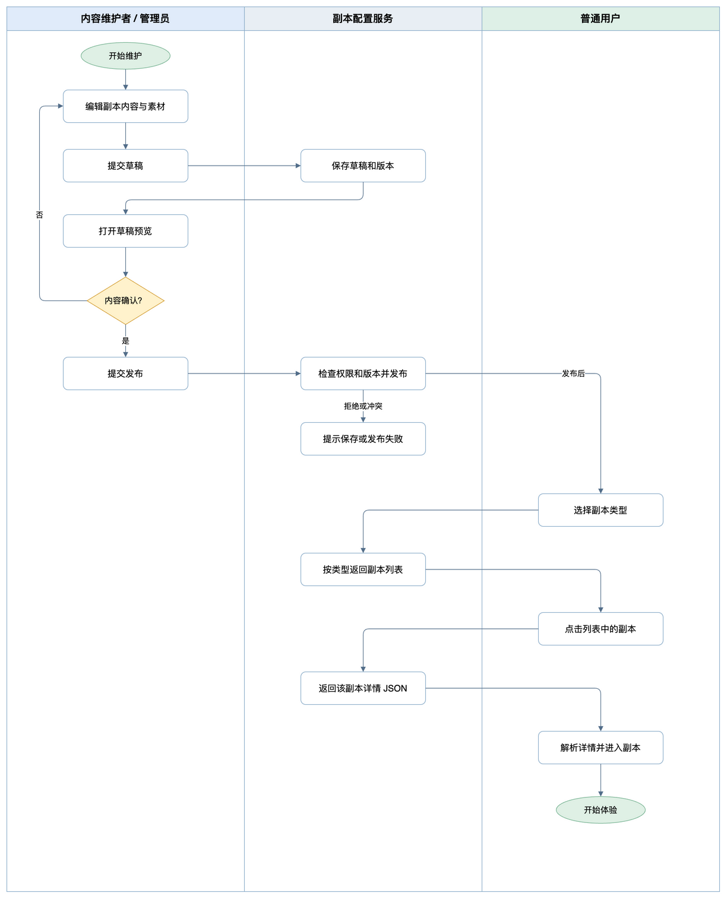
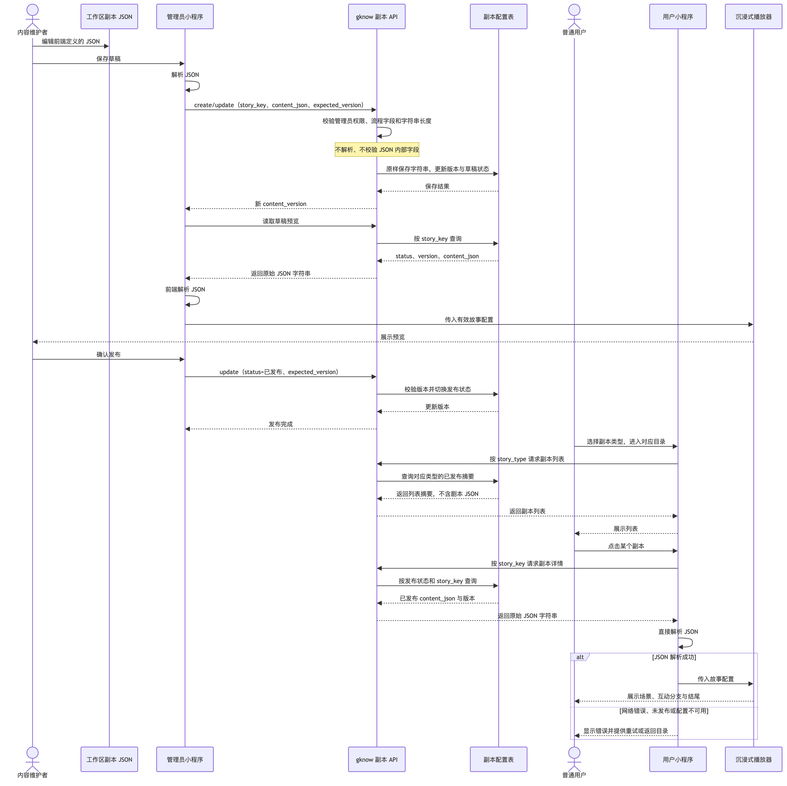

# 鹅懂个啥副本配置化方案

> 状态：首版已实现，test 库已建表并导入 8 篇未发布草稿；待部署和微信端预览。后端内容字段采用普通字符串，副本 JSON 字段由前端定义。

## 需求与范围

1. **让剧本可以独立更新。** 内容维护者调整现有副本或新增副本后，通过管理接口保存并发布，已安装的小程序即可读取新内容，不因剧本文字、分支或场景数据变化而重新发版。
2. **分开管理流程和内容。** 后端管理稳定标识、发布状态、内容版本、排序、操作者和时间；后端将完整 JSON 当字符串存取，不解析、校验、筛选或转换其内部字段。
3. **复用现有播放体验。** 小程序沿用现有故事类型，直接解析 JSON，根据稳定副本 ID 获取配置，并继续交给现有沉浸式播放器展示。
4. **迁移现有副本。** 将当前有效的故事目录与故事内容从静态 TS 注册改为 JSON 配置并经后台发布，使副本入口统一从服务端取得内容。剧情和入口 ID 保持现状。

**当前状态**　当前故事以 TS 数据文件静态打包；多个副本类型页面各自取得 `storyId` 并调用 `getImmersiveStory`，之后共用 `ImmersiveStoryPlayer`。现有测试配置后端模型会解析 JSON 为 Go 固定结构并校验；本方案不复用该内容模型。

**已确定**　后端只负责控制记录和发布流程；内容 JSON 是后端不透明字符串。前端独立维护 JSON 结构和播放器映射，直接解析返回内容。不建设可视化编辑后台，配置由工作区文件维护并由管理员接口保存、预览、发布。复用已有后端管理员/AppID 校验、版本并发控制和小程序登录请求链路。

**范围边界**　本期覆盖现有已上线的沉浸式故事及其目录入口，保持剧情内容、仍存在的副本 `storyId` 分享地址、埋点标识和播放行为。普通文本、分支选项、背景等都属于前端定义的 JSON。后端按副本类型筛选目录、按记录 ID 查询详情；目录摘要单独保存，不读取详情 JSON 内部字段。

**待验证**　开发阶段核实后端请求体与网关大小限制能否承载最长副本 JSON，并只读确认 test 库 schema；若实际限制低于现有配置长度，再提出与用户确认具体上限或传输方案。方案不假定当前数据库状态，也不在确认前执行 DDL。

## 整体方案

1. **新增副本配置业务记录。** 在后端建立独立的副本配置表和 `/gknow/story` API，不在已有测试表中增加类型或共用测试 DTO。记录保存副本标识、类型、目录摘要、状态、内容版本、排序、配置 JSON 字符串及操作者和时间。
2. **JSON 由小程序拥有。** 小程序沿用 `ImmersiveStoryDefinition` 描述内容结构。后端只存取字符串；前端收到详情后直接解析 JSON 并传给播放器，解析失败时显示内容加载失败。无需额外的 schema 版本、迁移器或完整性校验框架。
3. **按类型获取列表，再加载详情。** 小程序根据 `story_type` 请求副本列表；列表仅返回标识、类型、标题、简介、封面、状态和排序等摘要，不包含剧本 JSON。用户点击某项后按 `story_key` 请求详情，前端解析返回的 JSON 字符串并进入现有播放器。
4. **以草稿预览和发布切换内容。** 管理员创建记录时状态为未发布。保存/更新只替换当前 JSON 并递增 `content_version`；管理员详情允许预览草稿，普通用户列表只见已发布记录、详情只可读取已发布记录。发布请求用预期版本号防止覆盖并发修改。发布后的配置更新会立即对客户端生效；要预览修改，先转为草稿，再更新、预览、发布。
5. **一次切换现有故事入口。** 将当前有效故事导出为 JSON 配置，通过管理员 API 写入 test 服务并由负责人预览发布；小程序删去对应的静态内容注册和旧的本地详情路径，目录与分享落点使用稳定 ID 进入服务端配置。小程序需发布一次以接入远端读取；之后只改副本 JSON 无需重新发布小程序。此后不保留同一故事的本地静态回退路径。

## 使用流程

内容维护者在小程序项目 `docs/content/stories/{story_key}/` 维护并备份前端定义的副本 JSON 和素材，经管理员接口创建或更新草稿。小程序管理员预览使用正式目录、加载和播放器链路，但读取未发布配置。确认后通过状态更新发布。普通用户先按人生、恋爱或理财副本类型请求对应列表；点击某条副本后，小程序请求该副本详情，直接解析 JSON 并交给播放器。用户分享的 URL 使用后端返回的 `story_key` 作为 `storyId`；副本删除、下线或标识不存在时提示不可用，不重定向到其他副本。

业务泳道图按责任角色展示编辑、预览、发布和普通用户播放过程；系统时序图展示各客户端、API 和数据库的调用顺序。两图共同强调后端只保存和返回原始 JSON 字符串，前端负责解析和播放器映射。

**业务泳道图：** [可编辑原稿](assets/story-business-flow.drawio)



**系统时序图：** [可编辑原稿](assets/story-config-flow.drawio)



读取失败、记录未发布或 JSON 解析失败时，页面显示明确错误和返回目录/重试操作，不以静态旧内容冒充最新发布版本。

## 任务拆分与实施顺序

| 顺序 | 子任务与交付物 | 前置依赖 | 验收方式与结果 | 状态 |
| --- | --- | --- | --- | --- |
| 1 | **定义前端配置契约。** 沿用现有故事类型，将故事整理为可解析 JSON | 方案确认 | 所有现有故事可序列化和解析，分支和播放器字段无损 | 待开始 |
| 2 | **建立后端记录和流程 API。** 新表、list/detail/create/update，字符串原样存取，管理员与 AppID 校验、发布状态、内容版本并发保护 | 1；test 库只读核验及 DDL 授权 | API 权限、状态、版本、原始字符串往返正确；真实 test 接口验证 | 待开始 |
| 3 | **接入小程序远端目录与播放。** 目录/详情/预览连接 API，前端解析配置并复用现有播放器，处理失败状态 | 1、2、共享契约更新 | 目录、详情、预览可观察到正确故事和失败提示 | 待开始 |
| 4 | **迁移现有故事并切换入口。** 导入所有当前有效副本 JSON，负责人预览发布；移除对应静态副本数据，保留现有故事 ID | 1—3 | 每个入口及历史分享 ID 加载同一后端正式版本，不走旧路径 | 待开始 |
| 5 | **完整验收和交付。** 验证微信目标端目录、播放、分享与发布变更；回填任务记录 | 4；test 服务部署 | 目标端通过场景矩阵，未完成项和部署状态有明确记录 | 待开始 |

## 功能模块设计

### 1. 管理端副本配置

1. **创建草稿。** 管理员传入稳定 `story_key`、`story_type`、目录摘要、排序和 `content_json`；后端校验管理员/AppID、标识唯一、字符串非空与字节限制，创建 `status=0, content_version=1` 的记录，不解析 JSON。
2. **更新内容。** 管理员传 `story_key`、`expected_version` 和完整 `content_json`；后端按标识及当前版本更新字符串并将版本加一。版本不匹配返回冲突，调用者重新读取后决定是否覆盖。
3. **切换发布状态。** 管理员传目标状态和 `expected_version`；状态和版本在同一更新中变更。内容更新与发布状态变更可以同一请求原子完成。普通用户无法更改状态或内容。
4. **预览草稿。** 管理员可读取草稿 JSON；小程序解析后使用正式播放器预览。若 JSON 解析失败，页面报告配置问题，不写入正式播放状态。

### 2. 普通用户目录与详情

1. **浏览目录。** 目录页传入 `story_type` 分页请求对应类型的已发布记录，按 `display_order, story_key` 稳定排序。后端返回独立保存的标题、简介和封面摘要，不返回完整剧本 JSON；前端按摘要绘制卡片。
2. **打开副本。** 点击列表项后请求详情；入口与分享路径继续携带现有 `storyId`，分享直达可跳过列表；详情接口按 `story_key` 返回状态、版本及原始 JSON。前端解析 JSON，再交给现有 `ImmersiveStoryPlayer`。
3. **处理异常。** 加载中显示页面状态；网络失败提供重试；不存在、未发布或权限不足提示返回目录；JSON 解析失败时提示内容暂不可用，并记录脱敏诊断，不记录整份剧本或用户信息。
4. **处理缓存。** 首期不缓存完整副本配置和播放进度，避免发布后继续播放旧剧本；每次进入详情读取服务端当前版本。图片由小程序静态资源或 HTTPS URL 引用，图片目标端访问在验收中核实。

### 3. 前端解析与播放器

1. **直接解析。** 沿用现有 `ImmersiveStoryDefinition` 类型；详情返回后调用 `JSON.parse`，将结果交给播放器。捕获解析错误并展示加载失败，不增加场景引用、可达性、ID 一致性或 schema 版本校验。
3. **保持单一播放器。** 三类副本入口统一使用已存在的 `ImmersiveStoryPlayer` 和 `ImmersiveStoryDefinition` 业务呈现逻辑；本期不借配置化重做播放器视觉或引入远程执行代码。
4. **内容结构演进。** 内容结构由前端维护；实际改版时按具体需求处理，不预设版本迁移机制。

## 接口与契约

所有端点沿用 `/api/so`、现有 JWT 和业务信封。管理接口额外在 Service 校验 `ctx.IsAdmin()` 与 gknow AppID，不能依靠页面门禁。契约统一进入 `frontend-contracts/openapi/gknow_story_api.yaml`，uni-gknow 从 `src/contracts` 子仓消费。

| 方法与路径（省略 `/api/so`） | 请求 | 响应与权限 |
| --- | --- | --- |
| `POST /gknow/story/list` | 必填 `story_type`，`offset`、`size`、可选 `include_unpublished`（仅管理员可用） | `total`、`list[]`；每项为 `story_key`、`story_type`、`title`、`summary`、`cover_url`、`status`、`content_version`、`display_order`，不含 `content_json`。普通用户仅返回已发布配置；管理员可选择含草稿 |
| `GET /gknow/story/detail` | query：`story_key` | `story_key`、`status`、`content_version`、`content_json` 字符串；普通用户只读已发布，管理员可读草稿 |
| `POST /gknow/story/create` | `story_key`、`story_type`、`title`、`summary`、`cover_url`、`display_order`、`content_json` | 创建未发布记录，返回 `content_version=1`；管理员 |
| `POST /gknow/story/update` | `story_key`、`expected_version`、`story_type`、`title`、`summary`、`cover_url`、`content_json`、`status`、`display_order` 均可选 | 至少包含一个更新字段；原子更新并返回新版本；管理员 |

`story_key` 沿用现有 `storyId`，保持 ASCII 小写字母、数字和连字符，长度上限 64 字符；`status` 为整数 `0=草稿、1=已发布`，仅表示流程。列表默认 `offset=0,size=20`，最大 `size=100`。`story_type` 首期建议为 `life`、`love`、`finance`，由后端作为分类字段筛选；目录摘要是独立字段，与前端定义的详情 JSON 分开维护。

后端只对 `content_json` 做非空和 UTF-8 字节长度检查（具体限制以实际 DB、服务与网关限制核实后确定），写读时保证内容字节语义不变，不对 JSON 解码、重排、裁剪字段或做字段校验。版本更新采用 `story_key + expected_version` 条件更新，冲突返回现有 `IllegalOperation`；无权限 `NoPermission`、非法流程参数 `ParamError`、不存在/未发布 `NotFoundError`、数据库异常 `DBError`。业务 API 不能把未发布记录内容返回给普通用户，即使直接传入 ID。

请求示例（草稿保存，配置字符串内部格式仅作例子，后端不理解其字段）：

```json
{
  "story_key": "love-speedrun",
  "expected_version": 3,
  "content_json": "{\"id\":\"love-speedrun\",\"scenes\":[]}"
}
```

发布请求可以只传 `story_key`、`expected_version`、`status=1`；或和新版 `content_json` 一起原子更新。状态更新及 JSON 更新都递增同一个 `content_version`。不提供草稿历史/回滚版本存储；需要回退时由维护者从版本管理中的 JSON 文件恢复，再保存为新版本。

## 数据设计与迁移

新增 `gknow_story_tab`，与 `gknow_assessment_tab` 分表、分 DTO、分 Service。内容采用 `MEDIUMTEXT` 原文字符串（MySQL 最大约 16 MiB），满足长剧本及转义后的 UTF-8 内容；请求经过的服务和网关仍需按实际部署配置核对大小限制。表中另存副本类型及目录展示所需标题、简介、封面；列表按类型读取这些摘要字段，详情 JSON 只在请求具体副本时返回。后端不解析详情 JSON。

建议 DDL（开发阶段先只读核对目标库、表规范与索引；DDL 需按工作台数据库授权流程确认后执行）：

```sql
CREATE TABLE `gknow_story_tab` (
  `id` bigint NOT NULL AUTO_INCREMENT COMMENT '主键ID',
  `story_key` varchar(64) CHARACTER SET ascii COLLATE ascii_bin NOT NULL COMMENT '副本稳定标识',
  `story_type` varchar(32) CHARACTER SET ascii COLLATE ascii_bin NOT NULL COMMENT '副本类型',
  `title` varchar(128) NOT NULL DEFAULT '' COMMENT '目录标题',
  `summary` varchar(512) NOT NULL DEFAULT '' COMMENT '目录简介',
  `cover_url` varchar(1024) NOT NULL DEFAULT '' COMMENT '目录封面地址',
  `display_order` int NOT NULL DEFAULT 0 COMMENT '目录排序，数值越小越靠前',
  `status` tinyint unsigned NOT NULL DEFAULT 0 COMMENT '发布状态：0草稿，1已发布',
  `content_version` int unsigned NOT NULL DEFAULT 1 COMMENT '副本配置版本号',
  `content_json` mediumtext NOT NULL COMMENT '前端定义的副本配置 JSON 原文，不解析',
  `created_by` varchar(64) NOT NULL DEFAULT '' COMMENT '创建者标识',
  `updated_by` varchar(64) NOT NULL DEFAULT '' COMMENT '最后修改者标识',
  `create_time` int unsigned NOT NULL DEFAULT 0 COMMENT '创建时间，Unix秒',
  `update_time` int unsigned NOT NULL DEFAULT 0 COMMENT '更新时间，Unix秒',
  PRIMARY KEY (`id`),
  UNIQUE KEY `uniq_story_key` (`story_key`),
  KEY `idx_type_status_order` (`story_type`, `status`, `display_order`, `story_key`)
) ENGINE=InnoDB DEFAULT CHARSET=utf8mb4 COLLATE=utf8mb4_unicode_ci COMMENT='鹅懂个啥副本配置';
```

历史内容来自业务仓已提交的 TS 数据：life、love、finance 副本配置与三个目录数组；按 `story_key` 导出 JSON。无老用户答题结果或服务端播放状态需要迁移；仍存在的副本沿用其 `storyId`；已删除或不存在的标识不在前端映射到其他副本。上线切换前确认现有有效故事数量和入口 ID，全部配置导入 test 后逐项回读并预览；只有全部正式发布且小程序读取链路就绪后，移除静态配置并部署新版客户端。回滚时恢复上一版小程序代码和静态数据，并将受影响记录下线；不删除数据库内容。回滚会使远端新内容暂时不能显示，恢复旧包与数据库发布状态后核验旧入口。

## 改动范围与复用依据

| 仓库 / 文件落点 | 职责与复用点 |
| --- | --- |
| `backend-superone/app/api_service/api_gknow.go`、`app/api_service/api_service.go` | 注册副本列表、详情、创建、更新路由和 UseCase 依赖；对照当前 assessment 路由组织，不复用其 DTO |
| `backend-superone/use_case/story_use_case.go`、`use_case/wire.go`、`use_case/wire_gen.go` | 入口转发与依赖注入，沿用现有 Wire 生成方式 |
| `backend-superone/internal/domain/story/story_dto/`、`story_service/`、`internal/repo/story_repo.go` | 副本 API DTO、权限/状态/版本规则、记录查询；Service 不反序列化内容 |
| `backend-superone/internal/model/gknow_story_tab.go`、数据库迁移目录 | 管理字段和 `content_json string` 映射；单独迁移建表 |
| `frontend-contracts/openapi/gknow_story_api.yaml`、生成/维护的 `apis/story.ts` 与 `types/story.ts` | 跨端唯一接口契约；字符串类型承载原始 JSON，管理枚举只表达状态 |
| `uni-gknow/src/types/immersiveStory.ts`、新建 `src/types/storyConfig.ts` / `src/utils/story-config.ts` | 前端故事类型与 JSON 解析，复用现有播放器，不新增校验或迁移框架 |
| `uni-gknow/src/data/immersiveStories.ts` 与 `src/data/*Story*.ts` | 改为工作区 JSON 配置资源与管理上传源；移除正式播放所用的静态故事注册/回退 |
| `uni-gknow/src/data/*CopyCatalog.ts`、`src/pages/game/life-copy/`、`src/pages/game/love-copy/`、`src/pages/game/finance-copy/`、`src/components/story/ImmersiveStoryPlayer.vue` | 切目录、详情、分享到服务端数据；保留共享播放器。若页面可收敛到共用目录/故事页，在实现前按单一实现原则核对并合并调用入口 |
| `uni-gknow/src/contract.ts`、`src/apis/` 或契约生成路径、`src/contracts` | 按当前项目绑定方式连接共享接口；更新子模块指针需遵守仓库规则 |
| `task/dev-flow/QB82_gknow-story-config/` | 配置样例、迁移清单、方案和实现过程记录 |

主要对照依据：`src/components/story/ImmersiveStoryPlayer.vue` 已接收故事配置并处理播放、互动和结尾；`src/types/immersiveStory.ts` 定义当前字段；`src/data/immersiveStories.ts` 是本地按 ID 注册入口；life/love/finance 各自目录和故事页读取本地配置。后端对照 `api_gknow.go` 与现有 assessment 路由、UseCase、Service、Repo、Model 和管理员校验，但副本持久化类型及校验边界独立实现。测试配置现有 `GknowAssessmentContent` 固定 Go 结构拒绝未知字段，不能作为副本内容模型复用。

## 验收与验证

| 场景 | 操作 | 预期结果 | 环境 |
| --- | --- | --- | --- |
| 原始字符串保存 | 管理员保存含中文、转义符、长段落和嵌套数组的配置，再读取详情 | 返回的 `content_json` 与保存内容一致；后端不依赖字段、接受新增字段 | 后端单测 + test API |
| JSON 解析 | 读取有效配置及语法损坏的 JSON | 有效 JSON 交给播放器；解析失败显示加载失败 | 微信页面 + test 服务 |
| 管理权限 | 普通用户尝试创建、更新或读取草稿；其他 AppID 管理员尝试管理 | 请求被拒绝；普通用户只取已发布内容 | 后端 HTTP 测试 + test 服务 |
| 状态与目录 | 新建草稿、发布、下线；普通用户按类型读取列表并点击某个副本 | 列表只包含指定类型的已发布摘要，且不包含正文 JSON；点击后才请求详情并进入副本 | test 服务 + 微信端 |
| 并发版本 | 两个管理请求使用同一 `expected_version` 更新同一故事 | 首个更新递增版本；后一个收到冲突且不覆盖新内容 | 后端测试 + test API |
| 副本迁移 | 对照迁移清单逐条保存现有故事并在小程序预览、发布 | 现有 ID、标题、目录顺序、故事正文、选项跳转和结尾一致 | test 服务 + 微信开发者工具 |
| 目录/详情失败 | 模拟网络失败、空目录、记录不存在、未发布和错误配置 | 各状态文案可区分，支持重试或返回目录；不显示静态旧版伪装成功 | 微信开发者工具 + test 服务 |
| 播放与分享 | 从目录及已有分享 `storyId` 打开每类副本，完成主线和代表性分支 | 进入相同故事，播放器逐幕、选项、跳转、结尾与分享落点正确 | 微信开发者工具/真机 |
| 热更新内容 | 更新已发布配置中的可观察文字/场景后再进入 | 已安装小程序读取当前版本；无需重新编译发布小程序 | test 服务 + 已安装目标端 |
| 内容规模 | 使用当前最长副本及图片 URL，检查列表仅含摘要、详情 API 响应大小与时延 | 请求在实际代理限制内成功，页面可加载；若超限则停止发布并排查详情传输链路 | test 服务 + 微信目标端 |
| 编译回归 | 运行项目约定的类型检查及微信构建 | 类型检查与小程序构建通过，旧静态数据路径无未使用调用 | uni-gknow 本地 |

真实后端部署、test 库迁移和微信目标端交互分开记录；编译通过不代表 API 或微信页面验收通过。小程序按业务仓规范由 Agent 执行 `npm run type-check` 与 `npm run build:mp-weixin`；微信开发者工具/真机体验由负责人确认，除非另行要求。

## 风险与回滚

1. **JSON 过大或目录传输负载。** 先用真实最长副本核对 MySQL 字段、Go/HTTP 处理和反向代理限制。`MEDIUMTEXT` 的数据库容量不保证所有 HTTP 链路接受同样大小；发现上限不足时先调整部署限制或调整详情传输方案，不丢字段或截断字符串。
2. **内容与播放器不匹配。** 内容维护时通过真实播放器预览，确认场景与互动符合预期；解析失败显示加载失败。
3. **发布内容立即生效。** 更新已发布内容会影响下一次进入的用户。管理员先下线为草稿、预览后发布；历史 JSON 通过工作区 Git 版本追溯，不依赖线上历史版本表。
4. **统一切换时远端不可用。** 只有 test 环境 API 和迁移内容经端到端验证后才移除静态路径；若上线后服务端异常，按回滚步骤恢复上一版小程序与其静态数据。若项目不允许重新发布旧包或需保留离线播放，应在方案确认前明确选择并设计兼容流程。
5. **数据库变更。** 建表 DDL 不覆盖已有表。开发阶段先核对 test 目标库、现有同名表和备份/恢复方式；未获得明确 DDL 授权前不执行写操作。

## 落地记录

首版实现、test 建表、草稿导入和实际验证记录见 [开发过程](../process/03-开发与迭代.md)。后端尚未部署，微信端和分享链路待验收；草稿未发布。
