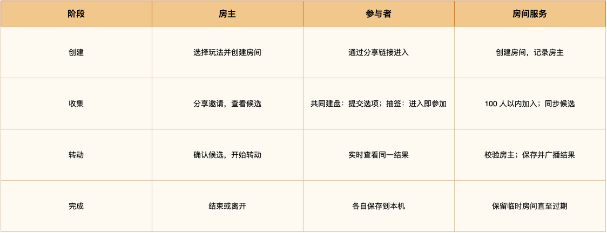
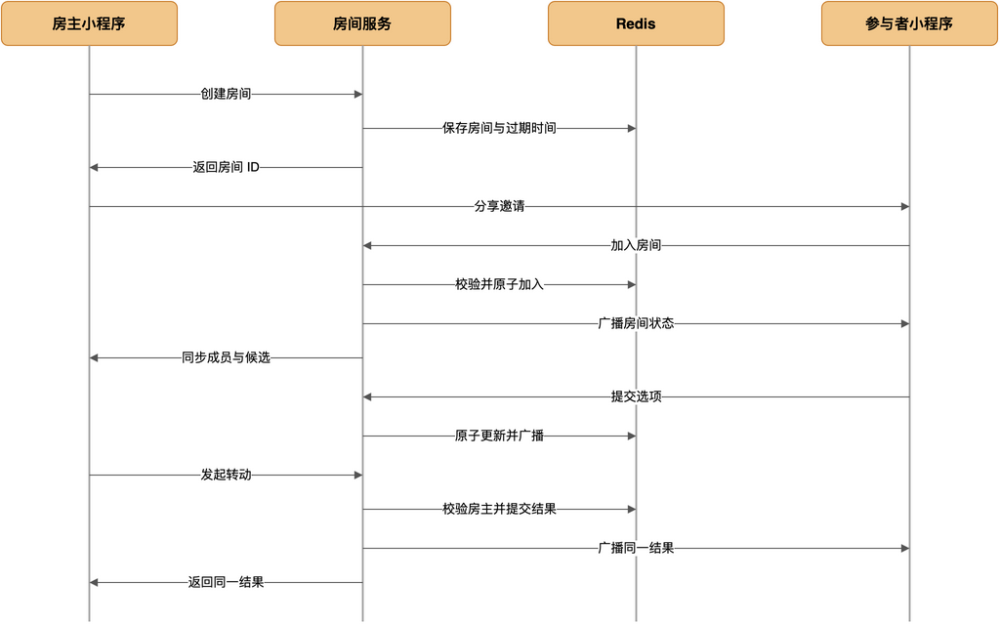

# 多人转盘与抽签玩法

> **当前实现**：按朋友间使用场景复用通用实时房间 `/api/so/realtime-room/ws`。后端负责成员、可选匿名标识、房主专属数据、版本原子写入、TTL 和通知。抽签、冻结候选、结算、结果展示及本机保存由小程序处理。房主离线时，未完成的轮次等房主恢复后结算。100 人是房间配置上限，沿用现有快照和通知机制。以下原方案的专用接口、服务端抽签和大房间分页设计已被这一方案替代，保留作决策记录。

## 需求与范围

1. **共同建盘。** 房主创建房间并邀请其他人，参与者提交选项；房主转动，所有人看到同一个结果。
2. **抽签转盘。** 房主直接创建并分享抽签房间；加入的用户成为候选人，房主本人也参加。抽中后默认保留，房主可手动移出，之后可以重新加入候选。
3. **100 人房间。** 每个房间最多 100 人，包含房主；沿用当前房间最长 2 小时的过期时间。该数字是目标，需验证现有部署能否承载。
4. **本地留存。** 每个参与者收到最终转盘和结果后保存到自己的设备；房间只提供临时协作状态。断线者在房间有效期内重连后获取快照并补存，过期后不能保证补存。

**已确认**：实时转动由房主发起；参与者自动成为抽签候选；抽中后默认保留并可手动移出；房主也参加。**实现假设**：断线或退到后台不自动移出候选，显式退出才移出；昵称相同也按不同用户区分；未设置昵称时提供可辨认的默认显示名。这些行为应在验收前与用户核对。

**当前状态**：本地开发已接通，待 test 环境部署和真实多人验收。现有通用房间限制 8 人、最长 7200 秒、共享数据 32768 字节，且每次广播由各连接查询成员状态；现有通用房间不执行转盘玩法权限，不能仅靠客户端隐藏按钮保证只有房主能转。

## 整体方案

1. **共用实时房间与转盘展示。** 沿用小程序 `RoomSocket`、登录身份、WebSocket 连接和现有转盘绘制；两种玩法使用独立的房间类型和相同的房主控制流程。
2. **服务端维护房间身份与动作。** 服务端从认证上下文取得用户身份，在房间中记录房主；加入、提交选项、移出候选、转动和结束等动作按房间类型及身份校验。以稳定用户 ID 区分成员，昵称只用于显示。
3. **用 Redis 保存临时房间和结果。** 所有状态变更通过原子操作完成，客户端重试使用请求 ID 防止重复提交；事件仅通知变化，重连通过权威快照恢复。已有默契小游戏房间继续使用原语义。
4. **100 人避免整包广播。** 选项、成员和历史分开存储并分段读取，实时事件只推送变更与版本，避免每次加入或提交时把完整数据广播给每个连接；Redis 中房间及关联数据按同一有效期清理。设计需验证 Redis 原子更新、版本冲突和跨实例广播。
5. **结果由服务端确定并持久于房间有效期内。** 房主请求转动时，服务端从当前有效候选中等概率选出结果并生成唯一轮次，原子提交后通知参与者。客户端基于同一轮次播放动画；断线恢复时以保存的结果为准，结果与动画一致，不以客户端计时作为结果事实源。

## 使用流程与图

房主选择共同建盘或抽签，创建房间并分享邀请。共同建盘由参与者提交选项；抽签由加入的成员构成候选。房主开始后，所有人展示同一结果；参与者设备各自保存已收到的结果和转盘副本。

[业务泳道图原稿](assets/多人转盘业务流程.drawio) · [预览](assets/多人转盘业务流程.png)

[系统时序图原稿](assets/多人转盘系统时序.drawio) · [预览](assets/多人转盘系统时序.png)

## 功能设计

### 房间与候选

- 用户从大转盘入口选择多人共同建盘或抽签，房主创建后获得邀请入口；相同账号重连恢复原成员，不重复加入。房间满员、过期或连接失败给出明确反馈和重试入口。
- 抽签候选以房间成员为来源，包含房主；断线成员保留，显式退出移出候选。房主可手动移出或重新纳入候选，用户同名时不合并。
- 共同建盘允许参与者提交选项，房主与参与者都能看见完整候选；提交使用稳定 ID 和幂等请求 ID。选项数量沿用单盘最多 500 项，满额时提示。
- 开始转动至少需要两个有效候选。转动中锁定本轮候选快照；新加入或退出及选项修改影响下一轮，不改变正在进行的结果。

### 转动、同步与本机历史

- 房主发起后服务端验证房主及当前状态，并在房间内原子生成轮次与结果；参与者只接收和展示，不能发起转动或更改结果。房主手动停止沿用现有交互时，需以服务端最终确认的结果为准，动画和结果一致。房主停止和到时自动停止使用同一次服务端结算，已结算的轮次不会重复写入。
- 每轮只写一条结果；重复请求和重连不重复记本地历史。各设备按房间 ID、轮次 ID 去重保存结果与对应的转盘副本。
- 房主断线时房间等待重连，不自动转移房主；其他成员仍可查看现有状态。房间到期前重连可恢复；到期后展示已结束，本机已保存数据保留。

## 接口与数据

- 专用 `GET /api/so/realtime-wheel/ws` 复用通用房间的认证和传输方式，服务端按房间成员与房主身份校验动作。
- 房间保存类型、房主 ID、成员集合、版本、到期时间和轮次状态；候选使用稳定 ID 存储，抽签以用户 ID 关联；结果保存轮次 ID、候选 ID、显示快照与时间。Redis 临时数据不新增业务 SQL 表。
- 需为 100 人房间单独评估现有房间上限、32 KB 消息限制、Lua 计算及 Redis Pub/Sub 放大；不为现有双人游戏改变业务语义。分段快照、增量推送与过期清理由服务端保证，房间过期与写入不能产生永久孤儿数据。
- 前端继续把最终转盘和历史存储在当前设备，不提供账号云同步；本地存储失败需明确提示，不能把收到广播当作保存成功。

## 埋点与验证

- 复用现有功能埋点，覆盖创建、加入、提交、房主转动和完成；避免记录选项内容或用户隐私文本。
- 业务验收：两种玩法各覆盖创建、邀请、多人加入、房主转动、同一结果、重复请求、断线重连、房间满员与过期、本地重进和保存失败；抽签覆盖房主参与、同名用户、结果保留及手动移出。
- 容量验收：在授权的 test 环境测 100 人并发加入、提交、广播、重连与多实例，记录成功率、延迟及 Redis 负载；不能以 Go 编译成功或两人联调推断 100 人可用。HTTP + DB autotest 不适用于纯 Redis 临时房间，真实 WebSocket 和 Redis 链路按实际环境验收。
- 微信开发者工具与真机多账号验证是目标端验收；不使用 H5 模拟替代。类型检查、构建只证明编译。

## 交付顺序与风险

1. 确定动作协议、容量与身份模型，完成服务端权限和房间数据设计。
2. 实现多人房间与 100 人消息处理，再实现抽签候选和共同提交；保持默契游戏回归范围。
3. 接入房主转动、参与者同步、每台设备本地副本及历史；之后在 test 环境验证并决定部署。

100 人容量尚未验证；Redis 临时房间过期或丢失后无法为离线设备恢复未保存数据。取消本功能可关闭多人入口并回退房间服务，已写入本机的转盘副本保留；Redis 临时房间自然过期。

## 动作协议

多人玩法使用专用 `/api/so/realtime-wheel/ws`，复用现有 WebSocket 认证和连接封装，不改变默契游戏的通用房间行为。请求沿用 `id`、`action`、`roomId`、`data` 的信封；每个成功的状态变更返回最新 `version`，广播只含版本和变更标识。错误码包括 `expired`、`full`、`forbidden`、`conflict`、`invalid` 和 `unavailable`。所有身份从服务端凭证取得，不接受客户端提交的房主或成员身份作为授权依据。

| action | 执行者 | data 核心字段 | 动作与结果 |
| --- | --- | --- | --- |
| `create` | 任意已登录用户 | `kind`：`collect` 或 `people`；`title` | 创建 100 人房间并确定房主，返回随机 roomId、版本与到期时间。 |
| `join` | 受邀用户 | 显示名和可选头像 | 原子加入或按用户 ID 重连；抽签模式确保每人只有一个候选。 |
| `snapshot` | 房间成员 | 可选分页游标 | 返回房间状态、成员与候选分页、轮次及版本；加载过程中版本变化则重新同步。 |
| `add_option` | 共同建盘成员 | 请求 ID、选项文字 | 原子追加选项，最多 500 项；相同请求 ID 重试返回原结果。 |
| `set_candidate` | 房主 | 候选 ID、是否参与、期望版本 | 更新本轮之后的候选状态；抽签结果保留，房主可手动移出或恢复。 |
| `start` / `stop` | 房主 | 请求 ID、期望版本 | 按状态校验发起或停止；服务端确定唯一轮次及最终结果，重复请求不得产生第二个结果。 |
| `finish` / `leave` | 房主 / 成员 | 请求 ID | 房主结束房间或成员主动退出；结束状态保留至 TTL 过期以供成员补存。 |

事件与快照中的用户标识采用房间内稳定标识，不向其他成员公开 OpenID；显示名仅用于界面和本地结果。昵称重复不能影响抽中对象的区分。开始阶段固定当前候选快照；房主手动停止或自动到时后服务端只提交一次结果。各客户端收到最终结果后对齐该结果完成动画，断线重连无需重播错过的动画。

Redis 分别保存房间元信息、成员映射、候选集合、按序结果及幂等标记；所有关联 key 使用同一绝对过期时间。关键变更使用同槽原子操作更新状态和版本，广播只携带房间 ID 与版本；按需拉取分页或变化。房间数量、活跃连接量、结果历史增长和每用户操作次数的实际容量须在 test 环境测量，不凭 100 人目标推断服务器承载力。

## 落地记录

- 后端通过 Redis Lua 原子变更房间状态，成员、候选、本轮冻结名单和结果分别存储，每个服务实例共用一个 Redis Pub/Sub 订阅。客户端收到版本通知后读取元信息，连续版本应用单条变更，跨版本或首次连接再分页补齐。刷新和重连读取已有轮次。
- 小程序在大转盘增加共同建盘和抽签入口，房主分享邀请和控制转动。抽签昵称显示房间内编号，参与者可以区分同名账号。转出结果或结束后保存转盘和按轮次去重的历史。房主可从转盘入口继续上次未过期的房间。
- 后端代码和 Redis Lua 脚本已编译，前端契约和小程序构建已检查。待部署 test 后核对新 WSS 路径、微信多账号流程、断线恢复和 100 人房间的实际容量。
