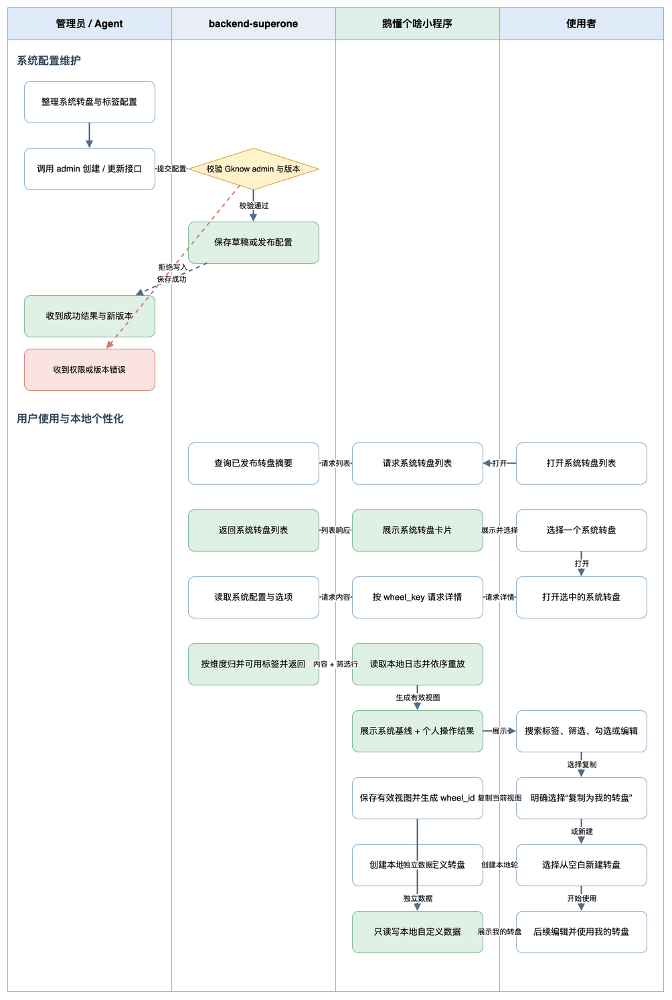
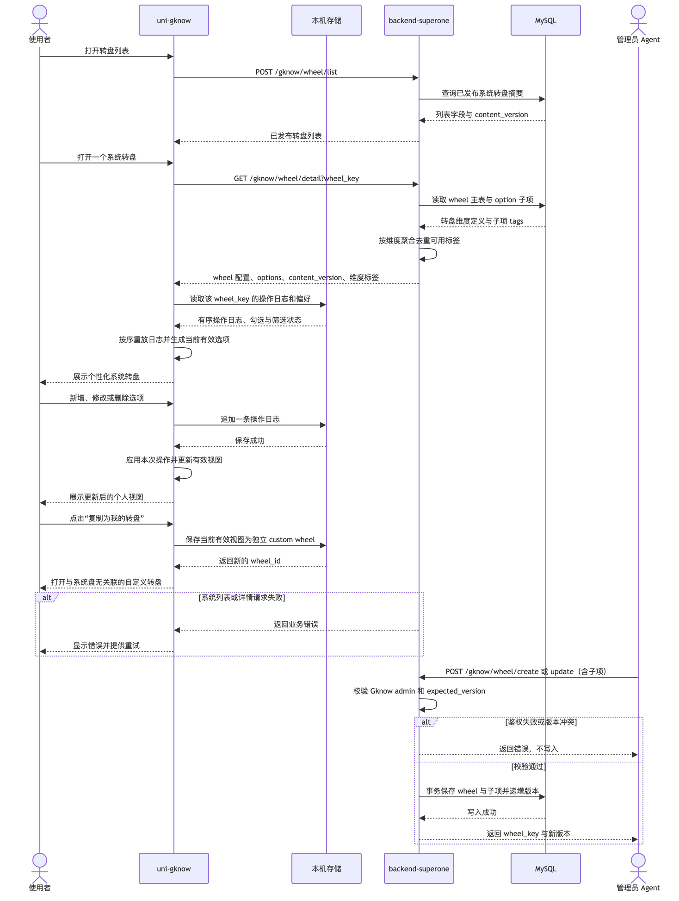

# 大转盘远程配置方案

## 需求与范围

1. **远程维护系统转盘。** 使用者打开大转盘时读取后端已发布的转盘列表；Agent 通过 Gknow admin API 创建、编辑、排序、发布、下架或删除系统转盘，不建设管理后台。
2. **远程维护系统选项。** 每个系统转盘的分类、地区筛选和候选项由后端配置提供；Agent 更新候选内容后不需要重新发布小程序。
3. **用本地操作日志个性化系统转盘。** 普通用户只读系统配置；新增、修改、删除系统选项只在本机追加操作日志，读取远程系统配置后重放。只有用户明确点击“复制为我的转盘”时，才物化为独立自定义转盘。
4. **保持转盘玩法。** 转动、随机结果、Canvas 绘制、结果分享和选项数量上限继续由小程序实现；选项元数据按远程配置驱动显示。

**当前状态**　后端、共享契约与小程序代码已实现，test 两表已创建但仍为空；下一步是导入首批 3 个系统转盘并完成真实 API 与微信端验收。当前首批仍是「今天吃什么」46 项、「深圳周末去哪逛」56 项、「周末玩点啥」100 项，合计 202 项；去哪玩首批数据仍为深圳内容，后续可扩充全国及其他国家地区。

**已确定**　用户确认采用盲盒测试和人生副本的管理方式，由 Agent 通过 admin 接口维护系统转盘列表和选项。

**用户确认的范围**　系统转盘由 admin 维护且用户只读；个性化改动按 `wheel_key` 保存为本地操作日志；明确复制或从零创建时保存独立自定义转盘；标签按维度分组；全部用户数据留在当前设备，本期不做账号云同步。

**已确定的筛选规则**　同一筛选维度内选中的标签按 OR 匹配；不同已选维度之间按 AND 匹配；未选择的维度不参与过滤。

## 整体方案

1. **复用 Gknow 副本配置的 admin CRUD 模式。** 在后端新增 wheel 域，按 Gknow AppID 与 admin 身份授权；普通用户只读已发布转盘，管理员可读草稿并创建、更新和发布。复用内容版本号避免覆盖并发修改的配置。
2. **用两张表保存系统转盘。** `gknow_wheel_tab` 保存转盘元数据、版本、页面文案和筛选维度；`gknow_wheel_option_tab` 每个候选项一行，保存稳定 option key、名称、维度 tags、排序及扩展信息。详情 API 聚合两表并返回 options 与按维度归并出的可用标签。
3. **小程序只消费后端转盘清单。** 列表页完全由已发布 API 响应驱动；详情按列表中的 `wheel_key` 读取转盘配置。小规模转盘使用 `direct` 模式随详情加载选项；预计超过 500 项的转盘使用 `filter_first` 模式，先显示城市和标签筛选，再通过分页搜索加载候选。前端不内置 wheel key、默认转盘或旧主题映射；删空全部系统转盘时显示空态，后端新增任意 wheel 后即可展示。
4. **每次加载后重放本地操作。** 系统详情每次从远端读取，随后按序重放该 `wheel_key` 下的本地新增、修改、删除日志；不持久化系统数据副本，不为用户日志维护版本，也不做系统同步流程。系统 API 返回的 `content_version` 仅用于系统配置并发更新和可选的内存缓存键。
5. **明确复制时生成独立自定义轮。** 将当前“远程系统内容 + 本地操作重放结果”保存为新 `wheel_id`；复制后不保留来源关联，不再响应系统更新。用户也可创建空白自定义轮。自定义轮与操作日志均只在本机。
6. **筛选使用维度化标签。** 每个子项只有一个 `tags` 字段，按维度 key 保存标签列表；后端从子项表按维度归并标签并去重，返回前端可显示的二维筛选项。去哪玩首批可使用 `country`、`region1`、`region2`、`city`、`district`、`scene` 等维度；国家/地区的层级深浅由每个子项实际携带的 tags 决定，不要求绑定某个国家的行政区模型。
7. **系统图标也从列表字段读取 HTTPS URL。** 现有三个入口图标先上传到 HTTPS 并写入 test 配置；未来新增系统转盘可通过 `icon_url` 配置图标，不要求改小程序包。配置缺图或接口失败时不读取本地题目数据作为第二数据源。

## 使用流程与图

Agent 通过 admin 接口维护系统转盘摘要及 JSON 内容，后端保存草稿或发布版本。使用者打开系统转盘时读取最新数据并重放本地操作；用户新增、修改或删除选项只追加本地日志。用户明确复制后才生成无来源关联的独立自定义轮。筛选标签由维度分组，组内 OR、组间 AND。管理员权限错误、版本冲突或小程序读取失败时分别返回错误并可重试。

**业务泳道图**：按纵向角色列、横向阶段行组织，同一角色的动作留在本列，跨列箭头表示交接；管理员配置与用户使用分成两个阶段区。

[可编辑 draw.io 原稿](assets/wheel-business-flow.drawio) · [PNG 预览](assets/wheel-business-flow.drawio.png)



**系统时序图**：展示用户列表/详情请求、管理员写配置、版本校验与失败返回。

[可编辑 draw.io 原稿](assets/wheel-system-sequence.drawio) · [PNG 预览](assets/wheel-system-sequence.drawio.png)



## 任务拆分与实施顺序

| 顺序 | 子任务与交付物 | 前置依赖 | 验收方式 | 状态 |
| --- | --- | --- | --- | --- |
| 1 | **定义配置 schema 并准备首批内容。** 由 Agent 准备当前首批 3 个 wheel 和 202 项数据；这些只是可替换的后台配置样例，不是前端固定清单。 | 本方案确认；test 图片上传权限可用 | API 写入草稿并逐项回读，数量为 46/56/100，字段完整。 | 已完成 |
| 2 | **新增后端两表与 admin/read API。** wheel 主表、option 子项表、模型、Repo、Service、UseCase、路由、迁移 SQL。 | 子任务 1 的配置 schema | 真实 test API 可列出、读取、创建、更新、发布和下架；权限及版本冲突符合预期。 | 代码与本地真实服务回归已完成；待部署 test |
| 3 | **实现本地操作日志与自定义转盘。** 系统数据按 `wheel_key` 重放本地操作；用户明确复制时物化独立转盘。 | 子任务 1 的稳定 wheel/option ID | 多次重放结果一致；用户改动不影响系统；复制后无系统关联；本地日志和自定义轮重启后保留。 | 已实现，待微信端交互验收 |
| 4 | **接入维度化标签筛选。** 系统与自定义转盘都按维度 key 保存 tag 数组；小程序动态显示搜索多选行。 | 子任务 1 schema；子任务 3 本地数据模型 | 同维度 OR、维度间 AND；不同维度同名标签不串行；筛选不改变已勾选项。 | 已实现，待微信端交互验收 |
| 5 | **同步唯一契约并接入后端/小程序。** 更新 OpenAPI 与契约仓，客户端加载系统轮列表/详情并消费后端归并的维度标签。 | 子任务 2、3、4 | 小程序类型检查与 mp-weixin 构建通过；test 目标端显示系统轮和自定义轮。 | 契约与构建已完成；待部署后目标端验收 |
| 6 | **初始化并验收 test 系统转盘。** 通过 admin API 建立并发布三条 test 配置。 | 子任务 2、5；用户确认 test DDL | 非管理员只读已发布配置；管理员可管理草稿；系统轮操作日志、独立自定义轮及标签筛选符合规则。 | 配置已导入 test 库；待 test 服务部署与微信端验收 |
| 7 | **支持大规模转盘筛选优先。** wheel 增加 `option_mode`；详情不返回 `filter_first` 的 options，新增服务端条件查询；前端先显示筛选并按默认城市查询。 | 子任务 2、5；用户确认多城市扩展 | `where-to-go` 详情 options 为 0、默认筛选深圳；`option/search` 按城市和标签返回匹配候选项。 | 已实现，待微信端验收 |
| 8 | **拆分 option 写接口。** 单条 upsert/delete 与批量 batch 各自在事务中锁 wheel、校验版本，只处理目标选项；wheel update 只改元数据。 | 子任务 2、7 | 更新或删除单个 option 不读取整盘；批量变更只递增一次版本；版本冲突不修改数据。 | 已实现，待 test 部署 |

## 功能模块设计

### 1. 系统配置管理

Agent 通过 admin API 管理全体用户共用的转盘配置，无需管理后台。

1. **创建草稿 → 后端校验身份与稳定 key → 建立版本 1 的未发布记录。** `wheel_key` 是 admin 为每个 wheel 指定的稳定标识；去哪玩使用 `where-to-go`，不把地区写入 key。前端不得枚举 key。删除 wheel 时，后端按 `expected_version` 删除主记录和所有子项；管理员不得复用删除过的 key，避免遗留本机日志误套到新配置。
2. **更新配置 → 后端核对 `expected_version` → 更新字段并递增版本。** 版本不匹配返回现有 `IllegalOperation` 错误，避免覆盖他人更新。
3. **发布/下架 → 管理员更新 `wheel_status` → 普通用户列表立即按发布状态看到变化。** 草稿只对 Gknow admin 可见。
4. **管理员跨环境维护 → Agent 从文件准备 JSON，调用目标环境 API 并回读。** 凭证只从忽略目录读取，不进入命令行参数、日志或文档；本方案不包含生产数据写入或发布授权。

### 2. 使用者读取系统转盘

使用者只访问已发布转盘；列表摘要与选项内容分开读取，避免每次打开入口都下载全部 202 条候选。

1. **打开入口 → 小程序请求列表 → 渲染排序后的卡片。** 展示 API 返回的标题、简介和远程图标；列表失败显示重试，列表为空显示空态。不通过本地常量补出任何 wheel。
2. **选择转盘 → 详情页读取 `wheel_key` → 重放本地日志 → 渲染有效配置。** 详情失败显示错误和重试，不回退到本地常量数据；远端明确返回 NotFound 时清除此 key 对应的个人日志和偏好，并返回动态列表。
3. **接口返回转盘内容与筛选维度 → 后端聚合每维可用标签 → 小程序动态呈现。** JSON 或维度定义错误时停止该转盘并显示配置无法读取，不继续操作不完整数据。
4. **分享系统转盘 → 分享 URL 携带动态 `wheel_key` → 接收端按该 key 请求详情。** 不再识别旧 `theme` 参数或保留旧链接映射；已经废弃的旧链接不在本期兼容范围内。
5. **API 网络失败 → 页面显示重试 → 重试同一远程请求。** 不使用本地静态转盘内容作为第二来源，避免系统配置更新后客户端仍使用旧列表。

### 2.1 大规模转盘的筛选优先模式

「周末去哪逛」计划覆盖北上广深及主要旅游城市，候选项预计超过 500 项，因此使用 `filter_first`：

**2026-11-10 补充需求：**每次筛选条件改变向后端查询匹配选项；每次最多加载 500 项，超出时提示缩小筛选范围。不新增必选和选择数量规则。

**候选推荐与随机抽样。** 候选项扩展 JSON 中的 `recommendation_score` 取 0–100，未设置按 0 排序；分数由内容维护时结合热度和质量填写。默认按指数降序返回，分数相同时按 `display_order`、`option_id` 排序；随机模式先筛选，再抽取请求 `size` 指定数量，最大 500，返回匹配总数且忽略 offset。页面提供推荐优先、随机选取和重新随机。本方案复用已有 JSON 存储，不涉及 DDL；存量选项未评分，不能当成真实热度。

**筛选标签汇总。** 在 wheel 主表增加后端维护的 `filter_values_json`，option 的创建、更新、删除和批量写入在锁住主记录的事务内重新汇总 tags 并更新版本；wheel 配置接口不接受该字段。筛选优先模式的详情读取主记录和 `COUNT`，不读取子项明细。直接加载模式继续返回子项。存量数据需在新代码启用前回填：暂停旧版本 option 写入，执行字段 DDL，执行 `go run ./scripts/migration -action=backfill-wheel-filters -env=test`，核对汇总，再部署新版本并恢复写入；旧版本写入不维护汇总，不能与回填和新版本切换交错。新增 SQL 文件为 `scripts/migration/sql/20261110_add_gknow_wheel_filter_values.sql`；部署回滚时先停止写入、回滚服务，字段可保留，重新启用新代码前须再次回填。test 库只读核对结果：wheel 表有 3 条，现有 `content_json` 为非空 mediumtext，尚无新字段。test 库字段 DDL 与回填已执行，3 个转盘汇总与子项标签比对一致；新代码尚未部署，切换前须避免旧服务写入 option，发生写入则重新回填并核对。

1. wheel 摘要和详情返回 `option_mode=1`、选项总数及筛选项，不返回全部 options。
2. `option_mode=1` 复用原有选项 sheet。本机没有该转盘的筛选选择时，按各维度的 `default_selected` 配置决定是否默认选中该维度的第一个值，自动打开 sheet 并查询；字段缺省为不选。去哪逛的国家、省和市设为 true，区和场景设为 false。
3. 完成选择时按 `wheel_key` 在当前设备保存筛选条件；已有选择时进入直接恢复并查询，不自动打开 sheet。用户可通过调整选项入口修改筛选。
4. 用户调整筛选后调用 `POST /gknow/wheel/option/search`，服务端按维度过滤并分页返回候选；维度内 OR，维度间 AND。
5. 当前返回的候选默认加入本轮转盘，用户仍可继续增减；已选集合独立保存，最多 500 项。
6. 城市等筛选变化后重新查询并重建当前候选集合，避免旧城市的结果继续参与新一轮。

### 3. 本地操作日志与自定义转盘

普通用户不能修改后端系统配置。在系统转盘中编辑选项时，小程序把操作按 `wheel_key` 保存在本机；加载系统最新数据后按顺序重放。用户明确复制或新建时，才保存独立自定义转盘。

1. **读取系统转盘 → 先取最新远端配置 → 重放本地操作日志。** 日志按 `seq` 顺序应用；同一输入重复重放得到相同结果。系统内容不另存为持久化副本。
2. **新增选项 → 追加 `add` 操作。** 使用本地唯一 `option_id`，且该 ID 同时写入 `option.id`；数据包含名称、元信息和按维度分组的 `tags`。
3. **修改选项 → 追加 `update` 操作。** 以稳定 `option_id` 定位并保存完整的新选项内容；重放时用户值覆盖同 ID 系统项。系统删除了目标项但本地更新日志仍存在时，按日志内容将其作为个人项应用。
4. **删除选项 → 追加 `delete` 操作。** 重放时从个人有效候选中移除该 ID；若系统本身已经移除，删除操作自然无效果。
5. **勾选状态和筛选状态独立保存。** 它们是使用偏好，不属于选项内容日志，也不触发复制或 option 更新。
6. **直接重放，不保存计算副本。** 目前规模为 202 个系统选项；每次打开远端详情后按序重放即可。可在页面运行期间按 `wheel_key + content_version + operation_revision` 缓存计算结果；不建立用户日志版本或远端同步流程。
7. **明确复制 → 物化当前有效内容 → 建立本地独立轮。** 复制内容包括当前系统基线、重放后的选项、维度配置及当前勾选结果；创建后分配新的 `wheel_id`，不保留 `source_wheel_key`，此后与系统盘完全隔离。搜索词和筛选选择是临时界面状态，不复制。空白自定义转盘也采用相同的数据类型。
8. **仅本机存储 → 不上传个人内容。** 卸载或清除小程序数据会丢失操作日志、自定义轮和选项；本期不做账号云同步。

### 4. 维度化标签筛选

每个选项只维护一个 `tags` 字段，但标签按筛选维度分组。不同维度互相独立；地区、类别、场景不采用层级联动，也不依赖 `address_tab`。

1. **转盘配置声明维度。** 每项包含稳定 `key`、展示标题和排序，例如 `province/省份`、`city/城市`、`scene/场景`。后端不从标签文字猜测类型。
2. **选项标签按维度归属。** `tags` 是维度 key 到标签列表的映射。同一维度可放多个标签；不同维度即使出现同名标签也不会混淆。
3. **后端归并筛选项。** 读取维度声明和全部选项标签，按维度聚合去重，排序后返回二维筛选行；筛选项来自当前选项，避免展示没有候选内容的标签。
4. **前端逐行搜索和多选。** 每行使用该维度自己的搜索框；例如“省份”行搜索“广”得到广东、广西。每一行的已选标签按 OR 匹配；不同已选择的行按 AND 组合；未选择的行不过滤。
5. **筛选只影响列表。** 过滤后的列表只用于查看和编辑候选；已选项是否参与转盘仍由独立选择状态决定，保持现有行为。
6. **本地操作日志复用同一 tag schema。** 本地新增或修改选项携带相同维度 key；用户复制为自定义转盘时，维度配置与选项标签整体复制，不保留系统关联。

### 5. 转盘玩法

Canvas、转动、结果和埋点保持现有调用链，去除依赖固定主题 key 的业务判断。

1. **候选项字段 → 由配置驱动过滤与结果展示。** 统一字段包括稳定 `id`、`name`、按维度分组的 `tags`，可选字段包括 `note`、`remote`、`source_url`、`last_checked_at`、`duration`、`cost`、`people`。
2. **维度和标签 → 读取详情配置 → 页面动态生成搜索多选行。** 客户端不含 `category`、`district` 等固定业务字段；「全部」为客户端通用状态，不储存在内容 JSON。
3. **结果元信息 → 按 option 实际字段组合 → 不再按 wheel key 分支拼文案。** 详情里的 `hint`、`footnote`、`custom_option_placeholder` 驱动对应简短提示。
4. **埋点 → 使用稳定 `wheel_key` 作为 `item_key` → 继续复用 `decision_wheel` 事件。** 本需求不新增事件类别。

## 接口与契约

基础路径为 `/api/so`，鉴权使用当前 Gknow 请求 JWT。唯一契约来源为 `business-repo/frontend-contracts/openapi/gknow_wheel_api.yaml`，客户端同步其 API client 与类型。

| 方法与路径 | 请求 | 响应 | 权限与错误 |
| --- | --- | --- | --- |
| `POST /gknow/wheel/list` | `offset?`、`size?`、`include_unpublished?` | `total`、`list[]`，字段为 `wheel_key`、`title`、`summary`、`icon_url`、`display_order`、`wheel_status`、`option_mode`、`option_total`、`content_version` | 普通用户只读已发布摘要；`include_unpublished=true` 仅 Gknow admin 可用；分页默认 0/20，上限 100。 |
| `GET /gknow/wheel/detail?wheel_key=...` | 稳定 key | `wheel_key`、`wheel_status`、`content_version`、`option_mode`、`option_total`、`content_json`、`options[]`、`filter_dimensions[]`（key/title/values） | `direct` 模式返回 options；`filter_first` 模式 options 为空，只返回配置与筛选项。 |
| `POST /gknow/wheel/option/search` | `wheel_key`、`filters`、`offset`、`size` | `total`、`options[]` | 服务端按标签筛选并分页；空筛选、未知维度返回参数错误。 |
| `POST /gknow/wheel/option/upsert` | `wheel_key`、`expected_version`、`option_id`、`option` | `wheel_key`、新 `content_version` | 仅 Gknow admin；新增或更新单个 option，不读取整盘 options。 |
| `POST /gknow/wheel/option/delete` | `wheel_key`、`expected_version`、`option_id` | `wheel_key`、新 `content_version` | 仅 Gknow admin；只删除目标 option。 |
| `POST /gknow/wheel/option/batch` | `wheel_key`、`expected_version`、`upsert_options[]`、`delete_option_ids[]` | `wheel_key`、新 `content_version` | 一次事务处理一批新增、更新和删除，只递增一次版本。 |
| `POST /gknow/wheel/create` | `wheel_key`、`title`、`summary`、`icon_url`、`display_order`、`option_mode`、`content_json`、`options[]` | `wheel_key`、`content_version` | 仅 Gknow admin；新建 wheel 和首批子项在一个事务内保存，初始为草稿、版本为 1。 |
| `POST /gknow/wheel/update` | `wheel_key`、`expected_version`、可选的 wheel 元数据、`option_mode`、`content_json`、`wheel_status` | `wheel_key`、新 `content_version` | 仅 Gknow admin；只更新 wheel 元数据和发布状态，不再接受 option 写入。 |
| `POST /gknow/wheel/delete` | `wheel_key`、`expected_version` | 删除结果 | 仅 Gknow admin；校验版本后在一个事务中删除该 wheel 及全部 option 子项；删除过的 key 永不复用。 |

**内容 JSON 示例**（结构由前端与维护 Agent 约定；后端保留 JSON 原文）：

```json
{
  "subtitle": "选好候选项，鹅来拍板。",
  "hint": "至少勾选 2 个选项，才能开始转。",
  "footnote": "",
  "custom_option_placeholder": "加一个你想吃的",
  "default_filters": {
    "city": ["深圳"]
  },
  "filter_dimensions": [
    { "key": "country", "title": "国家/地区", "display_order": 1, "selection": "multiple" },
    { "key": "region1", "title": "省/州/一级地区", "display_order": 2, "selection": "multiple" },
    { "key": "region2", "title": "二级地区", "display_order": 3, "selection": "multiple" },
    { "key": "city", "title": "城市", "display_order": 4, "selection": "single" },
    { "key": "district", "title": "区县/街区", "display_order": 5, "selection": "single" },
    { "key": "scene", "title": "场景", "display_order": 6, "selection": "multiple" }
  ]
}
```

`content_json` 只保存转盘级文案和筛选维度定义，不保存 options。admin 创建请求可携带首批 `options[]`；后续单个 option 通过 upsert/delete 修改，批量导入使用 batch。所有写接口在事务中锁定 wheel、校验版本，选项变更完成后递增一次 `content_version`。Wheel Service 校验维度 key 并从子项表归并标签值，复用 `story` 域的 Gknow AppID/admin 判定、草稿/发布状态、版本比较和列表排序模式。

**详情接口筛选结果示例**：`content_json` 保留管理员维护的 `filter_dimensions`；服务端从子项表读取 `options[]`，并按系统选项归并可用标签行。前端重放操作后，按最终候选集合做一次本地增删清理。

```json
{
  "wheel_key": "where-to-go",
  "wheel_status": 1,
  "content_version": 5,
  "option_mode": 1,
  "option_total": 56,
  "content_json": "{\"filter_dimensions\":[...]}",
  "options": [],
  "filter_dimensions": [
    { "key": "country", "title": "国家/地区", "selection": "multiple", "values": ["中国"] },
    { "key": "region1", "title": "省/州", "selection": "multiple", "values": ["广东"] },
    { "key": "city", "title": "城市", "selection": "single", "values": ["深圳"] }
  ]
}
```

**本地操作日志示例**（仅本机，不进入 API）。新增项的 `option_id` 与 `option.id` 相同，确保其后续编辑/删除可稳定定位：

```json
{
  "wheel_key": "where-to-go",
  "operations": [
    { "seq": 1, "type": "add", "option_id": "local-001", "option": { "id": "local-001", "name": "深圳湾看日落", "tags": { "country": ["中国"], "region1": ["广东"], "city": ["深圳"], "scene": ["自然"] } } },
    { "seq": 2, "type": "update", "option_id": "place-001", "option": { "id": "place-001", "name": "南山海边步道", "tags": { "country": ["中国"], "region1": ["广东"], "city": ["深圳"], "district": ["南山"], "scene": ["自然"] } } },
    { "seq": 3, "type": "delete", "option_id": "place-002" }
  ]
}
```

**本地存储分区**：系统操作日志、系统盘使用偏好和自定义转盘分开保存，避免勾选/筛选动作混入内容修改日志。自定义转盘是独立快照，不含系统来源字段：

```json
{
  "system_wheel_operations": {
    "where-to-go": [
      { "seq": 1, "type": "add", "option_id": "local-001", "option": { "id": "local-001", "name": "深圳湾看日落", "tags": { "city": ["深圳"], "scene": ["自然"] } } }
    ]
  },
  "system_wheel_preferences": {
    "where-to-go": { "selected_option_ids": ["place-001", "local-001"], "selected_tags": { "city": ["深圳"] } }
  },
  "custom_wheels": [
    {
      "wheel_id": "local-wheel-uuid",
      "title": "周末散步",
      "filter_dimensions": [{ "key": "scene", "title": "场景", "display_order": 1 }],
      "options": [{ "id": "custom-001", "name": "海边走走", "tags": { "scene": ["户外"] } }],
      "selected_option_ids": ["custom-001"]
    }
  ]
}
```

`add` 和 `update` 保存完整个人选项内容；`delete` 按 `option_id` 移除有效候选。勾选与所选标签单独作为偏好存储。日志按数组顺序重放，不带独立版本字段；系统 `content_version` 是后端配置版本，`operation_revision` 只可在内存中用于避免重复计算。

## 数据设计与迁移

系统配置只使用两张表：`gknow_wheel_tab` 保存一条转盘主记录，`gknow_wheel_option_tab` 每条候选项一行。维度定义放主表 `content_json`；option 表用 `tags_json` 存维度标签，detail API 聚合两表返回。用户操作日志、偏好和自定义轮仍留在本机，不新增用户数据表。

### `gknow_wheel_tab` 转盘主表

| 字段 | 类型 | NULL / 默认值 | 用途 |
| --- | --- | --- | --- |
| `id` | `bigint` | `NOT NULL AUTO_INCREMENT` | 主键，复用 `model.BaseTab`。 |
| `wheel_key` | `varchar(64) ascii_bin` | `NOT NULL` | 稳定业务标识，唯一索引，大小写敏感。 |
| `title` | `varchar(128)` | `NOT NULL DEFAULT ''` | 列表标题。 |
| `summary` | `varchar(512)` | `NOT NULL DEFAULT ''` | 列表简介。 |
| `icon_url` | `varchar(1024)` | `NOT NULL DEFAULT ''` | 列表图标 HTTPS URL。 |
| `display_order` | `int` | `NOT NULL DEFAULT 0` | 已发布列表排序，升序。 |
| `wheel_status` | `tinyint unsigned` | `NOT NULL DEFAULT 0` | 0 草稿/下架，1 已发布；删除通过 admin delete API 物理删除主记录和子项。 |
| `option_mode` | `tinyint unsigned` | `NOT NULL DEFAULT 0` | 0 `direct` 直接加载，1 `filter_first` 先筛选再查询。 |
| `content_version` | `int unsigned` | `NOT NULL DEFAULT 1` | 配置版本，创建为 1，每次更新递增。 |
| `content_json` | `mediumtext` | `NOT NULL` | 引导文案及筛选维度定义 JSON；不含 options。 |
| `created_by` / `updated_by` | `varchar(64)` | `NOT NULL DEFAULT ''` | 创建和最近更新的 Gknow OpenID。 |
| `create_time` / `update_time` | `int unsigned` | `NOT NULL DEFAULT 0` | Unix 秒；复用 `model.BaseTab`。 |

索引：`PRIMARY KEY(id)`；`UNIQUE KEY uniq_wheel_key(wheel_key)` 保证稳定 key 唯一；`KEY idx_status_order_key(wheel_status, display_order, wheel_key)` 覆盖已发布列表筛选与排序。字段类型和时间字段跟随 `model.BaseTab`、`gknow_story_tab`。

### `gknow_wheel_option_tab` 转盘子项表

| 字段 | 类型 | NULL / 默认值 | 用途 |
| --- | --- | --- | --- |
| `id` | `bigint` | `NOT NULL AUTO_INCREMENT` | 子项记录主键。 |
| `wheel_key` | `varchar(64) ascii_bin` | `NOT NULL` | 关联 wheel 主表稳定业务键。 |
| `option_id` | `varchar(96) ascii_bin` | `NOT NULL` | 稳定子项标识，对外序列化为 `option.id`；更新和删除时不复用。 |
| `name` | `varchar(256)` | `NOT NULL DEFAULT ''` | 选项名称。 |
| `tags_json` | `mediumtext` | `NOT NULL` | 维度 key 到标签数组的 JSON 映射。 |
| `option_json` | `mediumtext` | `NOT NULL` | 可选扩展信息，如说明、花费、时长、来源链接；不重复存 id/name/tags。 |
| `display_order` | `int` | `NOT NULL DEFAULT 0` | 转盘内排序。 |
| `create_time` / `update_time` | `int unsigned` | `NOT NULL DEFAULT 0` | Unix 秒。 |

索引：`PRIMARY KEY(id)`；`UNIQUE KEY uniq_wheel_option(wheel_key, option_id)`；`KEY idx_wheel_order(wheel_key, display_order, option_id)`。按 wheel 读取所有子项并在服务层解码 tags、汇总可用标签。首批每盘百项规模，无需为每个标签再建关联表；未来数据量明显增长后再评估 JSON 索引或拆标签关系表，但本期限定两表。

**可评审 DDL**（仅方案，不执行）：

```sql
CREATE TABLE `gknow_wheel_tab` (
  `id` bigint NOT NULL AUTO_INCREMENT COMMENT '主键ID',
  `wheel_key` varchar(64) CHARACTER SET ascii COLLATE ascii_bin NOT NULL COMMENT '系统转盘稳定标识',
  `title` varchar(128) NOT NULL DEFAULT '' COMMENT '转盘列表标题',
  `summary` varchar(512) NOT NULL DEFAULT '' COMMENT '转盘列表简介',
  `icon_url` varchar(1024) NOT NULL DEFAULT '' COMMENT '转盘列表图标HTTPS地址',
  `display_order` int NOT NULL DEFAULT 0 COMMENT '展示顺序，数值越小越靠前',
  `wheel_status` tinyint unsigned NOT NULL DEFAULT 0 COMMENT '配置状态：0草稿或下架，1已发布',
  `option_mode` tinyint unsigned NOT NULL DEFAULT 0 COMMENT '选项加载模式：0直接加载，1先筛选再查询',
  `content_version` int unsigned NOT NULL DEFAULT 1 COMMENT '配置版本号，创建为1',
  `content_json` mediumtext NOT NULL COMMENT '转盘文案与筛选维度定义JSON，不含选项',
  `created_by` varchar(64) NOT NULL DEFAULT '' COMMENT '创建者OpenID',
  `updated_by` varchar(64) NOT NULL DEFAULT '' COMMENT '最后更新者OpenID',
  `create_time` int unsigned NOT NULL DEFAULT 0 COMMENT '创建时间，Unix秒',
  `update_time` int unsigned NOT NULL DEFAULT 0 COMMENT '更新时间，Unix秒',
  PRIMARY KEY (`id`),
  UNIQUE KEY `uniq_wheel_key` (`wheel_key`),
  KEY `idx_status_order_key` (`wheel_status`, `display_order`, `wheel_key`)
) ENGINE=InnoDB DEFAULT CHARSET=utf8mb4 COLLATE=utf8mb4_0900_ai_ci COMMENT='鹅懂个啥系统转盘配置';

CREATE TABLE `gknow_wheel_option_tab` (
  `id` bigint NOT NULL AUTO_INCREMENT COMMENT '主键ID',
  `wheel_key` varchar(64) CHARACTER SET ascii COLLATE ascii_bin NOT NULL COMMENT '所属转盘稳定业务键',
  `option_id` varchar(96) CHARACTER SET ascii COLLATE ascii_bin NOT NULL COMMENT '稳定选项标识，对外为option.id',
  `name` varchar(256) NOT NULL DEFAULT '' COMMENT '候选项名称',
  `tags_json` mediumtext NOT NULL COMMENT '按筛选维度分组的标签JSON',
  `option_json` mediumtext NOT NULL COMMENT '可选扩展内容JSON',
  `display_order` int NOT NULL DEFAULT 0 COMMENT '转盘内展示顺序',
  `create_time` int unsigned NOT NULL DEFAULT 0 COMMENT '创建时间，Unix秒',
  `update_time` int unsigned NOT NULL DEFAULT 0 COMMENT '更新时间，Unix秒',
  PRIMARY KEY (`id`),
  UNIQUE KEY `uniq_wheel_option` (`wheel_key`, `option_id`),
  KEY `idx_wheel_order` (`wheel_key`, `display_order`, `option_id`)
) ENGINE=InnoDB DEFAULT CHARSET=utf8mb4 COLLATE=utf8mb4_0900_ai_ci COMMENT='鹅懂个啥系统转盘选项';
```

**迁移顺序与回滚**：先在 test 创建两张空表；再由 Agent 按当时运营需要通过 admin API 创建 wheel 和子项，逐项回读核对字段、标签和图标 URL；发布配置后部署并验证小程序。首批三个 wheel 和 202 项只是初始内容，可以全部删除或替换，客户端行为不依赖这些 key。旧 `theme` 路由、本机旧 `customOptions`、`selectedIds` 和筛选偏好均不迁移；升级时清理旧存储并初始化新日志与偏好结构。远端删除 wheel 时同时删除子项，客户端只依据远端列表展示。若回归失败，可通过 admin API 重建配置或回退前端版本；删除过的 key 不复用。Live DDL、配置写入和发布均需另行授权。

## 埋点设计

继续复用现有 `decision_wheel` 事件和 tracker；将固定主题 item key 改为远程 `wheel_key`。现有事件链已覆盖打开和完成转盘，当前不新增事件。

## Auto Test 设计

后端接口持久化数据，已复用 `backend-superone/autotest` 的真实 HTTP + DB 用例覆盖管理员创建/发布、普通用户读取发布内容、普通用户不能读取草稿、普通用户不能写入、版本冲突、筛选维度归并、列表不返回正文和物理删除；错误 App 场景由现有认证用例继续覆盖。执行结果见 [`process/03-开发与迭代.md`](../process/03-开发与迭代.md)。

## 改动范围

| 仓库 | 文件 / 目录 | 责任与复用 |
| --- | --- | --- |
| `uni-gknow` | `src/pages/tools/index.vue` | 远程系统轮列表与本地「我的转盘」入口/分组、空态、错误与重试。 |
| `uni-gknow` | `src/pages/tools/wheel/index.vue` | 按 `wheel_key` 读系统详情并重放本地日志；支持编辑、复制为我的转盘及维度化搜索多选筛选。 |
| `uni-gknow` | `src/composables/useDecisionWheel.ts` | 系统配置与本地操作日志重放、明确复制后的自定义轮、维度标签聚合/匹配、本机持久化迁移。 |
| `uni-gknow` | `src/data/decisionWheel.ts` 或新 `src/types/decisionWheel.ts` | 保留结构类型，移除本地权威配置与 ID 初始清单。 |
| `uni-gknow` | `src/apis`、`src/contract.ts` | 绑定共享契约 wheel API。 |
| `backend-superone` | `api_service/api_gknow.go`、`use_case/`、`internal/domain/wheel/`、`internal/model/gknow_wheel_tab.go`、`internal/model/gknow_wheel_option_tab.go`、`internal/repo/` | 路由、DTO、UseCase、Service、Repo、wheel 与 option 双模型；复用 story/assessment Gknow admin 规则。 |
| `backend-superone` | `scripts/migration/sql/20261110_create_gknow_wheel.sql`、`20261110_add_gknow_wheel_option_mode.sql` | 增加 wheel 表 DDL、筛选模式字段与 test 迁移入口。 |
| `frontend-contracts` | `openapi/gknow_wheel_api.yaml`、`apis/wheel.ts`、`types/wheel.ts`、契约 API 汇总导出 | 唯一 OpenAPI 与 TS client/types；uni-gknow 子仓按工作台流程同步到 release。 |
| `task/QB91` | 本方案与过程记录 | 决策、数据迁移、实现验证和交接记录。 |

## 验收与验证

| 场景 | 操作 | 预期结果 | 环境 |
| --- | --- | --- | --- |
| 系统列表 | 普通用户请求 list | 返回已发布项目，按 `display_order` 排序，不包含 JSON 正文。 | test API |
| 筛选优先转盘 | 打开 `where-to-go` | 详情不返回 options；页面直接显示筛选行，并按配置默认选择深圳。 | test API + 微信小程序 |
| 条件查询候选 | 选择城市和标签后请求 option search | 只返回匹配候选和总数；维度内 OR、维度间 AND。 | test API |
| 单条 option 更新 | 对一个 option 发起 upsert/delete | 只读取和修改目标 wheel 与目标 option，版本加一；旧版本失败。 | test API |
| 批量 option 变更 | 一次提交多个 upsert 和 delete | 同一事务完成，整批只递增一次版本。 | test API |
| 系统轮清空 | 管理员删除全部系统 wheel 后打开列表 | 后端返回空列表，前端显示空态，不读取或重建任何默认 wheel。 | test API + 微信小程序 |
| 配置详情 | 普通用户请求已发布 detail | 返回对应版本与 JSON；草稿不可见。 | test API |
| 管理授权 | 以 Gknow admin 创建/更新；再以非 admin 或错误 App 更新 | Gknow admin 成功；其他身份得到权限错误。 | test API |
| 版本冲突 | 同一配置使用过期版本更新 | 更新失败且当前内容不被覆盖。 | test API |
| 三组首批内容 | 读取食物、深圳、周末活动详情 | 数量分别为 46、56、100，分类和每条现有可选元数据完整。 | test API + 小程序 |
| 个性化选择 | 勾选/取消并添加本机选项，重进页面 | 本机选择和操作日志保留，不改变另一用户或后端系统配置。 | 微信小程序 test |
| 操作日志重放 | 对系统项新增/修改/删除，再重新加载系统转盘 | 日志重放顺序稳定；用户个性化结果保留；系统配置未改变。 | 微信小程序 test |
| 显式复制隔离 | 对系统盘添加本地操作后点击复制；再分别修改系统盘和自定义盘 | 自定义盘内容等于复制时有效视图；复制后双方互不影响，也无同步入口。 | 微信小程序 test |
| 本地自定义转盘 | 新建纯本地轮、添加/编辑/删除选项后重启小程序 | 仅当前设备可见，数据保留，与系统轮无来源关联。 | 微信小程序 test |
| 维度标签筛选 | 同行多选标签、跨行多选；在某行搜索关键词 | 同一行任一标签命中即可；跨行都命中才显示；未选行不限制；筛选不改变转盘已选状态。 | 微信小程序 test |
| 加载失败 | 断网或模拟服务错误后打开列表/详情 | 展示错误与重试，不静默使用本地旧选项。 | 微信小程序 test |
| 动态分享链接 | 管理员新增任意 key 的 wheel 后生成链接，再由客户端打开 | 按 URL 中的 `wheel_key` 请求详情并打开，不依赖前端 key 清单。 | 微信小程序 test |
| 旧格式链接 | 打开旧 `?theme=...` 链接 | 不做主题映射或本地回退；提示链接已失效并返回动态转盘列表。 | 微信小程序 test |
| 构建 | `npm run type-check`、`npm run build:mp-weixin` | 类型检查与目标端构建通过。 | 本地 |

## 风险与回滚

1. **远程 API 成为系统配置唯一来源。** 服务不可用时系统转盘暂不可用；页面显示错误和重试，不读取旧静态数据，避免双轨内容漂移。
2. **筛选优先轮依赖服务端查询。** 当前 `tags_json` 足够支撑约 500–2000 项；若达到数万项或需要按距离排序，再把地点位置和标签拆为可索引关系表。
3. **本地转盘保存在当前设备。** 卸载或清除小程序数据会丢失本地操作日志、自定义轮和选项；本期不提供账号云同步，后续若需跨设备使用必须增加独立私有 API 和身份归属。
4. **本地操作日志会覆盖最新系统同 ID 选项。** 这是用户个性化结果的预期；`wheel_key`、`option_id` 和 `filter_dimensions.key` 必须稳定且不复用，避免日志或标签指向错误维度。
5. **内容由 Agent 经 admin API 维护。** 发布前回读版本、数量和 JSON 结构；错误发布通过 update 恢复上个内容 JSON 并递增版本，或先下架。
6. **test 回滚。** 如目标端加载失败，先下架 test wheel 配置，再回退小程序代码；留存 DB 行供排查。Live DDL、配置写入和发布不在本次授权范围。
