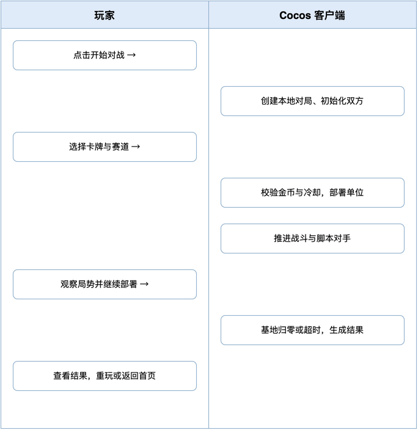
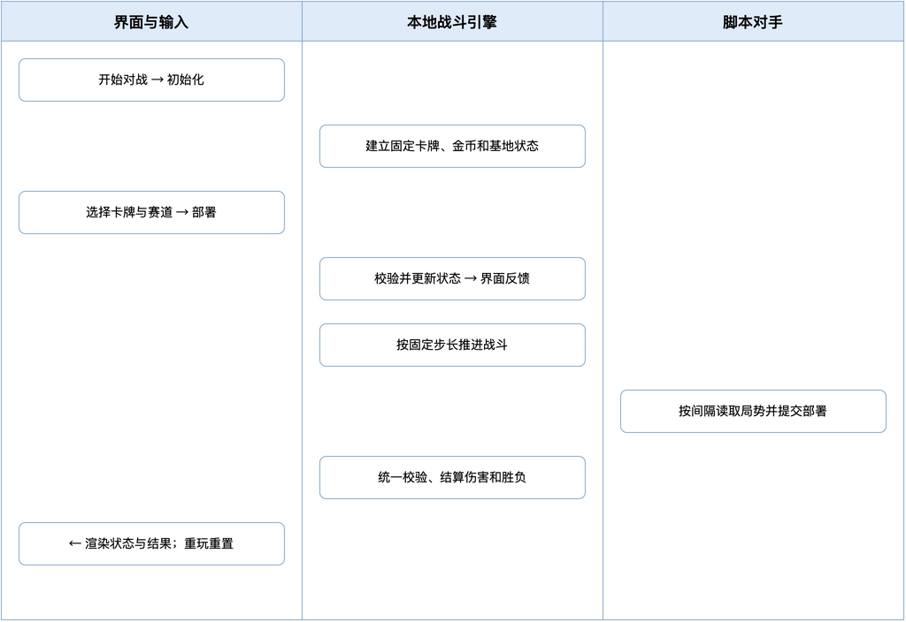

# 本地对战 MVP 方案

## 需求与范围

用户已确认：本地人机对战，MVP 使用固定卡牌，无需选卡；卡牌投放后各自冷却，金币定时恢复至上限，投放消耗金币。单位具有血量、攻击、防御、攻击范围等属性；单位进入敌方基地范围后基地自动攻击，存活单位靠近基地时持续攻击基地。基地血量归零结束对局。本方案以微信小游戏验证核心玩法，使用 Cocos Creator 3.8.8，固定策略对手在本地执行。

以下赛道、数值和规则细节是**首轮试玩建议**，可根据体验调整。割草、养成、合成、广告、好友和联网不属于本次试玩版本。

## 使用流程

玩家从首页开始，观察三条赛道，选择手牌再选赛道部署。双方单位自动前进与攻击；玩家按局势继续投放，基地血量归零或到时后展示结果，再开始新局或返回首页。

业务流程示意：[可编辑原稿](assets/mvp-business.drawio)（初稿，跨列交接以文字箭头表示）。

系统交互示意：[可编辑原稿](assets/mvp-sequence.drawio)（初稿，参与方以列表示）。

## 具体玩法

1. **初始化。** 三条独立赛道；双方各有 1000 点基地血量、5 金币和下表三张固定卡牌，开局全部冷却完成；双方使用相同规则，无需选择卡组。
2. **金币与冷却。** 金币上限 10，每 1 秒恢复 1 点，满额停止；花费后继续恢复，界面显示进度条。固定卡各自冷却，首轮建议冲锋鹅 3 秒、盾牌鹅 5 秒、投弹鹅 6 秒。只有金币足够且该卡冷却完成时才能部署；成功后扣金币并启动该卡冷却，卡牌始终保留在原卡槽，冷却结束可再次使用。
3. **单位属性。** 各单位在己方端点生成，沿赛道向敌方基地移动；速度按赛道长度百分比/秒计算，攻击范围按赛道长度百分比计算。攻击目标为同赛道最近敌方存活单位，范围内无单位且敌方基地在范围内时攻击基地。存在目标时停止移动；目标消失后继续移动。
4. **伤害与死亡。** 每次攻击伤害为 `max(1, 攻击 - 目标防御)`；血量不低于 0，归零即移除。首次进入攻击范围可立即攻击；切换目标保留攻击冷却，冷却结束才能再次攻击。攻击和伤害以固定步长 0.1 秒处理，同一步已发出的攻击同时结算。
5. **基地防御。** 基地防御 0、攻击 30、攻击间隔 1 秒、攻击范围为距己方端点 15% 的区域，优先攻击距基地最近的敌方单位；距离相同按生成顺序。单位攻击范围覆盖敌方基地时停下并持续攻击；基地和单位可同时造成伤害。
6. **胜负。** 任一基地血量归零立即结束；同一步双方均归零为平局。180 秒到时比较基地剩余血量，较高者获胜，相同则平局。结果展示双方血量及重玩/返回。
7. **脚本对手。** 默认简单难度，每 6 秒决策一次；普通、困难、地狱分别每 4、3、2 秒决策一次。首页和战斗左上角可切换难度，战斗中切换立即生效；使用同样的初始金币、恢复速度、卡牌属性及冷却规则。玩家单位进入靠近对方基地的后 30% 赛道，且该路没有对手单位时优先回防；否则依次轮换三条赛道出牌。从冷却完成且可支付的卡牌中选择费用最高者（并列选最左）；无可用卡时等待。

### 首轮卡牌配置

| 卡牌 | 费用 | 血量 | 攻击 | 防御 | 攻击范围 | 攻击间隔 | 移速 |
| --- | --- | --- | --- | --- | --- | --- | --- |
| 冲锋鹅 | 3 | 180 | 35 | 3 | 5% | 1 秒 | 8%/秒 |
| 盾牌鹅 | 4 | 360 | 20 | 10 | 5% | 1.2 秒 | 5%/秒 |
| 投弹鹅 | 5 | 130 | 50 | 0 | 25% | 1.5 秒 | 5%/秒 |

每局使用以上三张固定卡，无需选择或随机抽牌。每局开始重新初始化，不保存卡牌、金币或战绩。

## 界面与状态

- **首页**：标题和开始对战；点击后进入新局。
- **战斗**：敌我基地血条、三条赛道的单位和血量、金币恢复进度条、三个固定卡槽及各自冷却进度。敌我单位用颜色区分；单位交火与基地受击有可见反馈。
- **选牌状态**：选中卡牌高亮，赛道可点；再次点同一卡取消，点另一张切换；金币不足或冷却中的牌显示对应原因。点击有效赛道部署；无效操作不扣金币或触发冷却。
- **结算**：胜、负、平与双方剩余血量；重玩重置全部状态，返回首页结束本局。
- **前后台切换**：离开前台暂停战斗及所有计时，恢复后继续，不补算离线时间。
- **安全区域**：顶部预留微信胶囊空间，卡牌和按钮处于手机安全区。视觉参照本会话的四屏概念图，插图及数字为表现参考。

## 实施范围与顺序

1. **实现纯本地规则。** 新增 `assets/scripts/battle-engine.ts` 和 `battle-config.ts`：对局状态、固定步长、金币恢复、卡牌冷却、单位索敌、基地攻击、脚本对手、结果判定；规则与 Cocos 节点分离。
2. **实现画面和交互。** 新增 `assets/scripts/battle-demo.ts` 与 `assets/scenes/BattleDemo.scene`；参照现有 `LifeDemo.scene` 和 `life-demo.ts` 的 Canvas、节点与触控方式，使用原创占位图形呈现。战斗单位按引擎位置渲染。
3. **切换构建入口。** 将微信构建任务的入口配置为新场景，核对 Cocos 项目实际场景配置及 README 试玩说明。原人生模拟代码与存档处理尚需确认；在该问题得到决定前，不将其作为并行入口发布，也不删除数据。
4. **试玩调整。** 在微信开发者工具和微信真实设备验证一局，按反馈调整数值。编译与构建只证明构建状态，不代表真实体验通过。

对照依据：现有 `assets/scripts/life-demo.ts` 负责 Cocos 视图、输入和生命周期，`life-engine.ts` 负责独立规则；本次沿用职责划分，但新增对战状态和时间循环，不复用人生模拟规则。`config/wechatgame.demo.json` 为现有微信构建配置。具体场景列表及旧存档处置需在实现前核实。

## 接口、数据与埋点

本版无服务端接口、数据库、登录、持久化资产或迁移；游戏状态仅在当前进程内。无用户行为埋点：当前用人工试玩判断；HTTP + DB autotest 不适用。目标平台仅微信，抖音适配另行设计。

## 验收

| 场景 | 操作 | 预期 |
| --- | --- | --- |
| 冷却与金币 | 消耗金币、等待恢复、重复投放 | 金币满额停止恢复；投放后卡槽保留并独立冷却；金币不足或冷却中不能投放，冷却结束可再次使用 |
| 交战 | 放置近战、远程、盾牌单位并观察 | 进入范围攻击，按公式扣血；单位死亡后移除，剩余单位推进 |
| 基地 | 让单位进入基地范围 | 基地攻击最近敌人；存活单位接近并攻击基地 |
| 对手 | 等待并改变赛道压力 | 按难度对应的间隔决策，正常轮换赛道；缺少防守且玩家单位接近基地时回防；金币与冷却约束同玩家 |
| 结束与重玩 | 耗尽基地、到时及同时归零 | 按规则显示胜负/平局，重玩恢复初始状态 |
| 生命周期 | 切后台再恢复 | 战斗暂停，回来后继续，无时间跳跃 |
| 目标端 | 微信开发者工具和真机完成多局 | 触控、可读性、胶囊安全区和战斗流畅度可人工检查 |

## 风险与待决定

- 原人生模拟是否继续保留可玩入口、既有本地存档是否需要保留，直接影响场景切换与旧代码清理；必须由用户决定后才能确定替换和数据处理。
- 初始数值和 180 秒时限只是设计建议，未经试玩验证。
- 两张流程图是列式初稿，尚缺规范要求的实际跨列连线、时序请求响应线及失败分支，不能作为通过图示门禁的完成方案。

## 本轮画面与声音

基地血条与城堡上下分开，保留三条独立赛道；交战时低频播放短促碰撞音，基地受到伤害时播放独立音效，均限制播放频率。难度为本地临时选择，不保存到服务器；各档平衡仍需试玩。
